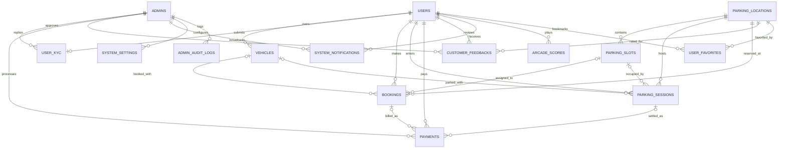

# 📊 DIAGRAM RELASI ANTAR TABEL (RAT) — SUPABASE DATABASE
## Proyek: Smart Parking (ParkSmart ID)
### Enterprise Relational Architecture & Visual Database Schema (Box-Drawing & ERD)

> 📌 **STATUS DOKUMEN: RELASI ANTAR TABEL (RAT) MURNI & TEROPTIMASI (15 TABEL)**  
> **Pendekatan Desain:** Struktur database esensial, tanpa tabel redundant.  
> **Konsolidasi Staf:** Super Admin, Operasional, Finansial, dan CS disatukan dalam satu entitas `admins`.  
> 🔒 **Keamanan AI:** Tabel `ai_agent_configs` telah dihapus sepenuhnya dari database. Kunci API Groq dikelola murni via `.env` (`GROQ_API_KEY`).

---

## 1. DAFTAR 15 TABEL UTAMA & NOTASI KARDINALITAS

### 📑 Ringkasan 15 Entitas Inti Sistem:
| No | Entitas (Tabel) | Klaster Bisnis | Peran & Deskripsi Fungsional |
|:---:|:---|:---|:---|
| 1 | `users` | Akun & Profil | Profil pengemudi, saldo dompet ParkSmart Pay, poin, tier & bookmark favorit |
| 2 | `vehicles` | Garasi Kendaraan | Garasi kendaraan pengguna, plat nomor (TNKB) & masa berlaku STNK (foto diolah in-memory, file tidak disimpan) |
| 3 | `admins` | Staf Terpadu | 1 Tabel konsolidasi staf (Super Admin, Operasional, Finansial, CS) via RBAC |
| 4 | `user_kyc` | Super Admin KYC | Verifikasi KTP 16 digit, biometrik selfie & tinjauan berkas identitas resmi |
| 5 | `parking_locations` | Operasional | Gedung/Mall mitra, koordinat GPS, radius geofence, fasilitas, daftar lantai (`floors`) & tarif dasar |
| 6 | `parking_slots` | Denah & IoT | Denah spot parkir per lantai fisik, zona (`zone`), kode slot & ID perangkat sensor IoT |
| 7 | `parking_sessions` | Sesi Lapangan | Kendaraan aktif masuk gerbang (tap-in s.d. tap-out), timer countdown, plat snapshot & overstay |
| 8 | `bookings` | Reservasi | Tiket digital pemesanan slot di muka (*advance*) / langsung (*walk-in*), plat snapshot & QR pass |
| 9 | `payments` | Billing & Audit | Buku besar arus kas (parkir, top-up, injeksi admin, refund) & hash SHA-256 on-chain |
| 10 | `customer_feedbacks` | CS & Review | Ulasan bintang (1-5), saran marka/kendala & respons resmi Customer Service |
| 11 | `system_notifications` | CS & Broadcast | Notifikasi broadcast promo, peringatan overstay & info keamanan sistem |
| 12 | `arcade_scores` | Gamifikasi | Rekor skor game balap & mesin capit serta perolehan SmartPoints pengemudi |
| 13 | `system_settings` | Super Admin | Konfigurasi global JSONB: saklar fitur (`feature_toggles`), saldo treasury (`company_treasury`), & parameter AI Jarvis (`ai_config`) |
| 14 | `admin_audit_logs` | Super Admin & Audit | Audit trail aktivitas login staf portal admin (IP publik, ISP, geolokasi, perangkat hardware, status) |
| 15 | `user_favorites` | Profil & Bookmark | Relasi bookmark lokasi parkir favorit per-user dengan proteksi Row Level Security (RLS) |

---

### 📐 Panduan Notasi Box-Drawing:
```text
┌────────────────────────────────────────────────────────┐
│                   NAMA_TABEL (Entitas)                 │  <-- Header Nama Tabel
├────────────────────────────────────────────────────────┤
│ [PK] id          : UUID (Primary Key Unik)             │  <-- [PK] Kunci Utama Unik
│ [FK] user_id     : UUID (Foreign Key ke Induk)         │  <-- [FK] Kunci Tamu/Asing
│      kolom_data  : TIPE_DATA (Keterangan)              │  <-- Kolom Atribut Data
└────────────────────────────────────────────────────────┘
```
* `(1:1)` : Hubungan Satu-ke-Satu (One-to-One).
* `(1:N)` : Hubungan Satu-ke-Banyak (One-to-Many).
* `(0..1:N)` : Hubungan Opsional Satu-ke-Banyak (Nullable FK).

---

## 2. KLASTER 1: IDENTITAS USER, KENDARAAN, ADMIN TERPADU & FAVORIT

```text
========================================================================================================================
                                     KLASTER 1: AKUN, KENDARAAN & TATA KELOLA STAF
========================================================================================================================

    ┌────────────────────────────────────────────────────────┐
    │                      AUTH.USERS                        │
    ├────────────────────────────────────────────────────────┤
    │ [PK] id                 : UUID                         │
    │      email              : VARCHAR                      │
    └───────────────────────────┬────────────────────────────┘
                                │
               ┌────────────────┴────────────────┐
               │ (1:1)                           │ (1:1)
               ▼                                 ▼
┌───────────────────────────────────┐    ┌───────────────────────────────────┐
│              USERS                │    │              ADMINS               │
├───────────────────────────────────┤    ├───────────────────────────────────┤
│ [PK] id               : UUID      │    │ [PK] id               : UUID      │
│ [FK] auth_user_id     : UUID      │    │ [FK] auth_user_id     : UUID      │
│      email            : VARCHAR   │    │      email            : VARCHAR   │
│      phone            : VARCHAR   │    │      full_name        : VARCHAR   │
│      full_name        : VARCHAR   │    │      phone            : VARCHAR   │
│      avatar_url       : TEXT      │    │      role             : ENUM      │
│      gender           : VARCHAR   │    │      division         : VARCHAR   │
│      birth_date       : DATE      │    │      avatar_url       : TEXT      │
│      address          : TEXT      │    │      status           : ENUM      │
│      wallet_balance   : NUMERIC   │    │      password         : TEXT      │
│      points           : INT       │    │      last_login_at    : TIMESTAMPTZ│
│      member_tier      : ENUM      │    │      created_at       : TIMESTAMPTZ│
│      tot_parking_cnt  : INT       │    │      updated_at       : TIMESTAMPTZ│
│      total_savings    : NUMERIC   │    └───────────────────────────────────┘
│      fav_location_ids : UUID[]    │
│      pin_hash         : VARCHAR   │
│      is_biometric_en  : BOOLEAN   │
│      status           : ENUM      │
│      ban_reason       : TEXT      │
│      password         : TEXT      │
│      saran_kuliah     : TEXT      │
│      pesan_kuliah     : TEXT      │
│      created_at       : TIMESTAMPTZ│
│      updated_at       : TIMESTAMPTZ│
└────────┬────────┬─────────────────┘
         │        │
   (1:N) │        │ (1:1)
         ▼        ▼
┌───────────────────────────────────┐    ┌───────────────────────────────────┐
│             VEHICLES              │    │             USER_KYC              │
├───────────────────────────────────┤    ├───────────────────────────────────┤
│ [PK] id               : UUID      │    │ [PK] id               : UUID      │
│ [FK] user_id          : UUID      │    │ [FK] user_id          : UUID      │
│      plate_number     : VARCHAR   │    │      nik              : VARCHAR(16│
│      vehicle_type     : ENUM      │    │      full_name        : VARCHAR   │
│      vehicle_category : VARCHAR   │    │      birth_place_city : VARCHAR   │
│      brand            : VARCHAR   │    │      birth_date       : DATE      │
│      model            : VARCHAR   │    │      address          : TEXT      │
│      color            : VARCHAR   │    │      gender           : VARCHAR   │
│      plate_expiry     : VARCHAR   │    │      religion         : VARCHAR   │
│      photo_url        : TEXT      │    │      occupation       : VARCHAR   │
│      is_default       : BOOLEAN   │    │      ktp_image_url    : TEXT      │
│      created_at       : TIMESTAMPTZ│    │      selfie_image_url : TEXT      │
│      updated_at       : TIMESTAMPTZ│    │      status           : ENUM      │
└───────────────────────────────────┘    │      reject_reason    : TEXT      │
                                         │ [FK] reviewed_by      : UUID (ADM)│
                                         │      submitted_at     : TIMESTAMPTZ│
                                         │      reviewed_at      : TIMESTAMPTZ│
                                         │      created_at       : TIMESTAMPTZ│
                                         │      updated_at       : TIMESTAMPTZ│
                                         └───────────────────────────────────┘
```

---

## 3. KLASTER 2: OPERASIONAL, FASILITAS & FAVORIT LOKASI

```text
========================================================================================================================
                                     KLASTER 2: OPERASIONAL, FASILITAS & FAVORIT
========================================================================================================================

    ┌───────────────────────────────────┐
    │         PARKING_LOCATIONS         │
    ├───────────────────────────────────┤
    │ [PK] id               : UUID      │
    │      code             : VARCHAR   │
    │      name             : VARCHAR   │
    │      type             : VARCHAR   │
    │      city             : VARCHAR   │
    │      province         : VARCHAR   │
    │      address          : TEXT      │
    │      latitude         : FLOAT     │
    │      longitude        : FLOAT     │
    │      checkin_radius_m : INT       │
    │      total_capacity   : INT       │
    │      car_slots_cap    : INT       │
    │      motor_slots_cap  : INT       │
    │      ev_slots_cap     : INT       │
    │      hourly_rate_mob  : NUMERIC   │
    │      hourly_rate_mot  : NUMERIC   │
    │      hourly_rate_ev   : NUMERIC   │
    │      operating_hours  : VARCHAR   │
    │      facilities       : TEXT[]    │
    │      rating           : NUMERIC   │
    │      review_count     : INT       │
    │      status           : ENUM      │
    │      image_url        : TEXT      │
    │      images           : TEXT[]    │
    │      floors           : TEXT[]    │
    │      created_at       : TIMESTAMPTZ│
    │      updated_at       : TIMESTAMPTZ│
    └─────────┬───────────┬─────────┬───┘
              │           │         │
        (1:N) │     (1:N) │   (1:N) │
              ▼           │         ▼
┌───────────────────────┐ │   ┌───────────────────────────┐
│     PARKING_SLOTS     │ │   │      USER_FAVORITES       │
├───────────────────────┤ │   ├───────────────────────────┤
│ [PK] id         : UUID│ │   │ [PK] id          : UUID   │
│ [FK] location_id: UUID│ │   │ [FK] user_id     : UUID   │
│      floor_name : VAR │ │   │ [FK] location_id : UUID   │
│      slot_code  : VAR │ │   │      created_at  : TSTZ   │
│      slot_type  : ENUM│ │   └───────────────────────────┘
│      status     : ENUM│ │
│      sensor_dev : VAR │ │
│      cur_plate  : VAR │ │
│      occupied_at: TSTZ│ │
│      zone       : TEXT│ │
│      created_at : TSTZ│ │
│      updated_at : TSTZ│ │
└───────────────────────┘ │
                          ▼
              ┌───────────────────────────┐
              │     PARKING_SESSIONS      │
              ├───────────────────────────┤
              │ [PK] id           : UUID  │
              │      session_code : VARCHAR│
              │ [FK] location_id  : UUID  │
              │ [FK] slot_id      : UUID  │◄──────┐ (0..1:N)
              │ [FK] user_id      : UUID  │       │
              │ [FK] vehicle_id   : UUID  │       │
              │ [FK] booking_id   : UUID  │       │
              │      plate_number : VARCHAR│       │
              │      vehicle_type : ENUM  │       │
              │      vehicle_desc : VARCHAR│       │
              │      check_in_time: TSTZ  │       │
              │      exp_out_time : TSTZ  │       │
              │      check_out_tim: TSTZ  │       │
              │      parking_fee  : NUMERIC│      │
              │      is_overstay  : BOOL  │       │
              │      overstay_min : INT   │       │
              │      penalty_fee  : NUMERIC│      │
              │      total_fee    : NUMERIC│      │
              │      status       : ENUM  │       │
              │      gate_in_id   : VARCHAR│      │
              │      gate_out_id  : VARCHAR│      │
              │      created_at   : TSTZ  │       │
              │      updated_at   : TSTZ  │       │
              └───────────────────────────┘
```

---

## 4. KLASTER 3 & 4: BOOKING RESERVASI & TRANSAKSI KEUANGAN

```text
========================================================================================================================
                                KLASTER 3 & 4: PEMESANAN PARKIR & TRANSAKSI DIGITAL
========================================================================================================================

    ┌───────────────────────────┐         ┌───────────────────────────┐
    │           USERS           │         │     PARKING_LOCATIONS     │
    └─────────────┬─────────────┘         └─────────────┬─────────────┘
                  │                                     │
                  │ (1:N)                               │ (1:N)
                  ▼                                     ▼
    ┌────────────────────────────────────────────────────────┐
    │                        BOOKINGS                        │
    ├────────────────────────────────────────────────────────┤
    │ [PK] id                 : UUID                         │
    │      booking_code       : VARCHAR                      │
    │ [FK] user_id            : UUID                         │
    │ [FK] location_id        : UUID                         │
    │ [FK] slot_id            : UUID (PARKING_SLOTS)         │
    │ [FK] vehicle_id         : UUID (VEHICLES)              │
    │      booking_type       : ENUM ('reservation','walk_in'│
    │      start_time         : TIMESTAMPTZ                  │
    │      end_time           : TIMESTAMPTZ                  │
    │      duration_hours     : INT                          │
    │      total_price        : NUMERIC                      │
    │      payment_status     : ENUM                         │
    │      booking_status     : ENUM                         │
    │      qr_code_hash       : TEXT                         │
    │      cancel_reason      : TEXT                         │
    │      plate_number       : VARCHAR(20)                  │
    │      vehicle_desc       : VARCHAR(100)                 │
    │      created_at         : TIMESTAMPTZ                  │
    │      updated_at         : TIMESTAMPTZ                  │
    └───────────────────────────┬────────────────────────────┘
                                │
                                │ (0..1:N)
                                ▼
    ┌────────────────────────────────────────────────────────┐
    │                        PAYMENTS                        │
    ├────────────────────────────────────────────────────────┤
    │ [PK] id                 : UUID                         │
    │      transaction_code   : VARCHAR                      │
    │ [FK] user_id            : UUID (USERS)                 │
    │ [FK] booking_id         : UUID (BOOKINGS, Nullable)    │
    │ [FK] session_id         : UUID (SESSIONS, Nullable)    │
    │      transaction_type   : ENUM (parkir, topup, injeksi)│
    │      payment_method     : ENUM (wallet, qris, va, etc) │
    │      amount             : NUMERIC                      │
    │      description        : TEXT                         │
    │      blockchain_hash    : VARCHAR(66)                  │
    │      status             : ENUM (pending, success, etc) │
    │      completed_at       : TIMESTAMPTZ                  │
    │      created_at         : TIMESTAMPTZ                  │
    └────────────────────────────────────────────────────────┘
```

---

## 5. KLASTER 5 & 6: CS, NOTIFIKASI, GAMIFIKASI & GLOBAL SETTINGS

```text
========================================================================================================================
                          KLASTER 5 & 6: LAYANAN CS, NOTIFIKASI, GAMIFIKASI & PENGATURAN
========================================================================================================================

    ┌───────────────────────────┐         ┌───────────────────────────┐
    │           USERS           │         │          ADMINS           │
    └───────┬───────────┬───────┘         └───────┬───────────┬───────┘
            │           │                         │           │
      (1:N) │     (1:N) │                   (0..1:N)│       (0..1:N)
            ▼           ▼                         ▼           ▼
┌───────────────────────────┐   ┌───────────────────────────┐
│    CUSTOMER_FEEDBACKS     │   │   SYSTEM_NOTIFICATIONS    │
├───────────────────────────┤   ├───────────────────────────┤
│ [PK] id           : UUID  │   │ [PK] id           : UUID  │
│ [FK] user_id      : UUID  │   │ [FK] sender_admin : UUID  │
│ [FK] location_id  : UUID  │   │ [FK] recipient_usr: UUID  │
│      rating (1-5) : INT   │   │      target_role  : VARCHAR│
│      comment      : TEXT  │   │      title        : VARCHAR│
│      admin_reply  : TEXT  │   │      message      : TEXT  │
│ [FK] replied_by   : UUID  │   │      notif_type   : VARCHAR│
│      is_resolved  : BOOL  │   │      action_type  : VARCHAR│
│      created_at   : TSTZ  │   │      is_read      : BOOL  │
│      replied_at   : TSTZ  │   │      created_at   : TSTZ  │
└───────────────────────────┘   └───────────────────────────┘

            │ (1:2 Max Overwritten)                │ (0..1:N)                    │ (0..1:N)
            ▼                                     ▼                             ▼
┌───────────────────────────┐   ┌───────────────────────────┐   ┌───────────────────────────┐
│       ARCADE_SCORES       │   │      SYSTEM_SETTINGS      │   │     ADMIN_AUDIT_LOGS      │
├───────────────────────────┤   ├───────────────────────────┤   ├───────────────────────────┤
│ [PK] id           : UUID  │   │ [PK] key          : VARCHAR│   │ [PK] id           : UUID  │
│ [FK] user_id      : UUID  │   │      value        : JSONB  │   │ [FK] admin_id     : UUID  │
│ [UQ] game_name    : VARCHAR   │      description  : TEXT  │   │      admin_name   : VARCHAR│
│ [UQ] score_type   : VARCHAR   │ [FK] updated_by   : UUID  │   │      admin_email  : VARCHAR│
│      score        : INT   │   │      updated_at   : TSTZ  │   │      role         : VARCHAR│
│      points_earned: INT   │   └───────────────────────────┘   │      action       : VARCHAR│
│      played_at    : TSTZ  │                                   │      device_model : VARCHAR│
│      score_type   : VARCHAR                                   │      ip_address   : VARCHAR│
└───────────────────────────┘                                   │      location     : VARCHAR│
                                                                │      isp          : VARCHAR│
                                                                │      status       : VARCHAR│
                                                                │      is_current   : BOOL   │
                                                                │      created_at   : TSTZ   │
                                                                └───────────────────────────┘
```

---

## 6. MASTER ERD MERMAID (15 TABEL UTAMA)



---

## 7. MATRIKS LENGKAP RELASI KUNCI (PK & FK)

| Tabel Induk (Parent) | Tabel Anak (Child) | Foreign Key (FK) | Kardinalitas | Aturan On Delete | Keterangan Relasi Bisnis |
|:---|:---|:---|:---:|:---|:---|
| `auth.users` | `users` | `users.auth_user_id` | `1 : 1` | `CASCADE` | Akun autentikasi Supabase ke profil pengguna |
| `auth.users` | `admins` | `admins.auth_user_id` | `1 : 1` | `CASCADE` | Akun autentikasi Supabase ke staf portal admin |
| `users` | `vehicles` | `vehicles.user_id` | `1 : N` | `CASCADE` | 1 Pengguna memiliki banyak kendaraan di garasi |
| `users` | `user_kyc` | `user_kyc.user_id` | `1 : 1` | `CASCADE` | 1 Pengguna hanya mengajukan 1 berkas verifikasi e-KTP |
| `users` | `user_favorites` | `user_favorites.user_id` | `1 : N` | `CASCADE` | Bookmark gedung parkir favorit pengguna |
| `users` | `bookings` | `bookings.user_id` | `1 : N` | `RESTRICT` | Pengguna memesan slot reservasi parkir |
| `users` | `parking_sessions` | `parking_sessions.user_id` | `1 : N` | `SET NULL` | Sesi aktif gerbang masuk saat pengguna check-in |
| `users` | `payments` | `payments.user_id` | `1 : N` | `RESTRICT` | Buku besar transaksi keuangan digital pengguna |
| `users` | `customer_feedbacks` | `customer_feedbacks.user_id` | `1 : N` | `CASCADE` | Ulasan rating dan komplain fasilitas dari pengguna |
| `users` | `system_notifications`| `system_notifications.recipient_user_id` | `1 : N` | `CASCADE` | Pesan notifikasi personal (NULL = broadcast publik) |
| `users` | `arcade_scores` | `arcade_scores.user_id` | `1 : N` | `CASCADE` | Catatan skor mini-game & poin loyalitas SmartPoints |
| `admins` | `user_kyc` | `user_kyc.reviewed_by` | `0..1 : N` | `SET NULL` | Super Admin memvalidasi atau menolak berkas KYC |
| `admins` | `customer_feedbacks`| `customer_feedbacks.replied_by_admin_id` | `0..1 : N` | `SET NULL` | Admin CS membalas ulasan keluhan pengguna |
| `admins` | `system_notifications`| `system_notifications.sender_admin_id` | `0..1 : N` | `SET NULL` | Admin CS / Super Admin menerbitkan pesan broadcast |
| `admins` | `system_settings` | `system_settings.updated_by` | `0..1 : N` | `SET NULL` | Super Admin memperbarui konfigurasi AI Jarvis & feature toggles |
| `admins` | `admin_audit_logs` | `admin_audit_logs.admin_id` | `0..1 : N` | `SET NULL` | Jejak audit digital aktivitas login seluruh tingkatan administrator |
| `parking_locations` | `parking_slots` | `parking_slots.location_id` | `1 : N` | `CASCADE` | Gedung parkir memiliki banyak slot fisik per lantai |
| `parking_locations` | `parking_sessions` | `parking_sessions.location_id` | `1 : N` | `RESTRICT` | Gedung parkir menaungi sesi kendaraan masuk gerbang |
| `parking_locations` | `bookings` | `bookings.location_id` | `1 : N` | `RESTRICT` | Lokasi gedung tempat slot parkir dipesan di muka |
| `parking_locations` | `customer_feedbacks`| `customer_feedbacks.location_id` | `0..1 : N` | `SET NULL` | Ulasan feedback pengguna ditujukan untuk lokasi spesifik |
| `parking_locations` | `user_favorites` | `user_favorites.location_id` | `1 : N` | `CASCADE` | Lokasi parkir yang difavoritkan oleh user |
| `parking_slots` | `parking_sessions` | `parking_sessions.slot_id` | `0..1 : N` | `SET NULL` | Slot fisik yang sedang ditempati oleh kendaraan |
| `parking_slots` | `bookings` | `bookings.slot_id` | `0..1 : N` | `SET NULL` | Slot fisik yang telah dibooking oleh pengemudi |
| `vehicles` | `bookings` | `bookings.vehicle_id` | `0..1 : N` | `SET NULL` | Kendaraan yang didaftarkan pada tiket pemesanan (terlindungi trigger snapshot) |
| `vehicles` | `parking_sessions` | `parking_sessions.vehicle_id` | `0..1 : N` | `SET NULL` | Kendaraan pengguna pada sesi aktif (terlindungi trigger snapshot) |
| `bookings` | `parking_sessions` | `parking_sessions.booking_id` | `0..1 : N` | `SET NULL` | Sesi gerbang yang berakar dari reservasi tiket di muka |
| `bookings` | `payments` | `payments.booking_id` | `0..1 : N` | `SET NULL` | Transaksi pembayaran untuk pesanan reservasi |
| `parking_sessions` | `payments` | `payments.session_id` | `0..1 : N` | `SET NULL` | Transaksi pelunasan parkir saat kendaraan keluar gerbang |

---

## 8. INTEGRITAS DATA & TRIGGER `snapshot_vehicle_before_delete`

Untuk menjamin riwayat audit pemesanan (`bookings`) dan sesi parkir (`parking_sessions`) tidak rusak saat pengguna menghapus kendaraannya dari garasi:
- Tabel `vehicles` dilengkapi dengan trigger database `trg_snapshot_vehicle_before_delete`.
- Trigger ini mengeksekusi fungsi `public.snapshot_vehicle_before_delete()`.
- Fungsi secara otomatis menyalin nilai `plate_number` dan gabungan `brand` + `model` ke dalam kolom `bookings.plate_number`, `bookings.vehicle_desc`, `parking_sessions.plate_number`, dan `parking_sessions.vehicle_desc` sebelum entri kendaraan dihapus.

---

## 9. RINGKASAN SEED DATA REAL & KONDISI DATABASE AKTIF

1. **Akun Staf Admin (4 Baris Lengkap):**
   - **Super Admin:** Gibran Widodo (`superadmin@parksmart.id` / `superadmin123`)
   - **Admin Operasional:** Erick Thohir (`ops@parksmart.id` / `ops123`)
   - **Admin Finansial:** Sri Mulyani (`finance@parksmart.id` / `finance123`)
   - **Admin CS & KYC:** Prabowo Subianto (`cs@parksmart.id` / `cs123`)
2. **Akun Pengguna (Hanya 1 Baris Resmi):**
   - **User Aktif:** `user@gmail.com` (Nama: `user 1`, Saldo: Rp 48.000, PIN: `4040`, Pass: `123456`, ID: `5d7d4224-c3f8-4add-a94f-7d87a62d9356`). Seluruh akun pengguna percobaan lainnya dikecualikan dari seeding.
3. **Kendaraan (`vehicles`):**
   - Dikosongkan (0 baris) agar pengguna dapat mendaftarkan kendaraan baru secara mandiri.
4. **Pengaturan Global (`system_settings` - 3 Baris):**
   - `feature_toggles`: Fitur arcade, booking EV, audit blockchain aktif.
   - `company_treasury`: Saldo cadangan kas utama operasional ParkSmart ID.
   - `ai_config`: Model Qwen, max tokens 1024, temperature 0.7, autonomous dynamic pricing aktif.
