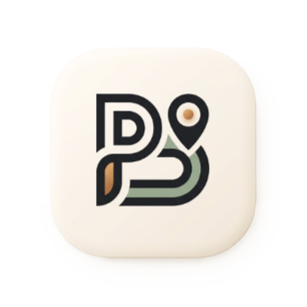

# 🚗 ParkSmart ID — Smart Parking & Web3 Blockchain Ecosystem

<p align="center">
  
</p>

<p align="center">
  <b>Solusi Ekosistem Parkir Cerdas Terintegrasi Kecerdasan Buatan (AI), IoT Real-time, dan Web3 Smart Contract Blockchain Sepolia.</b>
</p>

<p align="center">
  
  
  
  
  
  
</p>

---

## 📌 1. Deskripsi Eksekutif Proyek

**ParkSmart ID** adalah aplikasi mobile pintar generasi baru yang mentransformasi tata kelola parkir perkotaan dari sistem manual konvensional menjadi ekosistem digital yang transparan, otomatis, dan terdesentralisasi. 

Aplikasi ini menggabungkan:
1. **Navigasi & Pemesanan Slot Presisi**: Memberikan kepastian ketersediaan ruang parkir bagi pengemudi sebelum tiba di lokasi.
2. **Manajemen Multi-Role Admin (RBAC)**: Memisahkan operasional teknis lapangan, audit akuntansi finansial, pelayanan pelanggan (CS), dan kebijakan master platform ke dalam 4 hak akses independen.
3. **Web3 Blockchain Membership**: Menggunakan Smart Contract Ethereum (Sepolia Testnet) untuk pencatatan kartu keanggotaan digital terdesentralisasi yang tidak dapat dipalsukan (*tamper-proof*).
4. **Sistem Pemeliharaan Sistem Dinamis**: Menghadirkan fitur *Global Lockdown*, *Mode Peringatan*, dan *Modular Maintenance* tanpa menghentikan komputasi backend yang sedang berjalan.

---

## 🛠️ 2. Teknologi & Framework

| Komponen | Teknologi | Deskripsi |
| :--- | :--- | :--- |
| **Mobile Frontend** | Flutter & Dart | Antarmuka responsif performa tinggi untuk Android & iOS dengan Material Design 3. |
| **Database Relasional** | PostgreSQL via Supabase | Penyimpanan relasional ACID-compliant dengan Row Level Security (RLS) dan Realtime Socket. |
| **Penyimpanan Media** | Supabase Cloud Storage | Cloud Object Storage untuk foto lokasi parkir, foto kendaraan, avatar, dan dokumen KYC. |
| **Blockchain Smart Contract** | Ethereum Sepolia (Solidity) | Kontrak pintar terverifikasi untuk kartu keanggotaan on-chain dan pembuktian status membership. |
| **Web3 Client** | `web3dart` & Infura RPC | Penghubung RPC antara aplikasi mobile Flutter dengan jaringan blockchain Sepolia. |
| **Kecerdasan Buatan (AI)** | Groq Cloud API | Inference berkecepatan tinggi Llama 3 untuk asisten pencarian kontekstual lokasi dan tarif. |
| **Visi Komputer & OCR** | Google ML Kit | Pemindaian barcode/QR tiket serta pembacaan karakter teks e-KTP secara otomatis. |
| **Peta & Geospasial** | `flutter_map` & OpenStreetMap | Visualisasi peta interaktif dengan perhitungan jarak Haversine dan penentuan rute. |

---

## 🌐 3. Integrasi API Eksternal

1. **Supabase REST & Realtime API**: Sinkronisasi data slot, pesanan, notifikasi, dan sesi parkir secara instan.
2. **Groq LLM API (`llama3-70b-8192` / `llama3-8b-8192`)**: Asisten AI kontekstual yang membaca data ketersediaan slot aktual secara real-time.
3. **Ethereum Sepolia JSON-RPC Endpoint (Infura)**: Eksekusi transaksi *minting* kartu anggota, pengecekan saldo relayer, dan validasi hash transaksi on-chain.
4. **OpenStreetMap / OSRM Routing Engine**: Penentuan rute perjalanan dari posisi GPS pengguna menuju lokasi parkir tujuan.
5. **Biometric Security API (`local_auth`)**: Autentikasi biometrik lokal (Fingerprint & Face Recognition) untuk otorisasi dompet parkir.

---

## 💾 4. Arsitektur Penyimpanan Data (Online vs Offline)

### A. Penyimpanan Online (Cloud & On-chain)
- **Supabase PostgreSQL**:
  * 16 Tabel Relasional (`users`, `admins`, `parking_locations`, `parking_slots`, `bookings`, `parking_sessions`, `payments`, `vehicles`, `user_kyc`, `arcade_scores`, `user_member_cards`, `system_settings`, dll).
- **Supabase Cloud Object Storage**:
  * Bucket `parking-locations`: Foto tempat parkir, foto gerbang, denah lantai.
  * Bucket `vehicles`: Foto fisik kendaraan pengguna untuk validasi pos parkir.
  * Bucket `avatars`: Foto profil pengguna.
  * Bucket `kyc-documents`: Foto fisik e-KTP dan selfie verifikasi identitas (dilindungi RLS).
- **Ethereum Sepolia Blockchain**:
  * Catatan kepemilikan kartu member on-chain, status keanggotaan permanen, serta hash token digital.

### B. Penyimpanan Offline & Lokal (Client-Side)
- **`SharedPreferences`**:
  * Cache token sesi login, konfigurasi bahasa aktif (Indonesia/English), tema aplikasi (Dark/Light Mode), riwayat pencarian peta, dan salinan lokal status pemeliharaan sistem.
- **Secure Biometric Keystore**:
  * Pengamanan PIN 4-digit dompet parkir dengan enkripsi hardware untuk verifikasi transaksi cepat.

---

## 📱 5. Rincian Fitur Aplikasi Pengguna (User)

1. **Peta Interaktif & Pencarian Lokasi**:
   - Menampilkan lokasi parkir terdekat secara live berdasarkan koordinat GPS pengguna.
   - Informasi detail kapasitas slot mobil, motor, dan slot khusus kendaraan listrik (EV Charging Station).
2. **Reservasi & Pemilihan Slot Terjadwal**:
   - Memilih lantai dan nomor slot parkir secara visual.
   - Perhitungan estimasi biaya otomatis berdasarkan durasi parkir yang direncanakan.
3. **Smart Scanner Tiket (Check-In & Check-Out)**:
   - Pemindaian kamera QR Code di pos gerbang masuk dan pos gerbang keluar.
   - Pintu gerbang terbuka secara otomatis saat kode terverifikasi.
4. **Dompet Digital ParkSmart & Multi-Payment**:
   - Saldo dompet internal, QRIS dinamis, Virtual Account Bank, dan transfer instan.
   - Otorisasi pembayaran menggunakan PIN 4-digit atau biometrik sidik jari.
5. **Timer Sesi Parkir Real-time**:
   - Penghitung durasi parkir aktif yang berjalan otomatis saat check-in.
   - Penghitungan tarif dinamis berjalan secara transparan dan akurat.
6. **Asisten AI Chatbot Kontekstual**:
   - Konsultasi rekomendasi parkir terdekat, informasi tarif termurah, fasilitas khusus, dan jam operasional.
7. **Mini Arcade Game (Parking Challenge & Claws Car)**:
   - Game simulasi parkir mobil untuk mengisi waktu luang.
   - Pencatatan skor tertinggi sepanjang sejarah (*highest score*) dan akumulasi poin permainan.
   - Penukaran poin game menjadi **Claw Coins** untuk keuntungan ekstra.
8. **Kartu Anggota Digital On-Chain Blockchain**:
   - Penerbitan kartu digital dengan verifikasi transaksi Ethereum Sepolia.
   - Tingkatan keanggotaan (*Tier*): Bronze, Silver, Gold, dan Platinum.
   - Kode hash identitas unik yang dapat diverifikasi di explorer blockchain.
9. **Verifikasi Identitas KYC e-KTP**:
   - Pengambilan foto e-KTP dan foto selfie wajah langsung melalui kamera aplikasi.
   - Pembacaan data NIK dan identitas otomatis melalui OCR deteksi dokumen.

---

## 🛡️ 6. Rincian Fitur ke-4 Role Admin (RBAC)

ParkSmart membagi pengelolaan sistem ke dalam **4 portal admin khusus**:

```
                              ┌─────────────────────────────┐
                              │     SUPER ADMIN PORTAL      │
                              │ (Master Control & Lockdown) │
                              └──────────────┬──────────────┘
                                             │
             ┌───────────────────────────────┼───────────────────────────────┐
             │                               │                               │
┌────────────┴─────────────┐   ┌─────────────┴────────────┐   ┌──────────────┴────────────┐
│   ADMIN OPERASIONAL      │   │     ADMIN FINANSIAL      │   │   ADMIN CUSTOMER SERVICE  │
│ (Slot, Gerbang, Kendaraan)│   │ (Rekonsiliasi, Pendapatan)│   │ (KYC Verifikasi, Feedback) │
└──────────────────────────┘   └──────────────────────────┘   └───────────────────────────┘
```

### 1. 👑 Super Admin (`super_admin`)
* **Master Dashboard**: Memantau statistik global seluruh pengguna, pendapatan kotor, total okupansi parkir se-kota, dan ringkasan audit log.
* **Pengaturan Global Platform**:
  - *Global Maintenance Lockdown*: Mengunci seluruh akses antarmuka pengguna saat pemeliharaan besar, dengan pesan dinamis dan estimasi downtime.
  - *Mode Peringatan Saja (Warning Only Mode)*: Menampilkan pop-up pengumuman informasi tanpa memblokir navigasi dan pesanan tiket pengguna.
  - *Maintenance Per Modul Sistem*: Menonaktifkan sementara modul tertentu (Gateway Booking, Engine AI Assistant, Modul KYC KTP, atau Gateway Push Notifikasi) secara terpisah.
* **Verifikasi KYC**: Meninjau foto KTP dan foto selfie pengguna, menyetujui (*Approve*) atau menolak (*Reject*) dengan alasan penolakan.
* **Manajemen Data**: Kontrol penuh data pengguna, admin operasional, lokasi parkir, dan audit log keamanan.

### 2. 🚦 Admin Operasional Lapangan (`operational`)
* **Monitoring Okupansi Lapangan**: Melihat denah slot mobil, motor, dan EV di lokasi secara real-time.
* **Kontrol Ketersediaan Manual**: Mengubah status slot menjadi *Available*, *Booked*, atau *Maintenance*.
* **Pemeriksaan Pos Masuk/Keluar**: Validasi fisik kendaraan pengguna dan pencocokan plat nomor di gerbang parkir.
* **Force Check-out Darurat**: Menyelesaikan sesi parkir secara manual apabila pengguna mengalami kendala teknis atau tiket hilang.

### 3. 💳 Admin Finansial & Akuntansi (`finance`)
* **Rekonsiliasi Pembayaran**: Memverifikasi seluruh aliran dana masuk dari QRIS, Virtual Account, dan saldo dompet.
* **Audit Transaksi Harian & Bulanan**: Memeriksa detail transaksi pembayaran tiket, perpanjangan durasi, dan penalti keterlambatan.
* **Analisis Pendapatan per Lokasi**: Melihat laporan pendapatan tertinggi dan tingkat utilitas komersial setiap lokasi parkir.
* **Ekspor Laporan Keuangan**: Menghasilkan rekapan neraca pendapatan untuk keperluan pembukuan resmi.

### 4. 🎧 Admin Customer Service & Keluhan (`cs`)
* **Pusat Pengaduan & Feedback**: Menerima laporan kendala slot, keluhan sistem gerbang, dan ulasan bintang pengguna.
* **Penanganan Bantuan Langsung**: Merespons tiket bantuan pengguna dan memperbarui status penanganan masalah (*In Progress* / *Resolved*).
* **Pemeriksaan Berkas KYC Awal**: Meneliti kelengkapan dokumen identitas pengguna sebelum disahkan.

---

## 🔑 7. Data Kredensial Login Pengujian

Gunakan akun resmi berikut untuk menguji seluruh hak akses sistem:

### A. Tabel Kredensial Akun Admin (4 Role)

| Role Admin | Nama Petugas | Email Login | Password | Hak Akses Utama |
| :--- | :--- | :--- | :--- | :--- |
| **Super Admin** | Gibran Widodo | `superadmin@parksmart.id` | `superadmin123` | Master Dashboard, Maintenance Lockdown, Verifikasi KYC, Audit Log |
| **Admin Operasional** | Erick Thohir | `ops@parksmart.id` | `ops123` | Monitoring Slot Lapangan, Force Check-out, Validasi Gerbang |
| **Admin Finansial** | Sri Mulyani | `finance@parksmart.id` | `finance123` | Rekonsiliasi Pembayaran, Audit Transaksi, Laporan Revenue |
| **Admin Customer Service** | Prabowo Subianto | `cs@parksmart.id` | `cs123` | Penanganan Pengaduan Pengguna, Review Identitas KYC |

### B. Tabel Kredensial Akun Pengguna (User)

| Pengguna | Email Login | Password | PIN Dompet | Saldo Dompet | Member Tier | Status KYC |
| :--- | :--- | :--- | :--- | :--- | :--- | :--- |
| **User Utama** | `user@gmail.com` | `123456` | `4040` | Rp 1.044.500,- | **GOLD** | Sedang Diajukan (*Pending*) |
| **User Sekunder** | `aji@gmail.com` | `aji123` | `1111` | Rp 182.000,- | **BRONZE** | Terverifikasi (*Approved*) |

---

## 🚀 8. Panduan Instalasi & Migrasi Database 1-Langkah

Ikuti tahapan di bawah ini untuk mengklon, mengonfigurasi, dan menyinkronkan database & storage secara otomatis:

### Langkah 1: Klon Repositori
Jalankan perintah berikut pada terminal Anda:

```bash
git clone https://github.com/nanditosetyawan/ParkSmart.git
cd ParkSmart
```

### Langkah 2: Konfigurasi File Environment (`.env`)
Salin file template `.env.example` menjadi `.env`:

```bash
cp .env.example .env
```

Buka file `.env` dan sesuaikan dengan kredensial proyek Supabase Anda:

```env
# Supabase API Configuration
SUPABASE_URL=https://<your-project-id>.supabase.co
SUPABASE_ANON_KEY=eyJhbGciOiJIUzI1NiIsInR5cCI6IkpXVCJ9...
SUPABASE_PROJECT_ID=<your-project-id>

# AI Engine API
GROQ_API_KEY=gsk_...

# Web3 Blockchain Sepolia Testnet
SEPOLIA_RPC_URL=https://sepolia.infura.io/v3/<your-infura-key>
SEPOLIA_CONTRACT_ADDRESS=0x032220cE1517622D0622a72A76EbF76d55c16179
ENABLE_ONCHAIN_BROADCAST=true
```

### Langkah 3: Eksekusi Migrasi Database & Cloud Storage Otomatis
Jalankan satu perintah ini untuk membuat seluruh bucket storage, mengunggah 34+ gambar fisik, dan mengisi 16 tabel database:

```bash
dart run tools/seed_storage.dart
```

*(Atau jika menggunakan lingkungan Node.js)*:
```bash
node tools/seed_all.mjs
```

### Langkah 4: Jalankan Aplikasi Flutter
Unduh dependensi dan jalankan aplikasi pada emulator atau perangkat fisik Android/iOS:

```bash
flutter pub get
flutter run
```

---

<p align="center">
  Dibuat dengan dedikasi untuk penyelesaian <b>Project Akhir Teori Mobile (Semester 5)</b>.<br/>
  © 2026 <b>ParkSmart ID Team</b>. Hak Cipta Dilindungi Undang-Undang.
</p>
