# 📐 SUPABASE DATABASE ARCHITECTURE & RELATIONAL PLAN (RAT)
## Proyek: Smart Parking (ParkSmart ID) - Edisi Revisi & Penyesuaian Keputusan Desain

> 📌 **STATUS DOKUMEN: RENCANA ARSITEKTUR FINAL (TERVERIFIKASI & DIADAPTASI SESUAI KEPUTUSAN PENGEMBANG)**  
> Tanggal Pembaruan: 14 Oktober 2026  
> Basis Kode: 55 File Dart pada Proyek `smart_parking`

---

> [!WARNING]
> ### 🚨 CATATAN PENTING PENGEMBANGAN UI (ACTION ITEM): BELUM ADA SCREEN DOMPET & MUTASI!
> **Hasil audit kode:** Saat ini aplikasi baru menampilkan teks statis saldo (`Rp 145.000`) dan poin (`1.450 Poin`) di halaman Profile, serta pilihan metode pembayaran `"ParkSmart Wallet"` di halaman Checkout dan Extend Session. **Aplikasi saat ini BELUM memiliki Layar Detail Dompet (*Wallet Screen*), Riwayat Mutasi (*Ledger Transactions*), maupun Layar Isi Saldo (*Top-Up*)!**
> 
> ✅ **Langkah Solutif di Supabase:** Kami telah merancang tabel `user_wallets` dan tabel mutasi lengkap **`wallet_transactions`** di database Supabase. Dengan begitu, ketika Anda membuat antarmuka UI Dompet & Top-Up nanti, struktur backend database sudah **100% siap pakai tanpa perlu refactoring ulang!**

---

## 📑 DAFTAR ISI
1. [Rekapitulasi Keputusan Desain Pengembang (4 Pertanyaan Terjawab)](#1-rekapitulasi-keputusan-desain-pengembang)
2. [Bedah Lengkap Sisi Halaman Pengguna (Non-Admin)](#2-bedah-lengkap-sisi-halaman-pengguna-non-admin)
3. [Inventarisasi Konten Hardcode vs Target Penyimpanan](#3-inventarisasi-konten-hardcode-vs-target-penyimpanan)
4. [Prinsip & Verifikasi Normalisasi (1NF, 2NF, 3NF/BCNF)](#4-prinsip--verifikasi-normalisasi-1nf-2nf-3nf)
5. [Relasi Antar Tabel (RAT) & Diagram ERD Nyata](#5-relasi-antar-tabel-rat--diagram-erd-nyata)
6. [Spesifikasi Kamus Data & Kolom Tabel](#6-spesifikasi-kamus-data--kolom-tabel)
7. [Skema DDL SQL Supabase (PostgreSQL Production Ready)](#7-skema-ddl-sql-supabase-postgresql-production-ready)
8. [Kebijakan Row Level Security (RLS)](#8-kebijakan-row-level-security-rls)
9. [Integrasi Folder Admin: Audit Kelola Data & Pembersihan UI Mentah](#9-integrasi-folder-admin-audit-kelola-data--pembersihan-ui-mentah)

---

## 1. REKAPITULASI KEPUTUSAN DESAIN PENGEMBANG

Berdasarkan konfirmasi langsung dari Anda, berikut adalah 4 keputusan arsitektur data resmi yang telah diterapkan:

| No | Komponen Data | Keputusan Anda | Implementasi Arsitektur di Database |
|:--:|:---|:---|:---|
| **1** | **Master Wilayah Kota Indonesia** | **Tabel Database Supabase (`cities`)** | Tabel master **`cities`** resmi dikembalikan untuk menjamin normalisasi 3NF/BCNF dan mencegah inkonsistensi string/typo input admin. Tabel `parking_locations` memiliki foreign key `city_id` merujuk ke `cities(id)`. Di aplikasi Flutter, data kota di-cache sekali saat startup agar performa tetap instan (0 ms) namun data tetap dinamis dan terpusat. |
| **2** | **Karakter & Persona Jarvis AI** | **Disimpan di Database Supabase** | Dibuatkan tabel khusus **`ai_system_configs`** di Supabase untuk menampung identitas Jarvis (Nama, Umur 30, Asal Nganjuk, Hobi Vibe Coding, Pembuat: Taufik & Sultannang, Model Groq, dan System Prompt template). Admin dapat mengedit persona Jarvis secara *real-time* tanpa merilis APK baru. |
| **3** | **Riwayat Obrolan AI Jarvis** | **Cukup Offline / Lokal di HP** | Tidak dibuatkan tabel `ai_chat_sessions` atau `ai_chat_messages` di Supabase. Riwayat percakapan disimpan secara lokal di perangkat pengguna (menggunakan `SharedPreferences` / local cache) agar hemat storage cloud dan menjaga privasi pengguna. |
| **4** | **Skema Saldo Dompet & Mutasi** | **Wajib Dibuatkan Tabel Mutasi Transaksi (`wallet_transactions`)** | Disiapkan tabel **`user_wallets`** (saldo & poin) dan tabel mutasi **`wallet_transactions`** (mencatat riwayat *top-up*, pembayaran parkir, perpanjangan, dan reward game). Ditambahkan *highlight reminder* untuk pembuatan UI layarnya. |

---

## 2. BEDAH LENGKAP SISI HALAMAN PENGGUNA (NON-ADMIN)

Seluruh 20 folder non-admin (48 file Dart) telah dibedah baris demi baris:

### 1. Autentikasi (`lib/features/auth/`)
- **File**: [`login_screen.dart`](file:///d:/DITO/kuliah/Semester%205/teori%20mobile/project_akhir/smart_parking/lib/features/auth/login_screen.dart), [`register_screen.dart`](file:///d:/DITO/kuliah/Semester%205/teori%20mobile/project_akhir/smart_parking/lib/features/auth/register_screen.dart), [`otp_reset_screen.dart`](file:///d:/DITO/kuliah/Semester%205/teori%20mobile/project_akhir/smart_parking/lib/features/auth/otp_reset_screen.dart).
- **Atribut**: Nama Lengkap (`Sarah Pramudita`), Email (`sarah.pramudita@email.com`), No. Handphone (`+62 812-3456-7890`), Password Hashed, Kode OTP 4-digit, Status Verifikasi Akun.
- **Tabel Target**: `users`, terhubung langsung dengan Supabase `auth.users`.

### 2. Profil, Dompet & Keamanan Akun (`lib/features/profile/`, `lib/features/pin/`)
- **File**: [`profile_screen.dart`](file:///d:/DITO/kuliah/Semester%205/teori%20mobile/project_akhir/smart_parking/lib/features/profile/profile_screen.dart), [`settings_screen.dart`](file:///d:/DITO/kuliah/Semester%205/teori%20mobile/project_akhir/smart_parking/lib/features/profile/settings_screen.dart), [`pin_screen.dart`](file:///d:/DITO/kuliah/Semester%205/teori%20mobile/project_akhir/smart_parking/lib/features/pin/pin_screen.dart), [`pin_settings_screen.dart`](file:///d:/DITO/kuliah/Semester%205/teori%20mobile/project_akhir/smart_parking/lib/features/profile/pin_settings_screen.dart), [`ktp_camera_screen.dart`](file:///d:/DITO/kuliah/Semester%205/teori%20mobile/project_akhir/smart_parking/lib/features/profile/ktp_camera_screen.dart).
- **Atribut**: Foto Avatar, Membership Tier (`PLATINUM`, opsi: `BRONZE`, `SILVER`, `GOLD`), Saldo Dompet (`Rp 145.000` / `Rp 45.000`), Poin SmartPoints (`1.450 Poin`), PIN Transaksi 4-digit terenkripsi, Toggle Biometric Face ID (`false`) & Fingerprint (`true`), Push Notification (`true`), Preferensi Parkir Default (`Mobil SUV`, `Mobil Sedan/City`, `Motor Roda 2`), Status KYC KTP.
- **Tabel Target**: `users`, `user_wallets`, `wallet_transactions`, `user_security_settings`, `user_kyc_verifications`.

### 3. Garasi Digital Kendaraan (`lib/features/profile/vehicle_screen.dart`, `lib/features/vehicle/`)
- **File**: [`vehicle_screen.dart`](file:///d:/DITO/kuliah/Semester%205/teori%20mobile/project_akhir/smart_parking/lib/features/profile/vehicle_screen.dart), [`add_vehicle_screen.dart`](file:///d:/DITO/kuliah/Semester%205/teori%20mobile/project_akhir/smart_parking/lib/features/vehicle/add_vehicle_screen.dart), [`custom_camera_screen.dart`](file:///d:/DITO/kuliah/Semester%205/teori%20mobile/project_akhir/smart_parking/lib/features/vehicle/custom_camera_screen.dart).
- **Atribut**:
  - Mobil Utama: `Toyota Raize`, Plat `B 1234 XYZ`, Warna `Putih Pearl`, Kepemilikan `Milik Pribadi`, Golongan Tarif `Golongan I`, `is_primary = true`, status verifikasi ANPR `verified`.
  - Mobil Kedua: `Honda HR-V Special Edition`, Plat `D 5678 EFG`, Warna `Abu-Abu Metalik`, Kepemilikan `Mobil Kantor`.
  - Kategori Kendaraan: `suv` (Golongan I), `sedan` (Golongan I), `motor` (Golongan II).
  - Palet Pilihan Warna: Putih Mutiara, Hitam Solid, Abu-Abu Metalik, Merah Maroon, Silver Quartz.
- **Tabel Target**: `vehicles`, `vehicle_categories`.

### 4. Beranda & GPS Geocoding (`lib/features/home/home_screen.dart`)
- **File**: [`home_screen.dart`](file:///d:/DITO/kuliah/Semester%205/teori%20mobile/project_akhir/smart_parking/lib/features/home/home_screen.dart).
- **Atribut**:
  - Pil Lokasi Titik Hijau: Nama Kelurahan Saja (`Condongcatur`).
  - Floating Card Alamat Presisi: Jalan/RT/RW, Kelurahan, Kecamatan, Kota, Provinsi, Kode Pos, Lat/Long satelit.
  - Sapaan: "Halo, Sarah".
  - Hero Map Card: Live Traffic Status ("Lancar 18%"), Marker spot Central Park 24 slot, Navigator arrow heading (0-360 derajat).
  - Widget Sesi Parkir Aktif: Central Park Mall, Lantai B2, Spot A-12 (EV), countdown timer `01:42:18`, tombol buka tiket.
  - Rekomendasi Terdekat: Grand Indonesia West Mall (850m, 8 slot, Rp 6.000/jam, 4.8), Central Park Mall (350m, 42 slot, Rp 5.000/jam, 4.7).
- **Tabel Target**: `parking_locations`, `parking_sessions`, `traffic_snapshots`.

### 5. Eksplorasi Peta & Pencarian Lokasi (`lib/features/map/explore_map_screen.dart`)
- **File**: [`explore_map_screen.dart`](file:///d:/DITO/kuliah/Semester%205/teori%20mobile/project_akhir/smart_parking/lib/features/map/explore_map_screen.dart).
- **Atribut**:
  - 38 Kota Indonesia: Dikelola lokal/statis di Flutter.
  - 9 Lokasi Parkir Rekanan Dinamis: Central Park, Grand Indonesia, Malioboro Mall, Parkir Abu Bakar Ali, Taman Ngabean, Plaza Ambarrukmo, Neo Soho, Mall Taman Anggrek, EV Fast Charging Tomang.
  - Atribut tiap lokasi: Nama, Tipe tempat, Koordinat Lat/Long, Total slot, Slot tersedia, Dukungan EV, Jarak relatif, Tarif per jam, Rating, Jumlah ulasan, Jam buka/tutup, Galeri foto.
- **Tabel Target**: `cities`, `parking_locations`, `parking_photos`.

### 6. Detail Gedung Parkir & Fasilitas (`lib/features/parking/parking_detail_screen.dart`)
- **File**: [`parking_detail_screen.dart`](file:///d:/DITO/kuliah/Semester%205/teori%20mobile/project_akhir/smart_parking/lib/features/parking/parking_detail_screen.dart).
- **Atribut**:
  - Lokasi & Lobi: Central Park Mall - South Lobby B2, Jl. Letjen S. Parman Kav. 28.
  - Kapasitas: 28 Slot Siap pakai di Basement B2.
  - Tips Zona: "Zona A lebih dekat ke Lobby Tribeca & Central Park Lift".
  - Struktur Tarif: Tarif jam pertama (`Rp 5.000`), tarif jam berikutnya (`Rp 3.000`), tarif inap 12 jam (`Rp 30.000`).
  - Fasilitas (*Amenities*): CCTV 24 Jam, EV Charging, Akses Lift, Disabilitas.
  - Bookmark / Favorit: Simpan gedung ke daftar favorit pengguna.
- **Tabel Target**: `parking_locations`, `parking_tariffs`, `amenities_master`, `parking_location_amenities`, `user_favorites`.

### 7. Pemilihan Lantai & Slot Fisik (`lib/features/booking/slot_selection_screen.dart`)
- **File**: [`slot_selection_screen.dart`](file:///d:/DITO/kuliah/Semester%205/teori%20mobile/project_akhir/smart_parking/lib/features/booking/slot_selection_screen.dart).
- **Atribut**:
  - Lantai: `Basement 1`, `Basement 2`, `Basement 3`.
  - Zona: `Zona A` (dekat lift), `Zona B` (dekat akses masuk).
  - Slot Parkir: Kode slot (`A-01` s/d `A-12`, `B-01` s/d `B-12`), tipe slot (`regular`, `ev_charging`, `disabled`), status slot (`available`, `occupied`, `reserved`, `maintenance`), status sensor IoT online.
- **Tabel Target**: `parking_floors`, `parking_zones`, `parking_slots`.

### 8. Checkout, Reservasi & Digital Pass (`lib/features/checkout/`, `lib/features/booking/`)
- **File**: [`checkout_screen.dart`](file:///d:/DITO/kuliah/Semester%205/teori%20mobile/project_akhir/smart_parking/lib/features/checkout/checkout_screen.dart), [`booking_confirmation_screen.dart`](file:///d:/DITO/kuliah/Semester%205/teori%20mobile/project_akhir/smart_parking/lib/features/booking/booking_confirmation_screen.dart).
- **Atribut**:
  - **Durasi Parkir Dipesan**: Misal 2-3 Jam (`duration_hours`).
  - **Jadwal Kedatangan**: Jam rencana tiba (`scheduled_arrival`, misal 14:00 WIB).
  - **Batas Toleransi Check-in (Masa Berlaku Kedatangan)**: Batas maksimal scan QR masuk gerbang (`check_in_deadline`, misal maks jam 17:00 WIB). **Jika sampai jam 17:00 belum check-in, status booking otomatis HANGUS (`expired`), QR pass nonaktif, dan slot parkir fisik otomatis dikembalikan menjadi `available`**.
  - **Hold Timer Pembayaran**: Countdown batas waktu pembayaran saat checkout (misal 15 menit di `hold_expires_at`).
  - **Rincian Biaya**: Tarif Parkir Dasar, Biaya Layanan Rp 2.000, Diskon Voucher, Total Bayar.
  - **Metode Bayar**: ParkSmart Wallet, QRIS, Virtual Account, Kartu Kredit/Debit.
  - **Tiket Digital Pass**: Nomor pass `#PS-88210-CP`, payload enkripsi QR code untuk scanner gerbang masuk (`parking_passes`).
- **Tabel Target**: `bookings`, `parking_passes`, `payments`.

### 9. Sesi Parkir Aktif & Check-out Gerbang (`lib/features/session/`)
- **File**: [`checkin_screen.dart`](file:///d:/DITO/kuliah/Semester%205/teori%20mobile/project_akhir/smart_parking/lib/features/session/checkin_screen.dart), [`active_session_screen.dart`](file:///d:/DITO/kuliah/Semester%205/teori%20mobile/project_akhir/smart_parking/lib/features/session/active_session_screen.dart), [`expiring_session_screen.dart`](file:///d:/DITO/kuliah/Semester%205/teori%20mobile/project_akhir/smart_parking/lib/features/session/expiring_session_screen.dart), [`extend_session_screen.dart`](file:///d:/DITO/kuliah/Semester%205/teori%20mobile/project_akhir/smart_parking/lib/features/session/extend_session_screen.dart), [`session_checkout_screen.dart`](file:///d:/DITO/kuliah/Semester%205/teori%20mobile/project_akhir/smart_parking/lib/features/session/session_checkout_screen.dart).
- **Atribut**:
  - **Jam Check-in Gerbang (`check_in_time`)**: Timestamp nyata saat mobil scan QR masuk gerbang (misal 14:15 WIB).
  - **Batas Akhir Sesi Parkir (`scheduled_end_time`)**: Waktu berakhir dihitung dari `check_in_time + durasi` (misal 14:15 + 3 jam = 17:15 WIB).
  - **Timer Masa Berlaku Parkir (Countdown UI)**: Dihitung secara real-time di Flutter dari selisih `scheduled_end_time.difference(DateTime.now())` (Format: `01:45:20`).
  - **Indikator Status Sesi**: `'active'`, `'expiring_soon'` (sisa <= 15 menit), `'overstayed'` (jika melebihi `scheduled_end_time` dan belum checkout).
  - **Perpanjangan Parkir (Extend)**: Tambahan waktu (+30 / +60 menit) dicatat di `session_extensions`, otomatis memajukan `scheduled_end_time` di `parking_sessions` sehingga timer di HP bertambah instan.
  - **Ringkasan Keluar Gerbang**: Waktu aktual keluar (`actual_check_out_time`), denda penalti overtime (`overstay_penalty_fee`), dan total akhir bayar (`final_amount_paid`).
- **Tabel Target**: `parking_sessions`, `session_extensions`.

### 10. Riwayat Transaksi & Ulasan (`lib/features/history/`, `lib/features/profile/feedback_screen.dart`)
- **File**: [`history_screen.dart`](file:///d:/DITO/kuliah/Semester%205/teori%20mobile/project_akhir/smart_parking/lib/features/history/history_screen.dart), [`history_detail_screen.dart`](file:///d:/DITO/kuliah/Semester%205/teori%20mobile/project_akhir/smart_parking/lib/features/history/history_detail_screen.dart), [`verified_parking_sessions_screen.dart`](file:///d:/DITO/kuliah/Semester%205/teori%20mobile/project_akhir/smart_parking/lib/features/history/verified_parking_sessions_screen.dart), [`feedback_screen.dart`](file:///d:/DITO/kuliah/Semester%205/teori%20mobile/project_akhir/smart_parking/lib/features/profile/feedback_screen.dart).
- **Atribut**: Invoice `#PS-88210`, tanggal transaksi, nama mall, nomor slot, plat nomor kendaraan, status lunas, rating bintang 1-5, topik kendala, opsi apresiasi positif.
- **Tabel Target**: `bookings`, `parking_sessions`, `payments`, `feedbacks`.

### 11. Gamifikasi & Arcade (`lib/features/game/`)
- **File**: [`game_lobby_screen.dart`](file:///d:/DITO/kuliah/Semester%205/teori%20mobile/project_akhir/smart_parking/lib/features/game/game_lobby_screen.dart), [`game_list_screen.dart`](file:///d:/DITO/kuliah/Semester%205/teori%20mobile/project_akhir/smart_parking/lib/features/game/game_list_screen.dart), [`car_game_screen.dart`](file:///d:/DITO/kuliah/Semester%205/teori%20mobile/project_akhir/smart_parking/lib/features/game/car_game_screen.dart), [`claws_car_screen.dart`](file:///d:/DITO/kuliah/Semester%205/teori%20mobile/project_akhir/smart_parking/lib/features/game/claws_car_screen.dart).
- **Atribut**:
  - Game: `Parking Challenge` (Skor: Rekor Dinamis Lokal), `Claws Car` (Skor: Rekor Cakar Lokal), `Puzzle Valet`.
  - **Penyimpanan Skor (High Score)**: Disimpan **HANYA SECARA LOKAL DI PERANGKAT (Offline-first via `SharedPreferences`)**, tidak disimpan ke database Supabase sesuai instruksi.
  - Poin reward SmartPoints yang didapatkan dari bermain mini-game langsung bertambah ke saldo dompet akun pengguna.
- **Tabel Target**: `arcade_games` (Master Katalog Game di Supabase DB). Catatan: Skor permainan disimpan eksklusif secara **Lokal Perangkat** (`parking_high_score`, `claws_car_high_score`).

### 12. Asisten Cerdas Jarvis AI (`lib/features/ai_assistant/`)
- **File**: [`ai_assistant_screen.dart`](file:///d:/DITO/kuliah/Semester%205/teori%20mobile/project_akhir/smart_parking/lib/features/ai_assistant/ai_assistant_screen.dart), [`ai_results_screen.dart`](file:///d:/DITO/kuliah/Semester%205/teori%20mobile/project_akhir/smart_parking/lib/features/ai_assistant/ai_results_screen.dart).
- **Atribut**:
  - Konfigurasi Identitas Jarvis: Nama Jarvis, Umur 30 tahun, Lahir 1986, Asal Nganjuk, Hobi Vibe Coding, Pengembang: Taufik Nur Hidayah (124240070) & Sultannang Nandito Setiyawan (124240083), Platform model AI Groq.
  - Teks Obrolan Pengguna & Respon AI: Disimpan **secara lokal di perangkat (offline)** sesuai instruksi Anda.
- **Tabel Target**: `ai_system_configs` (Konfigurasi Persona di Supabase).

---

## 3. INVENTARISASI KONTEN HARDCODE VS TARGET PENYIMPANAN

Berikut adalah tabel rekapitulasi konten mock yang telah dipetakan:

| No | Elemen Data Saat Ini | Target Lokasi Penyimpanan | Alasan & Keterangan |
|:--:|:---|:---|:---|
| 1 | Profil "Sarah Pramudita", email, no HP, tier PLATINUM | **Supabase DB (`users`)** | Sinkron dengan autentikasi cloud |
| 2 | Saldo Dompet Rp 145.000 & 1.450 SmartPoints | **Supabase DB (`user_wallets`)** | Integritas keuangan cloud |
| 3 | Mutasi Potongan Parkir & Top-Up | **Supabase DB (`wallet_transactions`)** | Buku besar mutasi (*Action Item UI*) |
| 4 | Toyota Raize (B 1234 XYZ) & Honda HR-V (D 5678 EFG) | **Supabase DB (`vehicles`)** | Terhubung ke akun pengguna |
| 5 | Kategori Mobil SUV, Sedan/City, Motor Roda 2 | **Supabase DB (`vehicle_categories`)** | Master penentu golongan tarif gerbang |
| 6 | 9 Titik Parkiran (Central Park, Malioboro, dsb.) | **Supabase DB (`parking_locations`)** | Dinamis dapat ditambah oleh admin |
| 7 | Fasilitas (CCTV, EV Charging, Lift, Difabel) | **Supabase DB (`amenities_master`)** | Master relasi M:N ke lokasi parkir |
| 8 | Struktur Tarif Jam Pertama, Berikutnya, Inap | **Supabase DB (`parking_tariffs`)** | Dinamis per jenis kendaraan & gedung |
| 9 | Struktur Lantai B1-B3, Zona A-C, Slot A-01 s/d A-12 | **Supabase DB (`parking_floors, zones, slots`)** | Hierarki struktur fisik parkir |
| 10 | Reservasi Aktif, Tiket Pass #PS-88210-CP, Sesi Aktif | **Supabase DB (`bookings, passes, sessions`)** | Siklus hidup parkir dan countdown |
| 11 | Riwayat Transaksi & Bukti Pembayaran | **Supabase DB (`payments`, `parking_sessions`)** | Arsip audit transaksi berstatus lunas |
| 12 | Topik & Apresiasi Masukan Pengguna | **Supabase DB (`feedbacks`)** | Tiket komplain dan ulasan gedung |
| 13 | Mini Game Arcade (Parking Challenge, Claws Car) | **Lokal Perangkat (Offline `SharedPreferences`)** untuk Skor & **Supabase DB (`arcade_games`)** untuk Katalog | Hanya skor/high score yang disimpan lokal di perangkat pengguna (tidak di database), master katalog game di Supabase |
| 14 | **Identitas & Persona Jarvis AI (Umur, Nganjuk, Pembuat)** | **Supabase DB (`ai_system_configs`)** | Sesuai keputusan: dapat diedit via admin |
| 15 | **Daftar 38 Kota Besar Indonesia** | **Supabase DB (`cities`)** | Master wilayah kota operasional parkir, berelasi FK ke `parking_locations` (3NF) |
| 16 | **Riwayat Pesan Chat Jarvis AI** | **Lokal HP (Offline Storage)** | Sesuai keputusan: privasi & hemat DB |

---

## 4. PRINSIP & VERIFIKASI NORMALISASI (1NF, 2NF, 3NF/BCNF)

1. **1NF (Atomic Values & No Repeating Groups)**:
   - Setiap kolom hanya berisi satu nilai atomik.
   - Foto galeri dipisah ke `parking_photos`. Fasilitas dipisah ke `parking_location_amenities`.
   - Setiap baris memiliki identitas unik `id UUID DEFAULT uuid_generate_v4()`.
2. **2NF (Full Functional Dependency)**:
   - Entitas slot parkir `parking_slots` hanya bergantung pada `zone_id`, bukan pada gedung parkir. Struktur hierarki: `parking_locations` ➡️ `parking_floors` ➡️ `parking_zones` ➡️ `parking_slots`.
3. **3NF (No Transitive Dependency)**:
   - Transaksi `bookings` tidak menyimpan detail spesifikasi kendaraan, melainkan merujuk ke foreign key `vehicle_id`.
   - Pembayaran `payments` merekam angka final yang dikunci saat transaksi berhasil demi kepatuhan audit finansial.
   - Saldo dompet dipisahkan antara saldo agregat di `user_wallets` dan riwayat kronologis di `wallet_transactions`.

---

## 5. RELASI ANTAR TABEL (RAT) & DIAGRAM ERD NYATA

### A. Diagram ERD Master Kotak Tabel Nyata (Mermaid)

```mermaid
erDiagram
    USERS {
        uuid id PK "auth.users.id"
        varchar name "Sarah Pramudita"
        varchar email "sarah.pramudita@email.com"
        varchar phone "+6281234567890"
        text avatar_url "URL Foto"
        varchar member_tier "PLATINUM"
        varchar role "user / admin"
        boolean is_verified "true"
        timestamptz created_at
    }

    USER_WALLETS {
        uuid id PK
        uuid user_id FK "users.id (1:1)"
        decimal balance "Rp 145.000"
        int points "1.450 Pts"
        timestamptz updated_at
    }

    WALLET_TRANSACTIONS {
        uuid id PK
        uuid wallet_id FK "user_wallets.id (1:N)"
        varchar transaction_type "topup / parking_payment / reward"
        decimal amount "Perubahan Saldo (+/- Rp)"
        int points_change "Perubahan Poin (+/-)"
        decimal balance_after "Saldo Akhir Rp"
        int points_after "Poin Akhir"
        varchar reference_id "Kode Reservasi / Invoice"
        text description "Keterangan Mutasi"
        timestamptz created_at
    }

    USER_KYC_VERIFICATIONS {
        uuid id PK
        uuid user_id FK "users.id (1:1)"
        varchar nik "NIK KTP (16 Digit)"
        varchar full_name "Nama Lengkap Sesuai KTP"
        text ktp_photo_url "Foto Fisik KTP (Step 1)"
        text selfie_with_ktp_url "Foto Selfie + KTP (Step 2)"
        varchar status "unverified / pending / verified / rejected"
        text rejection_reason "Alasan Penolakan"
        timestamptz submitted_at "Waktu Pengajuan"
        timestamptz verified_at "Waktu Verifikasi"
        uuid verified_by FK "users.id (Admin Reviewer)"
    }

    USER_SECURITY_SETTINGS {
        uuid id PK
        uuid user_id FK "users.id (1:1)"
        varchar pin_hash "Hash 4-Digit PIN"
        boolean is_biometric_enabled "true"
        boolean is_face_id_enabled "false"
        boolean is_notification_enabled "true"
        varchar default_parking_preference "Mobil SUV"
    }

    VEHICLE_CATEGORIES {
        varchar id PK "suv / sedan / motor"
        varchar name "Mobil SUV"
        varchar tariff_group "Golongan I"
    }

    VEHICLES {
        uuid id PK
        uuid user_id FK "users.id (1:N)"
        varchar license_plate "B 1234 XYZ"
        varchar model_name "Toyota Raize"
        varchar category_id FK "vehicle_categories.id"
        varchar color_name "Putih Pearl"
        varchar ownership_type "Milik Pribadi"
        boolean is_primary "true"
        boolean is_verified_ocr "true"
    }

    CITIES {
        uuid id PK
        varchar name "Yogyakarta (Unique)"
        varchar province "D.I. Yogyakarta"
        decimal latitude "-7.7956"
        decimal longitude "110.3695"
        decimal default_zoom "13.5"
        text search_aliases "jogja, yogya, yk, malioboro"
        boolean is_active "true"
        timestamptz created_at
    }

    PARKING_LOCATIONS {
        uuid id PK
        varchar location_code "LOC-001 (Unique)"
        uuid city_id FK "cities.id (1:N)"
        varchar name "Central Park Mall Parking"
        varchar type_label "Parkiran Mall"
        text address "Jl. Letjen S. Parman Kav. 28"
        decimal latitude "-6.1788"
        decimal longitude "106.7916"
        int total_slots "200"
        int available_slots "42"
        boolean is_ev_ready "true"
        varchar operating_hours "Buka - Tutup 22.00 WIB"
        decimal average_rating "4.7"
        int total_reviews "1420"
        varchar status "active"
    }

    PARKING_PHOTOS {
        uuid id PK
        uuid location_id FK "parking_locations.id (1:N)"
        text photo_url "URL Foto Galeri"
        int display_order "1"
    }

    AMENITIES_MASTER {
        varchar id PK "cctv / ev / disabled / lift"
        varchar name "CCTV 24 Jam"
        varchar icon_name "videocam_outlined"
    }

    PARKING_LOCATION_AMENITIES {
        uuid location_id PK,FK "parking_locations.id"
        varchar amenity_id PK,FK "amenities_master.id"
    }

    PARKING_TARIFFS {
        uuid id PK
        uuid location_id FK "parking_locations.id (1:N)"
        varchar category_id FK "vehicle_categories.id"
        decimal first_hour_price "Rp 5.000"
        decimal next_hour_price "Rp 3.000"
        decimal overnight_price "Rp 30.000"
        int grace_period_minutes "15"
    }

    PARKING_FLOORS {
        uuid id PK
        uuid location_id FK "parking_locations.id (1:N)"
        varchar name "Basement 2"
        int floor_order "-2"
    }

    PARKING_ZONES {
        uuid id PK
        uuid floor_id FK "parking_floors.id (1:N)"
        varchar zone_code "Zona A"
        text description "Dekat Lift Tribeca"
    }

    PARKING_SLOTS {
        uuid id PK
        uuid zone_id FK "parking_zones.id (1:N)"
        varchar slot_number "A-05"
        varchar slot_type "regular / ev / disabled"
        varchar status "available / occupied / reserved"
        varchar sensor_hardware_id "IOT-CP-B2-A05"
        boolean is_sensor_active "true"
    }

    BOOKINGS {
        uuid id PK
        varchar booking_code "BK-20261024-88210"
        uuid user_id FK "users.id (1:N)"
        uuid location_id FK "parking_locations.id (1:N)"
        uuid slot_id FK "parking_slots.id (1:N)"
        uuid vehicle_id FK "vehicles.id (1:N)"
        timestamptz scheduled_arrival "14:00 WIB"
        timestamptz check_in_deadline "Maks 17:00 (Hangus)"
        int duration_hours "2"
        timestamptz hold_expires_at "Hold 3 Mnt"
        decimal base_price "Rp 10.000"
        decimal service_fee "Rp 2.000"
        decimal discount_amount "Rp 0"
        decimal total_price "Rp 12.000"
        varchar status "confirmed"
    }

    PARKING_PASSES {
        uuid id PK
        uuid booking_id FK "bookings.id (1:1)"
        varchar pass_number "#PS-88210-CP"
        text qr_payload "ENCRYPTED_PASS_DATA"
        varchar status "valid"
    }

    PAYMENTS {
        uuid id PK
        uuid booking_id FK "bookings.id (1:1)"
        varchar invoice_number "INV-88210"
        varchar payment_method "wallet"
        decimal amount "Rp 12.000"
        varchar payment_status "settled"
        timestamptz settled_at
    }

    PARKING_SESSIONS {
        uuid id PK
        uuid booking_id FK "bookings.id (1:1)"
        uuid user_id FK "users.id"
        uuid slot_id FK "parking_slots.id"
        uuid vehicle_id FK "vehicles.id"
        timestamptz check_in_time "14:02 WIB"
        timestamptz scheduled_end_time "16:02 WIB"
        timestamptz actual_check_out_time "15:50 WIB"
        varchar status "completed"
        decimal overstay_penalty_fee "Rp 0"
        decimal final_amount_paid "Rp 9.000"
    }

    SESSION_EXTENSIONS {
        uuid id PK
        uuid session_id FK "parking_sessions.id (1:N)"
        int additional_minutes "60"
        decimal extension_cost "Rp 5.000"
        varchar payment_method "wallet"
        timestamptz extended_at
    }

    FEEDBACKS {
        uuid id PK
        uuid user_id FK "users.id"
        uuid location_id FK "parking_locations.id"
        uuid session_id FK "parking_sessions.id"
        int rating "5"
        varchar rating_label "Sangat Puas (5/5)"
        text_array selected_topics "ANPR Sensor / Gate"
        text_array selected_appreciations "Palang Cepat / Slot Akurat"
        text comment "Parkir sangat nyaman"
        varchar admin_status "resolved"
    }

    USER_FAVORITES {
        uuid user_id PK,FK "users.id"
        uuid location_id PK,FK "parking_locations.id"
        timestamptz created_at
    }

    NOTIFICATIONS {
        uuid id PK
        uuid user_id FK "users.id (1:N)"
        varchar category "session / promo"
        varchar title "Sesi Berakhir Segera"
        text message "Tersisa 10 menit..."
        boolean is_read "false"
        text deep_link "/expiring-session"
    }

    ARCADE_GAMES {
        varchar id PK "parking-jam-3d"
        varchar title "Parking Challenge"
        varchar icon_name "directions_car"
        boolean is_active "true"
    }

    ARCADE_SCORES {
        uuid id PK
        varchar game_id FK "arcade_games.id (1:N)"
        uuid user_id FK "users.id (1:N)"
        int score "14500"
        int points_awarded "150"
        timestamptz played_at
    }

    AI_SYSTEM_CONFIGS {
        varchar id PK "jarvis_default"
        varchar ai_name "Jarvis"
        varchar model_name "qwen/qwen3.8-27b"
        int age "30"
        int birth_year "1986"
        varchar hometown "Nganjuk"
        varchar hobby "Vibe coding"
        jsonb creators "Taufik & Sultannang"
        text system_prompt_template "Instruksi Jarvis"
        boolean is_active "true"
    }

    %% KONEKSI RELASIONAL (RAT)
    USERS ||--|| USER_WALLETS : "has (1:1)"
    USER_WALLETS ||--o{ WALLET_TRANSACTIONS : "ledger_records (1:N)"
    USERS ||--|| USER_SECURITY_SETTINGS : "manages (1:1)"
    USERS ||--o| USER_KYC_VERIFICATIONS : "submits_kyc (1:1)"

    USERS ||--o{ VEHICLES : "owns (1:N)"
    USERS ||--o{ BOOKINGS : "places (1:N)"
    USERS ||--o{ PARKING_SESSIONS : "operates (1:N)"
    USERS ||--o{ FEEDBACKS : "reviews (1:N)"
    USERS ||--o{ USER_FAVORITES : "favorites (1:N)"
    USERS ||--o{ NOTIFICATIONS : "receives (1:N)"
    USERS ||--o{ ARCADE_SCORES : "plays (1:N)"

    VEHICLE_CATEGORIES ||--o{ VEHICLES : "classifies (1:N)"
    VEHICLE_CATEGORIES ||--o{ PARKING_TARIFFS : "tariff_for (1:N)"

    CITIES ||--o{ PARKING_LOCATIONS : "operates_in (1:N)"
    PARKING_LOCATIONS ||--o{ PARKING_PHOTOS : "has_photos (1:N)"
    PARKING_LOCATIONS ||--o{ PARKING_TARIFFS : "has_tariffs (1:N)"
    PARKING_LOCATIONS ||--o{ PARKING_LOCATION_AMENITIES : "provides (1:N)"
    AMENITIES_MASTER ||--o{ PARKING_LOCATION_AMENITIES : "amenity_ref (1:N)"
    PARKING_LOCATIONS ||--o{ USER_FAVORITES : "bookmarked_in (1:N)"
    PARKING_LOCATIONS ||--o{ FEEDBACKS : "rated_in (1:N)"

    PARKING_LOCATIONS ||--o{ PARKING_FLOORS : "has_floors (1:N)"
    PARKING_FLOORS ||--o{ PARKING_ZONES : "has_zones (1:N)"
    PARKING_ZONES ||--o{ PARKING_SLOTS : "has_slots (1:N)"

    PARKING_LOCATIONS ||--o{ BOOKINGS : "booked_at (1:N)"
    PARKING_SLOTS ||--o{ BOOKINGS : "reserved_in (1:N)"
    PARKING_SLOTS ||--o{ PARKING_SESSIONS : "occupied_in (1:N)"
    VEHICLES ||--o{ BOOKINGS : "vehicle_for (1:N)"
    VEHICLES ||--o{ PARKING_SESSIONS : "parked_vehicle (1:N)"

    BOOKINGS ||--|| PARKING_PASSES : "generates (1:1)"
    BOOKINGS ||--|| PAYMENTS : "paid_by (1:1)"
    BOOKINGS ||--o| PARKING_SESSIONS : "initiates (1:1)"

    PARKING_SESSIONS ||--o{ SESSION_EXTENSIONS : "extended_by (1:N)"
    PARKING_SESSIONS ||--o| FEEDBACKS : "feedback_for (1:1)"
    ARCADE_GAMES ||--o{ ARCADE_SCORES : "scores_logged (1:N)"
```



---

### B. Visualisasi Kotak Berbingkai Nyata (Box-Drawing Architecture)

Visualisasi arsitektur fisik basis data Supabase berikut disusun menggunakan seni kotak berbingkai (*Unicode Box-Drawing Art*) dengan perataan karakter monospaced yang presisi (lebar konsisten 75 karakter per baris).

Format terstruktur ini dirancang khusus agar **tidak patah (no line-wrapping)** saat dilihat pada GitHub, GitLab, terminal, maupun *markdown viewer* setelah proses commit. Seluruh informasi entitas, relasi kunci asing `[FK]`, kunci primer `[PK]`, konstrain unik `(UQ)`, dan aturan integritas tersampaikan secara tuntas ke dalam **5 Klaster Domain Utama**:

---

#### 1. Klaster Pengguna, Keamanan, Dompet Digital & Verifikasi KYC
*Diagram aliran akun induk, saldo Rupiah & SmartPoints, transaksi buku besar, verifikasi KTP 2-tahap, dan konfigurasi keamanan akun:*

```text
┌─────────────────────────────────────────────────────────────────────────┐
│                       USERS (Akun Utama Pengguna)                       │
├─────────────────────────────────────────────────────────────────────────┤
│ [PK] id          : UUID                                                 │
│      name        : VARCHAR(100)                                         │
│      email       : VARCHAR(150) (UNIQUE)                                │
│      phone       : VARCHAR(25)                                          │
│      member_tier : VARCHAR(20) ('basic', 'bronze', 'silver', 'gold')    │
│      avatar_url  : TEXT                                                 │
│      created_at  : TIMESTAMPTZ                                          │
└─────────────────────────────────────────────────────────────────────────┘
                  │                                      │                 
            ▼ (1:1 has)                          ▼ (1:1 submits)           
┌──────────────────────────────────┐   ┌──────────────────────────────────┐
│           USER_WALLETS           │   │      USER_KYC_VERIFICATIONS      │
├──────────────────────────────────┤   ├──────────────────────────────────┤
│ [PK] id         : UUID           │   │ [PK] id         : UUID           │
│ [FK] user_id    : UUID (UQ)      │   │ [FK] user_id    : UUID (UQ)      │
│      balance    : DECIMAL(12,2)  │   │      nik        : VARCHAR(16)    │
│      points     : INTEGER        │   │      full_name  : VARCHAR(100)   │
│      updated_at : TIMESTAMPTZ    │   │      ktp_photo  : TEXT (Step 1)  │
└──────────────────────────────────┘   │      selfie_ktp : TEXT (Step 2)  │
                                       │      status     : VARCHAR(20)    │
                                       │      reason     : TEXT           │
                                       │ [FK] verified_by: UUID           │
                                       │      verified_at: TIMESTAMPTZ    │
                                       └──────────────────────────────────┘
                  │                                      │                 
           ▼ (1:N ledger)                        ▼ (1:1 protects)          
┌──────────────────────────────────┐   ┌──────────────────────────────────┐
│       WALLET_TRANSACTIONS        │   │      USER_SECURITY_SETTINGS      │
├──────────────────────────────────┤   ├──────────────────────────────────┤
│ [PK] id            : UUID        │   │ [PK] id          : UUID          │
│ [FK] wallet_id     : UUID        │   │ [FK] user_id     : UUID (UQ)     │
│      tx_type       : VARCHAR(20) │   │      pin_hash    : VARCHAR(255)  │
│      amount        : DECIMAL(12, │   │      biometric   : BOOLEAN       │
│      points_change : INTEGER     │   │      updated_at  : TIMESTAMPTZ   │
│      balance_after : DECIMAL(12, │   └──────────────────────────────────┘
│      description   : TEXT        │                                       
│      created_at    : TIMESTAMPTZ │                                       
└──────────────────────────────────┘                                       
```

---

#### 2. Klaster Master Wilayah & Hierarki Fasilitas Parkir (Hierarki 3NF Fisik)
*Diagram hierarki fisik lokasi: Master 38 Kota -> Gedung Parkir -> Lantai (Floors) -> Zona -> Slot Fisik (Slots), serta relasi fasilitas dan galeri foto:*

```text
┌─────────────────────────────────────────────────────────────────────────┐
│              CITIES (Master 38 Kota Operasional Indonesia)              │
├─────────────────────────────────────────────────────────────────────────┤
│ [PK] id             : UUID                                              │
│      name           : VARCHAR(100) (UNIQUE - contoh: 'Jakarta Barat')   │
│      province       : VARCHAR(100) (contoh: 'DKI Jakarta')              │
│      latitude       : DECIMAL(10,8)                                     │
│      longitude      : DECIMAL(11,8)                                     │
│      default_zoom   : DECIMAL(3,1)                                      │
│      is_active      : BOOLEAN                                           │
└─────────────────────────────────────────────────────────────────────────┘
                                     │                                     
                            ▼ (1:N operates_in)                            
┌─────────────────────────────────────────────────────────────────────────┐
│               PARKING_LOCATIONS (Gedung / Area Fasilitas)               │
├─────────────────────────────────────────────────────────────────────────┤
│ [PK] id              : UUID                                             │
│      location_code   : VARCHAR(20) (UNIQUE - contoh: 'LOC-CP01')        │
│ [FK] city_id         : UUID (Relasi Master Wilayah 3NF)                 │
│      name            : VARCHAR(150) (contoh: 'Central Park Mall')       │
│      address         : TEXT                                             │
│      total_slots     : INTEGER                                          │
│      available_slots : INTEGER                                          │
│      is_ev_ready     : BOOLEAN                                          │
│      status          : VARCHAR(20) ('active', 'full', 'maintenance')    │
└─────────────────────────────────────────────────────────────────────────┘
                  │                                      │                 
           ▼ (1:N floors)                         ▼ (1:N photos)           
┌──────────────────────────────────┐   ┌──────────────────────────────────┐
│     PARKING_FLOORS (Lantai)      │   │     PARKING_PHOTOS (Galeri)      │
├──────────────────────────────────┤   ├──────────────────────────────────┤
│ [PK] id          : UUID          │   │ [PK] id          : UUID          │
│ [FK] location_id : UUID          │   │ [FK] location_id : UUID          │
│      floor_name  : VARCHAR(50)   │   │      photo_url   : TEXT          │
│      floor_order : INTEGER       │   │      caption     : VARCHAR(100)  │
│      total_slots : INTEGER       │   │      is_primary  : BOOLEAN       │
└──────────────────────────────────┘   └──────────────────────────────────┘
                  │                                      │                 
           ▼ (1:N zones)                         ▼ (1:N provides)          
┌──────────────────────────────────┐   ┌──────────────────────────────────┐
│    PARKING_ZONES (Area/Zona)     │   │    PARKING_LOCATION_AMENITIES    │
├──────────────────────────────────┤   ├──────────────────────────────────┤
│ [PK] id         : UUID           │   │ [PK] id          : UUID          │
│ [FK] floor_id   : UUID           │   │ [FK] location_id : UUID          │
│      zone_code  : VARCHAR(10)    │   │ [FK] amenity_id  : UUID          │
│      zone_name  : VARCHAR(50)    │   └──────────────────────────────────┘
└──────────────────────────────────┘                                       
                  │                                      │                 
           ▼ (1:N slots)                       ▼ (1:N amenity_ref)         
┌──────────────────────────────────┐   ┌──────────────────────────────────┐
│    PARKING_SLOTS (Slot Fisik)    │   │         AMENITIES_MASTER         │
├──────────────────────────────────┤   ├──────────────────────────────────┤
│ [PK] id          : UUID          │   │ [PK] id        : UUID            │
│ [FK] zone_id     : UUID          │   │      name      : VARCHAR(50)     │
│      slot_number : VARCHAR(20)   │   │      icon_name : VARCHAR(50)     │
│      slot_type   : VARCHAR(20)   │   └──────────────────────────────────┘
│      is_occupied : BOOLEAN       │                                       
│      is_reserved : BOOLEAN       │                                       
│      status      : VARCHAR(20)   │                                       
└──────────────────────────────────┘                                       
```

---

#### 3. Klaster Garasi Kendaraan Pengguna, Tarif & Utilitas
*Diagram master golongan kendaraan, garasi kendaraan pengguna, penetapan tarif per jam per gedung, serta fitur bookmark favorit & notifikasi:*

```text
┌─────────────────────────────────────────────────────────────────────────┐
│              VEHICLE_CATEGORIES (Master Kategori Kendaraan)             │
├─────────────────────────────────────────────────────────────────────────┤
│ [PK] id           : VARCHAR(20) ('mobil_compact', 'mobil_suv', 'motor', │
│      name         : VARCHAR(50)                                         │
│      tariff_group : VARCHAR(20)                                         │
└─────────────────────────────────────────────────────────────────────────┘
                  │                                      │                 
         ▼ (1:N classifies)                    ▼ (1:N tariff_rule)         
┌──────────────────────────────────┐   ┌──────────────────────────────────┐
│    VEHICLES (Garasi Pengguna)    │   │ PARKING_TARIFFS (Struktur Biaya) │
├──────────────────────────────────┤   ├──────────────────────────────────┤
│ [PK] id            : UUID        │   │ [PK] id               : UUID     │
│ [FK] user_id       : UUID        │   │ [FK] location_id      : UUID     │
│ [FK] category_id   : VARCHAR(20) │   │ [FK] category_id      : VARCHAR( │
│      license_plate : VARCHAR(20) │   │      first_hour_price : DEC(10,2 │
│      model_name    : VARCHAR(100 │   │      next_hour_price  : DEC(10,2 │
│      color_name    : VARCHAR(50) │   │      overnight_price  : DEC(10,2 │
│      is_primary    : BOOLEAN     │   └──────────────────────────────────┘
└──────────────────────────────────┘                                       
                  │                                      │                 
         ▼ (1:N favorites)                       ▼ (1:N receives)          
┌──────────────────────────────────┐   ┌──────────────────────────────────┐
│    USER_FAVORITES (Bookmark)     │   │    NOTIFICATIONS (Push Alert)    │
├──────────────────────────────────┤   ├──────────────────────────────────┤
│ [PK] id          : UUID          │   │ [PK] id         : UUID           │
│ [FK] user_id     : UUID          │   │ [FK] user_id    : UUID           │
│ [FK] location_id : UUID          │   │      title      : VARCHAR(150)   │
│      created_at  : TIMESTAMPTZ   │   │      body       : TEXT           │
└──────────────────────────────────┘   │      is_read    : BOOLEAN        │
                                       │      created_at : TIMESTAMPTZ    │
                                       └──────────────────────────────────┘
```

---

#### 4. Klaster Siklus Transaksi, Tiket Pass QR, Sesi Gerbang & Pembayaran
*Diagram *core transaction* end-to-end: Reservasi tiket (dengan batas check-in hangus) -> Tiket Pass QR ANPR & Pembayaran -> Sesi Masuk Gerbang -> Perpanjangan Timer & Ulasan Rating:*

```text
┌─────────────────────────────────────────────────────────────────────────┐
│                 BOOKINGS (Hub Reservasi & Tiket Parkir)                 │
├─────────────────────────────────────────────────────────────────────────┤
│ [PK] id                : UUID                                           │
│      booking_code      : VARCHAR(30) (UNIQUE - contoh: 'BK-20261014-001 │
│ [FK] user_id          : UUID                                            │
│ [FK] location_id      : UUID                                            │
│ [FK] slot_id          : UUID                                            │
│ [FK] vehicle_id       : UUID                                            │
│      scheduled_arrival : TIMESTAMPTZ (Waktu estimasi tiba)              │
│      check_in_deadline : TIMESTAMPTZ (Maksimal check-in -> lewat HANGUS │
│      duration_hours    : INTEGER                                        │
│      total_price       : DECIMAL(10,2)                                  │
│      status            : VARCHAR(20) ('pending','paid','active','comple │
└─────────────────────────────────────────────────────────────────────────┘
                  │                                      │                 
         ▼ (1:1 generates)                       ▼ (1:1 paid_by)           
┌──────────────────────────────────┐   ┌──────────────────────────────────┐
│    PARKING_PASSES (Tiket QR)     │   │  PAYMENTS (Transaksi Finansial)  │
├──────────────────────────────────┤   ├──────────────────────────────────┤
│ [PK] id          : UUID          │   │ [PK] id             : UUID       │
│ [FK] booking_id  : UUID (UQ)     │   │ [FK] booking_id     : UUID (UQ)  │
│      pass_number : VARCHAR(30) U │   │      invoice_number : VARCHAR(50 │
│      qr_payload  : TEXT (ANPR)   │   │      payment_method : VARCHAR(30 │
│      valid_until : TIMESTAMPTZ   │   │      amount         : DEC(10,2)  │
│      status      : VARCHAR(20)   │   │      status         : VARCHAR(20 │
└──────────────────────────────────┘   │      settled_at     : TIMESTAMPT │
                                       └──────────────────────────────────┘
                                     │                                     
                             ▼ (1:1 initiates)                             
┌─────────────────────────────────────────────────────────────────────────┐
│               PARKING_SESSIONS (Sesi Parkir Aktif Gerbang)              │
├─────────────────────────────────────────────────────────────────────────┤
│ [PK] id                        : UUID                                   │
│ [FK] booking_id                : UUID (UNIQUE)                          │
│ [FK] user_id                   : UUID                                   │
│ [FK] slot_id                   : UUID                                   │
│ [FK] vehicle_id                : UUID                                   │
│      entry_time                : TIMESTAMPTZ                            │
│      exit_time                 : TIMESTAMPTZ (NULL = masih terparkir)   │
│      grace_period_minutes      : INTEGER (15 menit toleransi awal)      │
│      overstay_duration_minutes : INTEGER (Waktu keterlambatan)          │
│      penalty_fee               : DECIMAL(10,2) (Denda overstay)         │
│      total_fee                 : DECIMAL(10,2)                          │
│      status                    : VARCHAR(20) ('active', 'completed', 'o │
└─────────────────────────────────────────────────────────────────────────┘
                  │                                      │                 
          ▼ (1:N extends)                        ▼ (1:1 reviews)           
┌──────────────────────────────────┐   ┌──────────────────────────────────┐
│        SESSION_EXTENSIONS        │   │   FEEDBACKS (Ulasan Pengguna)    │
├──────────────────────────────────┤   ├──────────────────────────────────┤
│ [PK] id             : UUID       │   │ [PK] id             : UUID       │
│ [FK] session_id     : UUID       │   │ [FK] session_id     : UUID (UQ)  │
│      extended_hours : INTEGER    │   │ [FK] user_id        : UUID       │
│      additional_fee : DEC(10,2)  │   │ [FK] location_id    : UUID       │
│      new_end_time   : TIMESTAMPT │   │      rating         : INTEGER (1 │
│      created_at     : TIMESTAMPT │   │      comment        : TEXT       │
└──────────────────────────────────┘   │      admin_response : TEXT       │
                                       └──────────────────────────────────┘
```

---

#### 5. Klaster Gamifikasi Arcade & Master Konfigurasi AI Jarvis
*Diagram game mini reward poin parkir dan konfigurasi kepribadian Asisten AI Jarvis:*

```text
┌──────────────────────────────────┐   ┌──────────────────────────────────┐
│    ARCADE_GAMES (Mini Games)     │   │    AI_SYSTEM_CONFIGS (Jarvis)    │
├──────────────────────────────────┤   ├──────────────────────────────────┤
│ [PK] id         : VARCHAR(30)    │   │ [PK] id             : VARCHAR(50 │
│      title      : VARCHAR(100)   │   │      ai_name        : VARCHAR(50 │
│      multiplier : DECIMAL(4,2)   │   │      model_name     : VARCHAR(50 │
│      is_active  : BOOLEAN        │   │      age            : INTEGER (3 │
└──────────────────────────────────┘   │      hometown       : VARCHAR(10 │
                                       │      hobby          : VARCHAR(10 │
                                       │      creators       : JSONB (Dit │
                                       │      system_prompt  : TEXT       │
                                       │      is_active      : BOOLEAN    │
                                       └──────────────────────────────────┘
                  │                                                        
            ▼ (1:N logs)                                                   
┌──────────────────────────────────┐   ┌──────────────────────────────────┐
│ ARCADE_SCORES (Skor Offline Lokal)│   │         AI_PERSONA_NOTES         │
├──────────────────────────────────┤   ├──────────────────────────────────┤
│ [PK] id             : UUID       │   │ Persona : Jarvis Senior Engineer │
│ [FK] game_id        : VARCHAR(30 │   │ Origin  : Nganjuk, Jawa Timur    │
│ [FK] user_id        : UUID       │   │ Stack   : Flutter + Supabase 3NF │
│      score          : INTEGER    │   │ Creator : Sultannang & Taufik    │
│      points_awarded : INTEGER    │   │ Status  : Enterprise Grade Solid │
│      created_at     : TIMESTAMPT │   └──────────────────────────────────┘
└──────────────────────────────────┘                                       
```

---

### C. Matriks Relasi Antar Tabel (RAT Matrix)

Tabel berikut merangkum seluruh relasi kunci asing (*Foreign Keys*), kardinalitas, dan aturan integritas (*Referential Actions*) pada database:

| No | Tabel Asal (Child) | Kolom Foreign Key | Tabel Tujuan (Parent) | Kolom Referensi | Tipe Relasi | Aksi Integritas (ON DELETE) | Keterangan Bisnis |
|:--:|:---|:---|:---|:---|:--:|:---:|:---|
| 1 | `user_wallets` | `user_id` | `users` | `id` | **1 : 1** | `CASCADE` | Dompet saldo Rupiah & SmartPoints per akun |
| 2 | `wallet_transactions` | `wallet_id` | `user_wallets` | `id` | **N : 1** | `CASCADE` | Buku besar mutasi saldo & reward poin |
| 3 | `user_kyc_verifications` | `user_id` | `users` | `id` | **1 : 1** | `CASCADE` | Berkas verifikasi KTP 2-step (Foto KTP + Selfie KTP) |
| 4 | `user_kyc_verifications` | `verified_by` | `users` | `id` | **N : 1** | `SET NULL` | Admin peninjau yang menyetujui/menolak berkas KTP |
| 5 | `user_security_settings` | `user_id` | `users` | `id` | **1 : 1** | `CASCADE` | PIN transaksi & biometrik per akun |
| 6 | `vehicles` | `user_id` | `users` | `id` | **N : 1** | `CASCADE` | Garasi digital: 1 user punya banyak mobil/motor |
| 7 | `vehicles` | `category_id` | `vehicle_categories` | `id` | **N : 1** | `RESTRICT` | Kategori penentu golongan tarif gerbang |
| 8 | `parking_locations` | `city_id` | `cities` | `id` | **N : 1** | `RESTRICT` | Master kota/wilayah operasional parkir (3NF) |
| 9 | `parking_photos` | `location_id` | `parking_locations` | `id` | **N : 1** | `CASCADE` | Foto galeri gedung parkir |
| 10 | `parking_location_amenities` | `location_id` | `parking_locations` | `id` | **N : 1** | `CASCADE` | Relasi M:N fasilitas lokasi parkir |
| 11 | `parking_location_amenities` | `amenity_id` | `amenities_master` | `id` | **N : 1** | `CASCADE` | Relasi M:N master fasilitas (CCTV, EV, dsb.) |
| 12 | `parking_tariffs` | `location_id` | `parking_locations` | `id` | **N : 1** | `CASCADE` | Struktur tarif parkir per gedung |
| 13 | `parking_tariffs` | `category_id` | `vehicle_categories` | `id` | **N : 1** | `RESTRICT` | Tarif dibedakan per SUV, Sedan, Motor |
| 14 | `parking_floors` | `location_id` | `parking_locations` | `id` | **N : 1** | `CASCADE` | Lantai gedung (B1, B2, B3, L1) |
| 15 | `parking_zones` | `floor_id` | `parking_floors` | `id` | **N : 1** | `CASCADE` | Zona parkir di tiap lantai (Zona A, B) |
| 16 | `parking_slots` | `zone_id` | `parking_zones` | `id` | **N : 1** | `CASCADE` | Slot parkir individual (A-01, A-05) |
| 17 | `bookings` | `user_id` | `users` | `id` | **N : 1** | `RESTRICT` | User pembeli tiket (1 user bisa beli banyak tiket) |
| 18 | `bookings` | `location_id` | `parking_locations` | `id` | **N : 1** | `RESTRICT` | Gedung parkir tujuan tiket reservasi |
| 19 | `bookings` | `slot_id` | `parking_slots` | `id` | **N : 1** | `RESTRICT` | Slot spesifik yang dibooking |
| 20 | `bookings` | `vehicle_id` | `vehicles` | `id` | **N : 1** | `RESTRICT` | Kendaraan yang diparkir |
| 21 | `parking_passes` | `booking_id` | `bookings` | `id` | **1 : 1** | `CASCADE` | Tiket digital pass QR untuk pemindai ANPR |
| 22 | `payments` | `booking_id` | `bookings` | `id` | **1 : 1** | `RESTRICT` | Transaksi pembayaran uang riil |
| 23 | `parking_sessions` | `booking_id` | `bookings` | `id` | **1 : 1** | `RESTRICT` | Sesi aktif gerbang yang sedang berjalan |
| 24 | `session_extensions` | `session_id` | `parking_sessions` | `id` | **N : 1** | `CASCADE` | Riwayat perpanjangan sesi parkir |
| 25 | `feedbacks` | `user_id` | `users` | `id` | **N : 1** | `CASCADE` | Ulasan yang dikirim oleh pengguna |
| 26 | `feedbacks` | `location_id` | `parking_locations` | `id` | **N : 1** | `CASCADE` | Gedung parkir yang diulas |
| 27 | `feedbacks` | `session_id` | `parking_sessions` | `id` | **N : 1** | `SET NULL` | Sesi parkir spesifik yang diulas |
| 28 | `user_favorites` | `user_id` | `users` | `id` | **N : 1** | `CASCADE` | Gedung parkir yang dibookmark user |
| 29 | `user_favorites` | `location_id` | `parking_locations` | `id` | **N : 1** | `CASCADE` | Lokasi favorit |
| 30 | `notifications` | `user_id` | `users` | `id` | **N : 1** | `CASCADE` | Notifikasi push per akun pengguna |
| 31 | `arcade_scores` | `user_id` | `users` | `id` | **N : 1** | `CASCADE` | Skor game arcade per pengguna |
| 32 | `arcade_scores` | `game_id` | `arcade_games` | `id` | **N : 1** | `CASCADE` | Jenis game yang dimainkan |

---

## 6. SPESIFIKASI KAMUS DATA & KOLOM TABEL

### 1. Master Konfigurasi Asisten AI Jarvis (`ai_system_configs`)
- `id` (`VARCHAR(50)`, PK): Identifier konfigurasi (Default: `'jarvis_default'`).
- `ai_name` (`VARCHAR(50)`): Nama AI (Default: `'Jarvis'`).
- `model_name` (`VARCHAR(50)`): Model AI Groq (Default: `'qwen/qwen3.8-27b'`).
- `age` (`INTEGER`): Umur (Default: `30`).
- `birth_year` (`INTEGER`): Tahun lahir (Default: `1986`).
- `hometown` (`VARCHAR(100)`): Asal daerah (Default: `'Nganjuk'`).
- `hobby` (`VARCHAR(100)`): Hobi (Default: `'Vibe coding'`).
- `creators` (`JSONB`): Informasi pencipta `[{"name": "Taufik Nur Hidayah", "nim": "124240070"}, {"name": "Sultannang Nandito Setiyawan", "nim": "124240083"}]`.
- `system_prompt_template` (`TEXT`): Format template prompt instruksi persona.
- `is_active` (`BOOLEAN`): Status aktif konfigurasi (Default: `true`).
- `updated_at` (`TIMESTAMPTZ`): Timestamp perubahan terakhir oleh admin.

### 3. Modul Verifikasi Identitas KTP / KYC (`user_kyc_verifications`)
- **`user_kyc_verifications`**:
  - `id` (`UUID`, PK): Identitas unik berkas verifikasi.
  - `user_id` (`UUID`, FK -> `users.id`, UNIQUE): Satu akun pengguna memiliki satu berkas verifikasi aktif.
  - `nik` (`VARCHAR(16)`): Nomor Induk Kependudukan 16 digit.
  - `full_name` (`VARCHAR(100)`): Nama lengkap resmi sesuai KTP.
  - `ktp_photo_url` (`TEXT`): Foto fisik KTP asli (diambil pada Step 1 kamera viewfinder).
  - `selfie_with_ktp_url` (`TEXT`): Foto selfie wajah sambil memegang KTP (diambil pada Step 2 kamera).
  - `status` (`VARCHAR(20)`): Status KYC (`'unverified'`, `'pending'`, `'verified'`, `'rejected'`). Menentukan label status di Settings Screen (dari "Belum Terverifikasi" menjadi "Terverifikasi").
  - `rejection_reason` (`TEXT`): Alasan jika dokumen ditolak admin (misal: "Foto buram atau tidak terbaca").
  - `submitted_at` (`TIMESTAMPTZ`): Waktu pengguna mengunggah foto KTP.
  - `verified_at` (`TIMESTAMPTZ`): Waktu verifikasi disetujui/ditolak oleh operator.
  - `verified_by` (`UUID`, FK -> `users.id`): Admin yang melakukan verifikasi dokumen.
  - `updated_at` (`TIMESTAMPTZ`).

### 2. Dompet & Riwayat Mutasi (`user_wallets`, `wallet_transactions`)
- `user_wallets`:
  - `id` (`UUID`, PK).
  - `user_id` (`UUID`, FK -> `users.id`, UNIQUE).
  - `balance` (`DECIMAL(12,2)`): Saldo aktif dompet Rupiah.
  - `points` (`INTEGER`): Saldo aktif SmartPoints.
- `wallet_transactions`:
  - `id` (`UUID`, PK).
  - `wallet_id` (`UUID`, FK -> `user_wallets.id`).
  - `transaction_type` (`VARCHAR(20)`): `'topup'`, `'parking_payment'`, `'session_extension'`, `'points_conversion'`, `'refund'`.
  - `amount` (`DECIMAL(12,2)`): Nominal Rupiah (+ untuk masuk, - untuk keluar).
  - `points_change` (`INTEGER`): Perubahan poin (+ untuk reward, - untuk redeem).
  - `balance_after` (`DECIMAL(12,2)`): Snapshot saldo setelah mutasi.
  - `points_after` (`INTEGER`): Snapshot poin setelah mutasi.
  - `reference_id` (`VARCHAR(100)`): Nomor referensi pesanan/invoice.
  - `description` (`TEXT`): Keterangan transaksi (misal: "Pembayaran Parkir Central Park Mall").
  - `created_at` (`TIMESTAMPTZ`).

---


### 4. Modul Durasi, Timer Masa Berlaku & Batas Check-In Hangus (`bookings`, `parking_sessions`, `session_extensions`)

Sistem menerapkan **dua jenis timer terpisah** untuk menjamin akurasi dan mencegah monopoli slot:

#### A. Timer Batas Kedatangan Check-in (Masa Berlaku Reservasi / Anti-Hangus)
- **Tabel**: `bookings` & `parking_passes`.
- **Kolom Utama**:
  - `scheduled_arrival` (`TIMESTAMPTZ`): Jam rencana kedatangan yang dipilih pengguna saat reservasi (contoh: Pukul 14:00 WIB).
  - `check_in_deadline` (`TIMESTAMPTZ`): Batas toleransi maksimal check-in di gerbang (contoh: Pukul 17:00 WIB, selisih 3 jam toleransi).
  - `status` (`VARCHAR(20)`): Berstatus `'confirmed'` saat pembayaran berhasil.
- **Logika Hangus (Expired)**:
  - Jika `NOW() > check_in_deadline` dan pengguna **belum** memindai QR code di gerbang masuk:
    1. Status reservasi diubah menjadi `'expired'` (Hangus).
    2. Tiket digital pass di `parking_passes.status` diubah menjadi `'expired'` sehingga gerbang scanner menolak akses.
    3. Slot fisik parkir di `parking_slots.status` otomatis dikembalikan menjadi `'available'` agar pengguna lain dapat memesan.

#### B. Timer Masa Berlaku Parkir Aktif (Active Parking Session Countdown)
- **Tabel**: `parking_sessions` & `session_extensions`.
- **Kolom Utama**:
  - `check_in_time` (`TIMESTAMPTZ`): Timestamp nyata saat mobil memindai QR dan palang gerbang terbuka (contoh: 14:15 WIB).
  - `scheduled_end_time` (`TIMESTAMPTZ`): Waktu batas akhir parkir dihitung dari `check_in_time + (duration_hours || ' hours')::INTERVAL` (contoh: 14:15 + 3 jam = 17:15 WIB).
  - `actual_check_out_time` (`TIMESTAMPTZ`): Timestamp nyata saat mobil keluar gerbang.
  - `status` (`VARCHAR(20)`): `'active'` ➡️ `'expiring_soon'` (sisa <= 15 menit) ➡️ `'overstayed'` (jika lewat waktu).
- **Mekanisme Perhitungan Timer di Flutter**:
  - Flutter tidak menyimpan detik berjalan ke database. Flutter menjalankan `Timer.periodic` lokal dengan formula:
    `sisaWaktu = scheduled_end_time.difference(DateTime.now())`.
  - Jika pengguna melakukan **Perpanjangan Durasi (Extend Session)**:
    1. Pengguna memilih +60 menit dan membayar via wallet.
    2. Riwayat tercatat di `session_extensions`.
    3. Kolom `parking_sessions.scheduled_end_time` dimajukan (+60 menit).
    4. Melalui Supabase Realtime Stream, widget timer di HP pengguna langsung bertambah secara dinamis.
  - Jika mobil keluar melebihi `scheduled_end_time`, status berubah menjadi `'overstayed'` dan dikenakan penalti di kolom `overstay_penalty_fee`.

---


### 5. Master Wilayah Kota Operasional (`cities`)
- **`cities`**:
  - `id` (`UUID`, PK): Identitas unik kota (UUID).
  - `name` (`VARCHAR(100)`, UNIQUE): Nama kota/kabupaten resmi (contoh: `'Yogyakarta'`, `'Jakarta Barat'`, `'Surabaya'`, `'Bandung'`).
  - `province` (`VARCHAR(100)`): Nama provinsi wilayah (contoh: `'D.I. Yogyakarta'`, `'DKI Jakarta'`, `'Jawa Timur'`).
  - `latitude` (`DECIMAL(10, 8)`): Titik koordinat lintang pusat kota untuk inisialisasi kamera peta.
  - `longitude` (`DECIMAL(11, 8)`): Titik koordinat bujur pusat kota.
  - `default_zoom` (`DECIMAL(3, 1)`): Level zoom kamera default saat pengguna memilih kota (contoh: `13.5`).
  - `search_aliases` (`TEXT`): Kumpulan kata kunci alias pencarian (contoh: `'jogja, yogya, yk, malioboro'`).
  - `is_active` (`BOOLEAN`): Penanda apakah kota tersebut aktif beroperasi (Default: `true`).
  - `created_at` (`TIMESTAMPTZ`): Timestamp pencatatan awal wilayah.

---

## 7. SKEMA DDL SQL SUPABASE (POSTGRESQL PRODUCTION READY)

```sql
-- ============================================================================
-- SMART PARKING SUPABASE DDL SCHEMA (REVISED ARCHITECTURE)
-- ============================================================================

CREATE EXTENSION IF NOT EXISTS "uuid-ossp";

-- 1. TABEL PENGGUNA (USERS)
CREATE TABLE public.users (
    id UUID PRIMARY KEY REFERENCES auth.users(id) ON DELETE CASCADE,
    name VARCHAR(100) NOT NULL,
    email VARCHAR(150) UNIQUE NOT NULL,
    phone VARCHAR(25) UNIQUE,
    avatar_url TEXT,
    member_tier VARCHAR(20) DEFAULT 'BRONZE' CHECK (member_tier IN ('BRONZE', 'SILVER', 'GOLD', 'PLATINUM')),
    role VARCHAR(20) DEFAULT 'user' CHECK (role IN ('user', 'admin', 'operator')),
    is_verified BOOLEAN DEFAULT FALSE,
    created_at TIMESTAMPTZ DEFAULT TIMEZONE('utc'::text, NOW()) NOT NULL,
    updated_at TIMESTAMPTZ DEFAULT TIMEZONE('utc'::text, NOW()) NOT NULL
);

-- 2. DOMPET SALDO PENGGUNA (USER WALLETS)
CREATE TABLE public.user_wallets (
    id UUID PRIMARY KEY DEFAULT uuid_generate_v4(),
    user_id UUID UNIQUE NOT NULL REFERENCES public.users(id) ON DELETE CASCADE,
    balance DECIMAL(12, 2) DEFAULT 0.00 NOT NULL CHECK (balance >= 0),
    points INTEGER DEFAULT 0 NOT NULL CHECK (points >= 0),
    updated_at TIMESTAMPTZ DEFAULT TIMEZONE('utc'::text, NOW()) NOT NULL
);

-- 3. BUKU BESAR MUTASI DOMPET (WALLET TRANSACTIONS)
CREATE TABLE public.wallet_transactions (
    id UUID PRIMARY KEY DEFAULT uuid_generate_v4(),
    wallet_id UUID NOT NULL REFERENCES public.user_wallets(id) ON DELETE CASCADE,
    transaction_type VARCHAR(25) NOT NULL CHECK (transaction_type IN ('topup', 'parking_payment', 'session_extension', 'points_conversion', 'refund', 'penalty', 'admin_injection')),
    amount DECIMAL(12, 2) NOT NULL,
    points_change INTEGER DEFAULT 0 NOT NULL,
    balance_after DECIMAL(12, 2) NOT NULL,
    points_after INTEGER NOT NULL,
    reference_id VARCHAR(100),
    description TEXT NOT NULL,
    created_at TIMESTAMPTZ DEFAULT TIMEZONE('utc'::text, NOW()) NOT NULL
);

-- 4. VERIFIKASI IDENTITAS KTP & KYC (USER KYC VERIFICATIONS)
CREATE TABLE public.user_kyc_verifications (
    id UUID PRIMARY KEY DEFAULT uuid_generate_v4(),
    user_id UUID UNIQUE NOT NULL REFERENCES public.users(id) ON DELETE CASCADE,
    nik VARCHAR(16),
    full_name VARCHAR(100),
    ktp_photo_url TEXT NOT NULL,
    selfie_with_ktp_url TEXT NOT NULL,
    status VARCHAR(20) DEFAULT 'pending' CHECK (status IN ('unverified', 'pending', 'verified', 'rejected')),
    rejection_reason TEXT,
    submitted_at TIMESTAMPTZ DEFAULT TIMEZONE('utc'::text, NOW()) NOT NULL,
    verified_at TIMESTAMPTZ,
    verified_by UUID REFERENCES public.users(id) ON DELETE SET NULL,
    updated_at TIMESTAMPTZ DEFAULT TIMEZONE('utc'::text, NOW()) NOT NULL
);

-- Trigger Otomatis: Update status is_verified di tabel users ketika KYC disetujui (verified)
CREATE OR REPLACE FUNCTION public.sync_user_kyc_status()
RETURNS TRIGGER AS $$
BEGIN
    IF NEW.status = 'verified' THEN
        UPDATE public.users SET is_verified = TRUE, updated_at = NOW() WHERE id = NEW.user_id;
    ELSIF NEW.status = 'rejected' OR NEW.status = 'unverified' THEN
        UPDATE public.users SET is_verified = FALSE, updated_at = NOW() WHERE id = NEW.user_id;
    END IF;
    RETURN NEW;
END;
$$ LANGUAGE plpgsql;

CREATE TRIGGER trg_sync_user_kyc
AFTER INSERT OR UPDATE OF status ON public.user_kyc_verifications
FOR EACH ROW EXECUTE FUNCTION public.sync_user_kyc_status();

-- 5. PENGATURAN KEAMANAN & PREFERENSI (USER SECURITY SETTINGS)
CREATE TABLE public.user_security_settings (
    id UUID PRIMARY KEY DEFAULT uuid_generate_v4(),
    user_id UUID UNIQUE NOT NULL REFERENCES public.users(id) ON DELETE CASCADE,
    pin_hash VARCHAR(255),
    is_biometric_enabled BOOLEAN DEFAULT TRUE,
    is_face_id_enabled BOOLEAN DEFAULT FALSE,
    is_notification_enabled BOOLEAN DEFAULT TRUE,
    default_parking_preference VARCHAR(30) DEFAULT 'Mobil SUV',
    updated_at TIMESTAMPTZ DEFAULT TIMEZONE('utc'::text, NOW()) NOT NULL
);

-- 6. KATEGORI KENDARAAN (VEHICLE CATEGORIES)
CREATE TABLE public.vehicle_categories (
    id VARCHAR(20) PRIMARY KEY, -- 'suv', 'sedan', 'motor'
    name VARCHAR(50) NOT NULL,
    tariff_group VARCHAR(20) NOT NULL,
    description TEXT
);

-- 7. KENDARAAN PENGGUNA (VEHICLES)
CREATE TABLE public.vehicles (
    id UUID PRIMARY KEY DEFAULT uuid_generate_v4(),
    user_id UUID NOT NULL REFERENCES public.users(id) ON DELETE CASCADE,
    license_plate VARCHAR(20) NOT NULL,
    model_name VARCHAR(100) NOT NULL,
    category_id VARCHAR(20) NOT NULL REFERENCES public.vehicle_categories(id),
    color_name VARCHAR(50) NOT NULL,
    ownership_type VARCHAR(30) DEFAULT 'Milik Pribadi',
    is_primary BOOLEAN DEFAULT FALSE,
    is_verified_ocr BOOLEAN DEFAULT FALSE,
    stnk_photo_url TEXT,
    created_at TIMESTAMPTZ DEFAULT TIMEZONE('utc'::text, NOW()) NOT NULL,
    CONSTRAINT unique_user_plate UNIQUE(user_id, license_plate)
);

-- 7. MASTER WILAYAH OPERASIONAL KOTA (CITIES)
CREATE TABLE public.cities (
    id UUID PRIMARY KEY DEFAULT uuid_generate_v4(),
    name VARCHAR(100) UNIQUE NOT NULL,
    province VARCHAR(100) NOT NULL,
    latitude DECIMAL(10, 8) NOT NULL,
    longitude DECIMAL(11, 8) NOT NULL,
    default_zoom DECIMAL(3, 1) DEFAULT 13.5,
    search_aliases TEXT,
    is_active BOOLEAN DEFAULT TRUE,
    created_at TIMESTAMPTZ DEFAULT TIMEZONE('utc'::text, NOW()) NOT NULL
);

-- 8. LOKASI GEDUNG PARKIR (PARKING LOCATIONS)
CREATE TABLE public.parking_locations (
    id UUID PRIMARY KEY DEFAULT uuid_generate_v4(),
    location_code VARCHAR(20) UNIQUE NOT NULL,
    city_id UUID NOT NULL REFERENCES public.cities(id) ON DELETE RESTRICT,
    name VARCHAR(150) NOT NULL,
    type_label VARCHAR(50) NOT NULL,
    address TEXT NOT NULL,
    latitude DECIMAL(10, 8) NOT NULL,
    longitude DECIMAL(11, 8) NOT NULL,
    total_slots INTEGER NOT NULL DEFAULT 0,
    available_slots INTEGER NOT NULL DEFAULT 0,
    is_ev_ready BOOLEAN DEFAULT FALSE,
    operating_hours VARCHAR(100) DEFAULT 'Buka 24 Jam',
    average_rating DECIMAL(3, 2) DEFAULT 4.80,
    total_reviews INTEGER DEFAULT 0,
    status VARCHAR(20) DEFAULT 'active' CHECK (status IN ('active', 'full', 'maintenance', 'closed')),
    created_at TIMESTAMPTZ DEFAULT TIMEZONE('utc'::text, NOW()) NOT NULL
);

-- 9. FOTO GALERI LOKASI (PARKING PHOTOS)
CREATE TABLE public.parking_photos (
    id UUID PRIMARY KEY DEFAULT uuid_generate_v4(),
    location_id UUID NOT NULL REFERENCES public.parking_locations(id) ON DELETE CASCADE,
    photo_url TEXT NOT NULL,
    display_order INTEGER DEFAULT 1,
    caption VARCHAR(100)
);

-- 10. MASTER FASILITAS (AMENITIES MASTER)
CREATE TABLE public.amenities_master (
    id VARCHAR(30) PRIMARY KEY, -- 'cctv', 'ev_charging', 'disabled', 'lift'
    name VARCHAR(100) NOT NULL,
    icon_name VARCHAR(50) NOT NULL
);

CREATE TABLE public.parking_location_amenities (
    location_id UUID NOT NULL REFERENCES public.parking_locations(id) ON DELETE CASCADE,
    amenity_id VARCHAR(30) NOT NULL REFERENCES public.amenities_master(id) ON DELETE CASCADE,
    PRIMARY KEY (location_id, amenity_id)
);

-- 11. STRUKTUR TARIF PARKIR (PARKING TARIFFS)
CREATE TABLE public.parking_tariffs (
    id UUID PRIMARY KEY DEFAULT uuid_generate_v4(),
    location_id UUID NOT NULL REFERENCES public.parking_locations(id) ON DELETE CASCADE,
    category_id VARCHAR(20) NOT NULL REFERENCES public.vehicle_categories(id),
    first_hour_price DECIMAL(10, 2) NOT NULL,
    next_hour_price DECIMAL(10, 2) NOT NULL,
    overnight_price DECIMAL(10, 2) NOT NULL,
    grace_period_minutes INTEGER DEFAULT 15,
    CONSTRAINT unique_location_category_tariff UNIQUE(location_id, category_id)
);

-- 12. LANTAI & ZONA & SLOT
CREATE TABLE public.parking_floors (
    id UUID PRIMARY KEY DEFAULT uuid_generate_v4(),
    location_id UUID NOT NULL REFERENCES public.parking_locations(id) ON DELETE CASCADE,
    name VARCHAR(50) NOT NULL,
    floor_order INTEGER NOT NULL,
    CONSTRAINT unique_location_floor_order UNIQUE(location_id, floor_order)
);

CREATE TABLE public.parking_zones (
    id UUID PRIMARY KEY DEFAULT uuid_generate_v4(),
    floor_id UUID NOT NULL REFERENCES public.parking_floors(id) ON DELETE CASCADE,
    zone_code VARCHAR(10) NOT NULL,
    description TEXT,
    CONSTRAINT unique_floor_zone UNIQUE(floor_id, zone_code)
);

CREATE TABLE public.parking_slots (
    id UUID PRIMARY KEY DEFAULT uuid_generate_v4(),
    zone_id UUID NOT NULL REFERENCES public.parking_zones(id) ON DELETE CASCADE,
    slot_number VARCHAR(20) NOT NULL,
    slot_type VARCHAR(20) DEFAULT 'regular' CHECK (slot_type IN ('regular', 'ev_charging', 'disabled')),
    status VARCHAR(20) DEFAULT 'available' CHECK (status IN ('available', 'reserved', 'occupied', 'maintenance')),
    sensor_hardware_id VARCHAR(50),
    is_sensor_active BOOLEAN DEFAULT TRUE,
    updated_at TIMESTAMPTZ DEFAULT TIMEZONE('utc'::text, NOW()) NOT NULL,
    CONSTRAINT unique_zone_slot UNIQUE(zone_id, slot_number)
);

-- 13. RESERVASI & TIKET PASS & PEMBAYARAN
CREATE TABLE public.bookings (
    id UUID PRIMARY KEY DEFAULT uuid_generate_v4(),
    booking_code VARCHAR(30) UNIQUE NOT NULL,
    user_id UUID NOT NULL REFERENCES public.users(id) ON DELETE RESTRICT,
    location_id UUID NOT NULL REFERENCES public.parking_locations(id) ON DELETE RESTRICT, -- Lokasi gedung parkir tiket (Central Park, Malioboro, dll.)
    slot_id UUID NOT NULL REFERENCES public.parking_slots(id) ON DELETE RESTRICT, -- Slot spesifik (Lantai, Zona, Nomor Slot)
    vehicle_id UUID NOT NULL REFERENCES public.vehicles(id) ON DELETE RESTRICT, -- Mobil/motor pada tiket
    scheduled_arrival TIMESTAMPTZ NOT NULL, -- Jadwal kedatangan rencana (contoh: 14:00 WIB)
    check_in_deadline TIMESTAMPTZ NOT NULL, -- Batas toleransi check-in di gerbang (contoh: maks 17:00 WIB). Lewat ini = HANGUS & slot kembali available
    duration_hours INTEGER NOT NULL CHECK (duration_hours > 0), -- Durasi parkir awal yang dipesan (contoh: 2-3 jam)
    hold_expires_at TIMESTAMPTZ NOT NULL, -- Batas waktu countdown checkout pembayaran (misal 15 menit)
    base_price DECIMAL(10, 2) NOT NULL,
    service_fee DECIMAL(10, 2) DEFAULT 2000.00 NOT NULL,
    discount_amount DECIMAL(10, 2) DEFAULT 0.00 NOT NULL,
    total_price DECIMAL(10, 2) NOT NULL,
    status VARCHAR(20) DEFAULT 'pending_payment' CHECK (status IN ('pending_payment', 'confirmed', 'active', 'cancelled', 'completed', 'expired')),
    created_at TIMESTAMPTZ DEFAULT TIMEZONE('utc'::text, NOW()) NOT NULL
);

CREATE TABLE public.parking_passes (
    id UUID PRIMARY KEY DEFAULT uuid_generate_v4(),
    booking_id UUID UNIQUE NOT NULL REFERENCES public.bookings(id) ON DELETE CASCADE,
    pass_number VARCHAR(50) UNIQUE NOT NULL,
    qr_payload TEXT NOT NULL,
    status VARCHAR(20) DEFAULT 'valid' CHECK (status IN ('valid', 'used', 'expired')),
    created_at TIMESTAMPTZ DEFAULT TIMEZONE('utc'::text, NOW()) NOT NULL
);

CREATE TABLE public.payments (
    id UUID PRIMARY KEY DEFAULT uuid_generate_v4(),
    booking_id UUID NOT NULL REFERENCES public.bookings(id) ON DELETE RESTRICT,
    invoice_number VARCHAR(50) UNIQUE NOT NULL,
    payment_method VARCHAR(30) NOT NULL CHECK (payment_method IN ('wallet', 'qris', 'virtual_account', 'credit_card')),
    amount DECIMAL(10, 2) NOT NULL,
    payment_status VARCHAR(20) DEFAULT 'settled' CHECK (payment_status IN ('pending', 'settled', 'failed', 'refunded')),
    settled_at TIMESTAMPTZ DEFAULT TIMEZONE('utc'::text, NOW()) NOT NULL
);

-- 14. SESI PARKIR AKTIF & PERPANJANGAN
CREATE TABLE public.parking_sessions (
    id UUID PRIMARY KEY DEFAULT uuid_generate_v4(),
    booking_id UUID UNIQUE NOT NULL REFERENCES public.bookings(id) ON DELETE RESTRICT,
    user_id UUID NOT NULL REFERENCES public.users(id) ON DELETE RESTRICT,
    slot_id UUID NOT NULL REFERENCES public.parking_slots(id) ON DELETE RESTRICT,
    vehicle_id UUID NOT NULL REFERENCES public.vehicles(id) ON DELETE RESTRICT,
    check_in_time TIMESTAMPTZ DEFAULT TIMEZONE('utc'::text, NOW()) NOT NULL,
    scheduled_end_time TIMESTAMPTZ NOT NULL,
    actual_check_out_time TIMESTAMPTZ,
    status VARCHAR(20) DEFAULT 'active' CHECK (status IN ('active', 'expiring_soon', 'overstayed', 'completed')),
    overstay_penalty_fee DECIMAL(10, 2) DEFAULT 0.00,
    final_amount_paid DECIMAL(10, 2) DEFAULT 0.00
);

CREATE TABLE public.session_extensions (
    id UUID PRIMARY KEY DEFAULT uuid_generate_v4(),
    session_id UUID NOT NULL REFERENCES public.parking_sessions(id) ON DELETE CASCADE,
    additional_minutes INTEGER NOT NULL,
    extension_cost DECIMAL(10, 2) NOT NULL,
    payment_method VARCHAR(30) DEFAULT 'wallet',
    extended_at TIMESTAMPTZ DEFAULT TIMEZONE('utc'::text, NOW()) NOT NULL
);

-- 15. ULASAN & FAVORIT & NOTIFIKASI
CREATE TABLE public.feedbacks (
    id UUID PRIMARY KEY DEFAULT uuid_generate_v4(),
    user_id UUID NOT NULL REFERENCES public.users(id) ON DELETE CASCADE,
    location_id UUID NOT NULL REFERENCES public.parking_locations(id) ON DELETE CASCADE,
    session_id UUID REFERENCES public.parking_sessions(id) ON DELETE SET NULL,
    rating INTEGER NOT NULL CHECK (rating >= 1 AND rating <= 5),
    rating_label VARCHAR(50),
    selected_topics TEXT[],
    selected_appreciations TEXT[],
    comment TEXT,
    admin_status VARCHAR(20) DEFAULT 'open' CHECK (admin_status IN ('open', 'in_review', 'resolved')),
    admin_notes TEXT,
    created_at TIMESTAMPTZ DEFAULT TIMEZONE('utc'::text, NOW()) NOT NULL
);

CREATE TABLE public.user_favorites (
    user_id UUID NOT NULL REFERENCES public.users(id) ON DELETE CASCADE,
    location_id UUID NOT NULL REFERENCES public.parking_locations(id) ON DELETE CASCADE,
    created_at TIMESTAMPTZ DEFAULT TIMEZONE('utc'::text, NOW()) NOT NULL,
    PRIMARY KEY (user_id, location_id)
);

CREATE TABLE public.notifications (
    id UUID PRIMARY KEY DEFAULT uuid_generate_v4(),
    user_id UUID NOT NULL REFERENCES public.users(id) ON DELETE CASCADE,
    category VARCHAR(30) DEFAULT 'general',
    title VARCHAR(150) NOT NULL,
    message TEXT NOT NULL,
    is_read BOOLEAN DEFAULT FALSE,
    deep_link TEXT,
    created_at TIMESTAMPTZ DEFAULT TIMEZONE('utc'::text, NOW()) NOT NULL
);

-- 16. GAMIFIKASI (ARCADE)
CREATE TABLE public.arcade_games (
    id VARCHAR(50) PRIMARY KEY,
    title VARCHAR(100) NOT NULL,
    icon_name VARCHAR(50) NOT NULL,
    is_active BOOLEAN DEFAULT TRUE
);

-- CATATAN ARSITEKTUR TERKINI:
-- Sesuai kebutuhan aplikasi, skor/high score mini game kini disimpan secara LOKAL di perangkat
-- (offline-first via SharedPreferences: parking_high_score & claws_car_high_score),
-- BUKAN di database Supabase. Skema tabel ini dicadangkan hanya jika fitur Global Leaderboard cloud diaktifkan.
CREATE TABLE public.arcade_scores (
    id UUID PRIMARY KEY DEFAULT uuid_generate_v4(),
    game_id VARCHAR(50) NOT NULL REFERENCES public.arcade_games(id) ON DELETE CASCADE,
    user_id UUID NOT NULL REFERENCES public.users(id) ON DELETE CASCADE,
    score INTEGER NOT NULL,
    points_awarded INTEGER DEFAULT 0,
    played_at TIMESTAMPTZ DEFAULT TIMEZONE('utc'::text, NOW()) NOT NULL
);

-- 17. MASTER KONFIGURASI JARVIS AI
CREATE TABLE public.ai_system_configs (
    id VARCHAR(50) PRIMARY KEY, -- 'jarvis_default'
    ai_name VARCHAR(50) NOT NULL DEFAULT 'Jarvis',
    model_name VARCHAR(50) NOT NULL DEFAULT 'qwen/qwen3.8-27b',
    age INTEGER DEFAULT 30,
    birth_year INTEGER DEFAULT 1986,
    hometown VARCHAR(100) DEFAULT 'Nganjuk',
    hobby VARCHAR(100) DEFAULT 'Vibe coding',
    creators JSONB DEFAULT '[{"name": "Taufik Nur Hidayah", "nim": "124240070"}, {"name": "Sultannang Nandito Setiyawan", "nim": "124240083"}]'::jsonb,
    system_prompt_template TEXT NOT NULL,
    is_active BOOLEAN DEFAULT TRUE,
    updated_at TIMESTAMPTZ DEFAULT TIMEZONE('utc'::text, NOW()) NOT NULL
);


-- SEED DATA AWAL: KOTA-KOTA OPERASIONAL UTAMA INDONESIA
INSERT INTO public.cities (name, province, latitude, longitude, default_zoom, search_aliases) VALUES
('Jakarta Pusat', 'DKI Jakarta', -6.186486, 106.834091, 13.5, 'jkt jakarta dki thamrin monas'),
('Jakarta Barat', 'DKI Jakarta', -6.168329, 106.758849, 13.5, 'jakbar central park tomang grogol'),
('Jakarta Selatan', 'DKI Jakarta', -6.261493, 106.810600, 13.5, 'jaksel scbd senopati blok m'),
('Yogyakarta', 'D.I. Yogyakarta', -7.795600, 110.369500, 13.5, 'jogja yogya yk malioboro tugu'),
('Sleman', 'D.I. Yogyakarta', -7.715560, 110.355560, 13.5, 'ambarrukmo ugm kaliurang'),
('Surabaya', 'Jawa Timur', -7.257500, 112.752100, 13.0, 'sby suroboyo tunjungan'),
('Bandung', 'Jawa Barat', -6.917500, 107.619100, 13.0, 'bdg paris van java braga'),
('Semarang', 'Jawa Tengah', -6.966700, 110.416700, 13.0, 'smg simpang lima'),
('Surakarta (Solo)', 'Jawa Tengah', -7.566700, 110.816700, 13.5, 'solo slamet riyadi'),
('Denpasar (Bali)', 'Bali', -8.670500, 115.212600, 13.0, 'bali kuta seminyak sanur'),
('Medan', 'Sumatera Utara', 3.595200, 98.672200, 13.0, 'sumut merdeka walk'),
('Makassar', 'Sulawesi Selatan', -5.147700, 119.432700, 13.0, 'sulsel losari panakkukang'),
('Balikpapan', 'Kalimantan Timur', -1.265400, 116.831200, 13.0, 'kaltim ikn nusantara'),
('Malang', 'Jawa Timur', -7.966600, 112.632600, 13.0, 'batu brawijaya')
ON CONFLICT (name) DO NOTHING;

-- SEED DATA AWAL KONFIGURASI JARVIS AI
INSERT INTO public.ai_system_configs (id, ai_name, model_name, age, birth_year, hometown, hobby, system_prompt_template)
VALUES (
    'jarvis_default',
    'Jarvis',
    'qwen/qwen3.8-27b',
    30,
    1986,
    'Nganjuk',
    'Vibe coding',
    'Nama Anda adalah Jarvis. Anda adalah asisten AI cerdas untuk aplikasi Smart Parking (ParkSmart) yang ditenagai oleh Groq (qwen/qwen3.8-27b). Umur 30 tahun (1986), asal Nganjuk, hobi vibe coding, diciptakan oleh Taufik Nur Hidayah (124240070) dan Sultannang Nandito Setiyawan (124240083).'
) ON CONFLICT (id) DO NOTHING;

-- INDEXES EFISIENSI TINGGI
CREATE INDEX idx_parking_locations_city ON public.parking_locations(city_id);
CREATE INDEX idx_parking_slots_zone ON public.parking_slots(zone_id);
CREATE INDEX idx_parking_slots_status ON public.parking_slots(status);
CREATE INDEX idx_bookings_user ON public.bookings(user_id);
CREATE INDEX idx_bookings_status ON public.bookings(status);
CREATE INDEX idx_sessions_user ON public.parking_sessions(user_id);
CREATE INDEX idx_vehicles_user ON public.vehicles(user_id);
CREATE INDEX idx_wallet_tx_wallet ON public.wallet_transactions(wallet_id);

-- 24. FUNGSI OTOMATIS: AUTO-HANGUS / EXPIRED RESERVASI KEDATANGAN
-- Contoh: Booking jam 14:00, batas check-in maks jam 17:00.
-- Jika jam 17:00 belum check-in di gerbang:
-- 1. Status booking menjadi 'expired' (Hangus).
-- 2. Status tiket pass QR menjadi 'expired'.
-- 3. Slot fisik parkir otomatis dikembalikan menjadi 'available'.
CREATE OR REPLACE FUNCTION public.handle_expired_bookings()
RETURNS INTEGER AS $$
DECLARE
    affected_count INTEGER;
BEGIN
    -- 1. Kembalikan slot fisik menjadi available
    UPDATE public.parking_slots
    SET status = 'available', updated_at = NOW()
    WHERE id IN (
        SELECT slot_id FROM public.bookings
        WHERE status = 'confirmed' AND check_in_deadline < NOW()
    );

    -- 2. Matikan tiket pass QR
    UPDATE public.parking_passes
    SET status = 'expired'
    WHERE booking_id IN (
        SELECT id FROM public.bookings
        WHERE status = 'confirmed' AND check_in_deadline < NOW()
    );

    -- 3. Ubah status booking menjadi expired (hangus)
    WITH expired_rows AS (
        UPDATE public.bookings
        SET status = 'expired'
        WHERE status = 'confirmed' AND check_in_deadline < NOW()
        RETURNING id
    )
    SELECT count(*) INTO affected_count FROM expired_rows;

    RETURN affected_count;
END;
$$ LANGUAGE plpgsql;

CREATE INDEX IF NOT EXISTS idx_bookings_checkin_deadline ON public.bookings(check_in_deadline);

-- 25. FUNGSI OTOMATIS: PERPANJANG DURASI PARKIR (EXTEND TIMER) & POTONG SALDO DOMPET
-- Alur di Aplikasi (ActiveSessionScreen -> ExtendSessionScreen):
-- 1. Cek saldo dompet user di user_wallets.
-- 2. Jika saldo cukup, potong saldo dan catat mutasi di wallet_transactions.
-- 3. Catat riwayat perpanjangan di tabel session_extensions (+30 / +60 menit).
-- 4. Majukan scheduled_end_time di parking_sessions. Timer di HP bertambah instan via Supabase Realtime!
CREATE OR REPLACE FUNCTION public.extend_parking_session(
    p_session_id UUID,
    p_additional_minutes INTEGER,
    p_cost DECIMAL(10, 2),
    p_payment_method VARCHAR(30) DEFAULT 'wallet'
)
RETURNS VOID AS $$
DECLARE
    v_user_id UUID;
    v_wallet_id UUID;
    v_current_balance DECIMAL(12, 2);
BEGIN
    -- Ambil user_id dari sesi parkir
    SELECT user_id INTO v_user_id FROM public.parking_sessions WHERE id = p_session_id;

    -- Jika pembayaran menggunakan saldo dompet internal
    IF p_payment_method = 'wallet' THEN
        SELECT id, balance INTO v_wallet_id, v_current_balance 
        FROM public.user_wallets WHERE user_id = v_user_id FOR UPDATE;

        IF v_current_balance < p_cost THEN
            RAISE EXCEPTION 'Saldo dompet tidak mencukupi untuk perpanjangan parkir.';
        END IF;

        -- Kurangi saldo dompet
        UPDATE public.user_wallets 
        SET balance = balance - p_cost, updated_at = NOW() 
        WHERE id = v_wallet_id;

        -- Catat riwayat mutasi
        INSERT INTO public.wallet_transactions (
            wallet_id, transaction_type, amount, balance_after, description
        ) VALUES (
            v_wallet_id, 'parking_payment', p_cost, v_current_balance - p_cost,
            'Perpanjangan parkir +' || p_additional_minutes || ' menit'
        );
    END IF;

    -- Catat riwayat ke tabel session_extensions
    INSERT INTO public.session_extensions (
        session_id, additional_minutes, extension_cost, payment_method
    ) VALUES (
        p_session_id, p_additional_minutes, p_cost, p_payment_method
    );

    -- Majukan jam batas akhir timer di tabel parking_sessions
    UPDATE public.parking_sessions
    SET scheduled_end_time = scheduled_end_time + (p_additional_minutes || ' minutes')::INTERVAL,
        status = CASE WHEN status = 'expiring_soon' THEN 'active' ELSE status END
    WHERE id = p_session_id;
END;
$$ LANGUAGE plpgsql;

CREATE INDEX IF NOT EXISTS idx_bookings_location ON public.bookings(location_id);

-- 26. FUNGSI OTOMATIS: INJEKSI SALDO DOMPET USER OLEH ADMIN
-- Memungkinkan admin melakukan penambahan saldo manual ke dompet user
-- (contoh: kompensasi kendala palang, refund transaksi gagal, reward khusus, atau saldo testing)
CREATE OR REPLACE FUNCTION public.admin_inject_wallet_balance(
    p_target_user_id UUID,
    p_amount DECIMAL(12, 2),
    p_reason TEXT DEFAULT 'Injeksi saldo manual oleh Administrator'
)
RETURNS JSONB AS $$
DECLARE
    v_wallet_id UUID;
    v_old_balance DECIMAL(12, 2);
    v_new_balance DECIMAL(12, 2);
    v_points INTEGER;
BEGIN
    -- Validasi nominal harus positif
    IF p_amount <= 0 THEN
        RAISE EXCEPTION 'Nominal injeksi saldo harus lebih besar dari 0.';
    END IF;

    -- Ambil dompet user
    SELECT id, balance, points 
    INTO v_wallet_id, v_old_balance, v_points
    FROM public.user_wallets 
    WHERE user_id = p_target_user_id 
    FOR UPDATE;

    IF v_wallet_id IS NULL THEN
        RAISE EXCEPTION 'Dompet pengguna tidak ditemukan untuk User ID tersebut.';
    END IF;

    v_new_balance := v_old_balance + p_amount;

    -- Tambah saldo di user_wallets
    UPDATE public.user_wallets
    SET balance = v_new_balance, updated_at = NOW()
    WHERE id = v_wallet_id;

    -- Catat riwayat mutasi di wallet_transactions
    INSERT INTO public.wallet_transactions (
        wallet_id,
        transaction_type,
        amount,
        points_change,
        balance_after,
        points_after,
        reference_id,
        description
    ) VALUES (
        v_wallet_id,
        'admin_injection',
        p_amount,
        0,
        v_new_balance,
        v_points,
        'ADMIN-INJ-' || TO_CHAR(NOW(), 'YYYYMMDD-HH24MISS'),
        p_reason
    );

    RETURN jsonb_build_object(
        'status', 'success',
        'message', 'Saldo berhasil diinjeksi ke dompet pengguna.',
        'user_id', p_target_user_id,
        'amount_injected', p_amount,
        'previous_balance', v_old_balance,
        'current_balance', v_new_balance
    );
END;
$$ LANGUAGE plpgsql SECURITY DEFINER;


```

---

## 8. KEBIJAKAN ROW LEVEL SECURITY (RLS)

```sql
ALTER TABLE public.users ENABLE ROW LEVEL SECURITY;
ALTER TABLE public.user_wallets ENABLE ROW LEVEL SECURITY;
ALTER TABLE public.user_kyc_verifications ENABLE ROW LEVEL SECURITY;
ALTER TABLE public.user_security_settings ENABLE ROW LEVEL SECURITY;
ALTER TABLE public.wallet_transactions ENABLE ROW LEVEL SECURITY;
ALTER TABLE public.vehicles ENABLE ROW LEVEL SECURITY;
ALTER TABLE public.bookings ENABLE ROW LEVEL SECURITY;
ALTER TABLE public.parking_sessions ENABLE ROW LEVEL SECURITY;
ALTER TABLE public.feedbacks ENABLE ROW LEVEL SECURITY;
ALTER TABLE public.notifications ENABLE ROW LEVEL SECURITY;
ALTER TABLE public.ai_system_configs ENABLE ROW LEVEL SECURITY;
ALTER TABLE public.cities ENABLE ROW LEVEL SECURITY;
ALTER TABLE public.parking_locations ENABLE ROW LEVEL SECURITY;

-- Pengguna hanya dapat melihat dan mengajukan berkas KYC KTP sendiri
CREATE POLICY "Users can view own kyc" ON public.user_kyc_verifications FOR SELECT USING (auth.uid() = user_id);
CREATE POLICY "Users can submit own kyc" ON public.user_kyc_verifications FOR INSERT WITH CHECK (auth.uid() = user_id);
CREATE POLICY "Users can update own kyc" ON public.user_kyc_verifications FOR UPDATE USING (auth.uid() = user_id AND status IN ('unverified', 'rejected'));

-- Pengguna hanya melihat dan memutasi dompet sendiri
CREATE POLICY "Users view own wallet" ON public.user_wallets FOR SELECT USING (auth.uid() = user_id);
CREATE POLICY "Users view own wallet tx" ON public.wallet_transactions FOR SELECT USING (
    EXISTS (SELECT 1 FROM public.user_wallets WHERE user_wallets.id = wallet_transactions.wallet_id AND user_wallets.user_id = auth.uid())
);

-- Pengguna hanya dapat membaca dan mengelola kendaraan sendiri
CREATE POLICY "Users manage own vehicles" ON public.vehicles FOR ALL USING (auth.uid() = user_id);

-- Publik dapat membaca konfigurasi Jarvis AI
CREATE POLICY "Public read jarvis config" ON public.ai_system_configs FOR SELECT USING (true);

-- KEBIJAKAN UNTUK CITIES & LOKASI PARKIR
CREATE POLICY "Public Read Active Cities" ON public.cities
    FOR SELECT USING (is_active = TRUE);

CREATE POLICY "Admin All Cities" ON public.cities
    FOR ALL USING (public.is_admin());

CREATE POLICY "Public Read Active Locations" ON public.parking_locations
    FOR SELECT USING (status != 'closed');

CREATE POLICY "Admin All Locations" ON public.parking_locations
    FOR ALL USING (public.is_admin());

```


---

## 9. INTEGRASI FOLDER ADMIN: AUDIT KELOLA DATA & PEMBERSIHAN UI MENTAH

Sesuai arahan arsitektur, pencatatan sistem berorientasi penuh pada pengguna (*User-Centric Architecture*). Peran admin berfokus murni pada **pengelolaan data yang langsung berdampak pada apa yang dialami dan dilihat oleh pengguna di aplikasi mobile**.

---

### 9.1. Matriks Komparasi: Apa yang Dikelola Admin [IYA] vs Tidak Dikelola Admin [TIDAK]

Berikut adalah hasil audit komparasi antara seluruh folder pengguna non-admin (22 folder) dengan modul admin (7 file di `lib/features/admin/`):

| No | Modul / Entitas Sistem | Dikelola Admin? | Tabel Supabase Terkait | Hak Akses Admin vs Hak Akses User |
|:--:|:---|:---:|:---|:---|
| 1 | **Gedung & Lokasi Parkir** | **[IYA]** | `parking_locations`, `parking_photos` | **Admin**: Tambah gedung baru, edit jam buka, upload galeri foto, ubah status gedung (aktif/penuh/tutup).<br>**User**: Mencari lokasi di peta, melihat detail gedung di Home & Map. |
| 2 | **Denah Lantai, Zona & Slot Fisik** | **[IYA]** | `parking_floors`, `parking_zones`, `parking_slots` | **Admin**: Mengatur denah lantai B1-B3, memblokir slot rusak (`maintenance`), memantau slot real-time.<br>**User**: Memilih dan memesan slot fisik di denah saat reservasi. |
| 3 | **Struktur Skema Tarif Parkir** | **[IYA]** | `parking_tariffs`, `vehicle_categories` | **Admin**: Mengatur tarif jam pertama, jam berikutnya, dan inap per kategori mobil/motor.<br>**User**: Melihat rincian tarif sebelum checkout dan membayar sesuai tarif aktif. |
| 4 | **Pengawasan Kendaraan & Sesi Parkir** | **[IYA]** | `parking_sessions`, `session_extensions` | **Admin**: Memantau daftar mobil yang sedang terparkir, mendeteksi kendaraan overstay, kirim alert keterlambatan.<br>**User**: Melihat timer mundur di HP, melakukan perpanjangan durasi (+60 mnt). |
| 5 | **Verifikasi Identitas KYC KTP** | **[IYA]** | `user_kyc_verifications`, `users` | **Admin**: Memeriksa foto fisik KTP & selfie KTP pengguna, menyetujui (ACC) atau menolak pengajuan KYC.<br>**User**: Mengambil foto KTP & selfie di kamera KYC, menunggu status verified. |
| 6 | **Masukan & Komplain Pengguna** | **[IYA]** | `feedbacks` | **Admin**: Membaca tiket keluhan/apresiasi, mengubah status tiket jadi terselesaikan, menindaklanjuti.<br>**User**: Mengirim ulasan bintang 1-5 dan komplain kendala parkir. |
| 7 | **Kontrol Mini Game Arcade & Poin** | **[IYA]** | `arcade_games`, `arcade_scores` | **Admin**: Mengaktifkan/menonaktifkan game, mengatur batas perolehan SmartPoints harian.<br>**User**: Memainkan game di waktu luang dan mengumpulkan SmartPoints reward. |
| 8 | **Master Wilayah & Kota Operasional** | **[IYA]** | `cities` | **Admin**: Menambah kota operasional baru, mengatur titik tengah peta dan radius zoom.<br>**User**: Memfilter pencarian parkir berdasarkan kota di seluruh Indonesia. |
| 9 | **Persona & Karakter Jarvis AI** | **[IYA]** | `ai_system_configs` | **Admin**: Mengubah template prompt instruksi Jarvis, identitas, model Groq AI secara real-time.<br>**User**: Berinteraksi dengan Jarvis AI untuk konsultasi rute & rekomendasi parkir. |
| 10 | **Injeksi Saldo Dompet & Kompensasi** | **[IYA]** | `user_wallets`, `wallet_transactions` | **Admin**: Berhak menginjeksi saldo manual ke dompet user (untuk kompensasi kendala gerbang, refund transaksi gagal, reward khusus, atau saldo testing) yang tercatat resmi di buku besar mutasi `wallet_transactions` (`type = 'admin_injection'`).<br>**User**: Menerima saldo masuk secara instan dan melihat riwayat mutasi di aplikasi. |
| 10 | **Akun Profil Pribadi & Sandi** | **[TIDAK]** | `users`, `auth.users` | **Admin**: Tidak berhak mengubah password atau foto profil user secara sepihak.<br>**User**: Murni dikelola sendiri oleh pengguna di halaman Profil & Pengaturan. |
| 11 | **Garasi Digital & Data Kendaraan Pribadi** | **[TIDAK]** | `vehicles` | **Admin**: Hanya membaca nomor plat saat mobil berada di gedung parkir.<br>**User**: Murni didaftarkan, diedit, atau dihapus sendiri oleh pengguna di Garasi Kendaraan. |
| 12 | **Keamanan PIN 6 Digit & Biometrik** | **[TIDAK]** | `user_security_settings` | **Admin**: Tidak memiliki akses ke hash PIN atau biometrik (*Zero Knowledge*).<br>**User**: Dibuat dan diubah sendiri oleh pengguna di menu Keamanan Akun. |
| 13 | **Gedung Parkir Favorit (Bookmark)** | **[TIDAK]** | `user_favorites` | **Admin**: Tidak mengurusi preferensi personal.<br>**User**: Menandai gedung favorit sesuai preferensi pribadi pengguna. |
| 14 | **Riwayat Chat Privat Jarvis AI** | **[TIDAK]** | *Lokal HP (Offline Storage)* | **Admin**: Tidak memiliki akses ke log percakapan privat user dengan AI.<br>**User**: Percakapan tersimpan aman secara offline di perangkat pengguna. |

| 16 | **Pilihan Metode Pembayaran** | **[TIDAK]** | `payments` | **Admin**: Menerima laporan agregat pendapatan.<br>**User**: Memilih bebas antara ParkSmart Wallet, QRIS, Virtual Account, atau Kartu Kredit. |
| 17 | **Navigasi Kamera AR Petunjuk Slot** | **[TIDAK]** | *Frontend UI / AR Camera* | **Admin**: Hanya menyediakan koordinat fisik slot parkir.<br>**User**: Mengarahkan kamera HP untuk memandu langkah kaki menuju slot mobil. |

---

### 9.2. Audit Kritis UI Folder Admin: Daftar Part, Tombol & Jargon Mentah yang HARUS DIHAPUS

Berdasarkan audit mendalam pada kode sumber `lib/features/admin/`, UI yang ada saat ini masih sangat mentah dan memuat beberapa komponen, tombol, serta teks fiktif yang **tidak sinkron dengan alur pengguna** dan **harus dibersihkan/dihapus**:

#### 1. File `admin_dashboard_screen.dart`
* ❌ **HAPUS**: Teks badge *"Sync Cloud Sejauh"* (Baris 62) ➡️ Typo mentah dari template generator UI.
* ❌ **HAPUS**: Status *"Zaman Online (98%)"* (Baris 220) ➡️ Typo teks bahasa mentah, harus diganti menjadi status baku `Sistem Normal` atau dihapus.
* ❌ **HAPUS**: Card *"Status Infrastruktur IoT: 42 Sensor ANPR aktif beroperasi. 4 Gate Barrier terhubung cloud dengan latensi 15ms"* (Baris 172-173) ➡️ Konsep over-engineering fiktif perangkat keras. Aplikasi beroperasi berbasis digital QR Code pass dan database cloud, bukan simulator hardware mikrokontroler.
* ❌ **HAPUS**: Indikator *"120 Sensor Kamera aktif"* & *"Auto Billing Aktif"* (Baris 318-326) ➡️ Tidak relevan dengan data tabel Supabase. Cukup tampilkan total slot dan ketersediaan slot riil.

#### 2. File `admin_slot_management_screen.dart`
* ❌ **HAPUS**: Badge *"Live 120Hz"* (Baris 62) ➡️ Istilah refresh rate layar monitor yang keliru dijadikan status sensor parkir.
* ❌ **HAPUS**: Tombol *"Reset Sensor ANPR A-05"* (Baris 203) ➡️ Admin aplikasi tidak mereset kamera gerbang fisik; tindakan yang benar di admin hanyalah: **Ubah Status Slot** (`available`, `occupied`, `maintenance`).
* ❌ **HAPUS**: Teks *"Teruskan instruksi manual sistem jika terjadi kendala verifikasi pelat nopol otomatis di palang gate masuk"* (Baris 192) ➡️ Sistem masuk menggunakan QR Code Digital Pass (`parking_passes`), bukan palang ANPR otomatis mandiri.

#### 3. File `admin_pricing_screen.dart`
* ❌ **HAPUS**: Switch *"Dynamic Pricing Aktif - Peak Hour Multiplier 1.2x berlaku otomatis"* (Baris 103-104) ➡️ **TIDAK ADA DI SISI PENGGUNA!** Di sisi user, tarif parkir bersifat pasti dan transparan per kategori kendaraan (misal Mobil Rp 5.000/jam, Motor Rp 2.000/jam). Fitur lonjakan tarif dinamis (surge pricing ala ride-hailing) tidak ada di alur checkout user.
* ❌ **HAPUS**: Label *"Okupansi Silabus"* (Baris 173) ➡️ Typo fatal; "Silabus" adalah istilah materi kuliah akademik, bukan istilah operasional perparkiran.
* ❌ **HAPUS**: Card *"ESTIMASI PROYEKSI: Pendapatan diprediksi naik +18% dengan konfigurasi dynamic surge 1.2x di titik padat B4"* (Baris 245-247) ➡️ Grafik dan proyeksi spekulatif fiktif yang tidak memiliki relasi data di tabel Supabase.

#### 4. File `admin_locations_screen.dart`
* ⚠️ **SEDERHANAKAN**: Card *"Estimasi Pendapatan Bulan Ini: Rp 412,5 Jt (+14.2% MoM)"* (Baris 78-86) ➡️ Nilai angka hardcode tanpa filter tanggal. Sebaiknya diganti agregasi SQL `SUM(total_price) FROM bookings WHERE status = 'completed'`.

---

### 9.3. Layar Admin Baru yang Wajib Ditambahkan (*Missing Admin Screens*)

Untuk melengkapi fungsionalitas timbal-balik dengan sisi pengguna, berikut adalah modul admin yang **seharusnya ada namun saat ini belum tersedia di folder `lib/features/admin/`**:

1. 🌟 **Layar Verifikasi KYC KTP (`admin_kyc_verification_screen.dart`)** [PRIORITAS UTAMA]:
   - **Korelasi User**: User mengupload foto fisik KTP dan foto selfie memegang KTP di `ktp_camera_screen.dart`.
   - **Fungsi Admin**:
     - Menampilkan daftar permohonan verifikasi identitas berstatus `pending`.
     - Pratinjau berdampingan (*side-by-side*): Foto KTP asli vs Foto Selfie Wajah dengan KTP + NIK 16 digit + Nama Lengkap.
     - Tombol **"Setujui (ACC)"** ➡️ Menjalankan query update `status = 'verified'` (otomatis trigger `users.is_verified = TRUE`).
     - Tombol **"Tolak"** ➡️ Menampilkan dialog alasan penolakan (`rejection_reason`) seperti "Foto KTP buram / tidak terbaca".
2. 🌟 **Layar Kelola Persona AI Jarvis (`admin_ai_config_screen.dart`)**:
   - **Korelasi User**: User berkonsultasi dengan Jarvis di `ai_assistant_screen.dart`.
   - **Fungsi Admin**: Mengedit nama AI, asal daerah, hobi, pembuat (Taufik & Dito), serta prompt sistem di tabel `ai_system_configs`.
3. 🌟 **Layar Kelola Kota Operasional (`admin_cities_screen.dart`)**:
   - **Korelasi User**: User mencari parkiran berdasarkan kota di `explore_map_screen.dart`.
   - **Fungsi Admin**: Menambah kota baru atau mengedit koordinat pusat kota pada tabel `cities`.

---


4. 🌟 **Fitur Tombol "Injeksi Saldo User" di Layar Admin Pengguna (`admin_active_users_screen.dart`)**:
   - **Kebutuhan**: Admin dapat memberikan saldo manual kepada akun pengguna terpilih.
   - **Alur UI**:
     - Di daftar pengemudi aktif / detail pengguna, terdapat tombol **"Inject Saldo"**.
     - Membuka modal pop-up: Input nominal (misal Rp 50.000) dan alasan/keterangan (contoh: *"Kompensasi kendala palang gerbang A-05"* atau *"Saldo testing developer"*).
     - Tombol konfirmasi memanggil fungsi database `admin_inject_wallet_balance()`.
     - Saldo di HP user langsung bertambah secara *real-time* via Supabase Realtime!

---

### 9.4. Kebijakan Row Level Security (RLS) Khusus Peran Admin

Untuk memastikan admin memiliki wewenang penuh tanpa mengorbankan privasi user, kebijakan RLS berikut ditambahkan ke Supabase:

```sql
-- Kebijakan Admin: Membaca dan memvalidasi berkas KYC KTP seluruh pengguna
CREATE POLICY "Admin manage all kyc" ON public.user_kyc_verifications
    FOR ALL USING (public.is_admin());

-- Kebijakan Admin: Mengelola seluruh gedung dan fasilitas parkir
CREATE POLICY "Admin manage all locations" ON public.parking_locations
    FOR ALL USING (public.is_admin());

-- Kebijakan Admin: Mengelola slot fisik (ubah status, maintenance, dsb.)
CREATE POLICY "Admin manage all slots" ON public.parking_slots
    FOR ALL USING (public.is_admin());

-- Kebijakan Admin: Mengatur skema tarif gedung
CREATE POLICY "Admin manage all tariffs" ON public.parking_tariffs
    FOR ALL USING (public.is_admin());


-- Kebijakan Admin: Mengelola dan menginjeksi saldo dompet seluruh pengguna
CREATE POLICY "Admin manage all wallets" ON public.user_wallets
    FOR ALL USING (public.is_admin());

CREATE POLICY "Admin manage all wallet tx" ON public.wallet_transactions
    FOR ALL USING (public.is_admin());

-- Kebijakan Admin: Memantau dan menindaklanjuti tiket keluhan pengguna
CREATE POLICY "Admin manage feedbacks" ON public.feedbacks
    FOR ALL USING (public.is_admin());
```
