# 📊 DIAGRAM RELASI ANTAR TABEL (RAT) — SUPABASE DATABASE
## Proyek: Smart Parking (ParkSmart ID)
### Enterprise Relational Architecture & Visual Database Schema (Box-Drawing & ERD)

> 📌 **KETERANGAN DOKUMEN:**  
> Dokumen ini menyajikan representasi visual **Diagram Relasi Antar Tabel (RAT) / Entity Relationship Diagram (ERD)** murni untuk seluruh **42 tabel basis data Supabase PostgreSQL** pada sistem ParkSmart ID.  
> Diagram disajikan dalam format **Kotak Berbingkai Relasional (Visual Box-Drawing Schema)** lengkap dengan penanda **`[PK]` (Primary Key)**, **`[FK]` (Foreign Key)**, dan **garis-garis relasi fisik (konektor panah kardinalitas)** antar tabel, disusul oleh Diagram Mermaid ERD dan Matriks Relasi Terpadu.

---

## 📑 DAFTAR ISI DIAGRAM

1. [Panduan Membaca Simbol, Kotak & Garis Relasi RAT](#1-panduan-membaca-simbol-kotak--garis-relasi-rat)
2. [Master Diagram RAT Terpadu (Makro Arsitektur Kotak Relasi)](#2-master-diagram-rat-terpadu-makro-arsitektur-kotak-relasi)
3. [Diagram RAT Klaster 1: Pengguna, Keamanan, KYC & Dompet Saldo](#3-diagram-rat-klaster-1-pengguna-keamanan-kyc--dompet-saldo)
4. [Diagram RAT Klaster 2: Master Wilayah & Hierarki Gedung Parkir 3NF](#4-diagram-rat-klaster-2-master-wilayah--hierarki-gedung-parkir-3nf)
5. [Diagram RAT Klaster 3: Klasifikasi Kendaraan, Garasi & Skema Tarif](#5-diagram-rat-klaster-3-klasifikasi-kendaraan-garasi--skema-tarif)
6. [Diagram RAT Klaster 4: Core Transaksi, Tiket Pass QR & Sesi Parkir Gerbang](#6-diagram-rat-klaster-4-core-transaksi-tiket-pass-qr--sesi-parkir-gerbang)
7. [Diagram RAT Klaster 5: Validasi Kriptografi Blockchain & Ulasan Pengguna](#7-diagram-rat-klaster-5-validasi-kriptografi-blockchain--ulasan-pengguna)
8. [Diagram RAT Klaster 6: Tata Kelola Staf Admin & Otorisasi RBAC](#8-diagram-rat-klaster-6-tata-kelola-staf-admin--otorisasi-rbac)
9. [Diagram RAT Klaster 7: Gamifikasi Arcade & Konfigurasi Global Sistem](#9-diagram-rat-klaster-7-gamifikasi-arcade--konfigurasi-global-sistem)
10. [Diagram Pemetaan Skema Relasional (FK ➡️ PK Pointer)](#10-diagram-pemetaan-skema-relasional-fk-pk-pointer)
11. [Matriks Lengkap Relasi Antar Tabel (RAT Matrix 51 Relasi)](#11-matriks-lengkap-relasi-antar-tabel-rat-matrix-51-relasi)
12. [Master ERD Mermaid (Kode Visual Cadangan)](#12-master-erd-mermaid-kode-visual-cadangan)

---

## 1. PANDUAN MEMBACA SIMBOL, KOTAK & GARIS RELASI RAT

Setiap tabel pada diagram RAT digambarkan sebagai **kotak entitas (*entity box*)** dengan struktur sebagai berikut:

```text
┌────────────────────────────────────────────────────────┐
│                   NAMA_TABEL (Entitas)                 │  <-- Header Nama Tabel
├────────────────────────────────────────────────────────┤
│ [PK] id          : UUID (Primary Key Unik Tabel)       │  <-- [PK] Kunci Utama Unik
│ [FK] parent_id   : UUID (Foreign Key ke Tabel Lain)    │  <-- [FK] Kunci Tamu/Asing
│      kolom_data  : TIPE_DATA (Keterangan)              │  <-- Kolom Atribut Biasa
└────────────────────────────────────────────────────────┘
```

### Arti Garis Relasi & Panah Kardinalitas Antar Kotak:
- `▼ (1:1)` atau `──(1:1)──►` : **One-to-One (Satu ke Satu)**. Satu baris di tabel induk hanya memiliki tepat satu baris di tabel anak.
- `▼ (1:N)` atau `──(1:N)──►` : **One-to-Many (Satu ke Banyak)**. Satu baris di tabel induk dapat memiliki banyak baris di tabel anak.
- `◄──(M:N)──►` : **Many-to-Many (Banyak ke Banyak)**. Dihubungkan melalui tabel perantara (*junction table*) dengan dua kunci `[PK][FK]`.
- `├──► [FK] kolom` : Garis fisik yang menunjukkan kolom Foreign Key di tabel anak merujuk langsung ke Primary Key `[PK]` di tabel induk.

---

## 2. MASTER DIAGRAM RAT TERPADU (MAKRO ARSITEKTUR KOTAK RELASI)

Diagram makro kotak berbingkai berikut memvisualisasikan bagaimana 7 modul inti saling terhubung melalui garis-garis kunci asing (FK):

```text
========================================================================================================================
                                     MASTER DIAGRAM RELASI ANTAR TABEL (RAT) MAKRO
========================================================================================================================

    ┌────────────────────────┐                                   ┌────────────────────────┐
    │         CITIES         │                                   │   VEHICLE_CATEGORIES   │
    │  (Master 38 Kota ID)   │                                   │ (SUV, Sedan, Motor, EV)│
    └───────────┬────────────┘                                   └─────┬──────────────┬───┘
                │                                                      │              │
         ▼ (1:N covers)                                                │              │
    ┌────────────────────────┐                                         │              │
    │   PARKING_LOCATIONS    │◄────────────────────────────────────────┘              │
    │    (Gedung Parkir)     │ (1:N base_tariffs)                      ▼ (1:N garage) │
    └─────┬──────────────────┘                                   ┌────────────────────┴───┐
          │                                                      │        VEHICLES        │
   ▼ (1:N floors)                                                │  (Garasi Plat Nopol)   │
    ┌─────┴──────────────────┐                                   └────────────┬───────────┘
    │     PARKING_FLOORS     │                                                │
    └─────┬──────────────────┘                                                │
   ▼ (1:N zones)                                                              │
    ┌─────┴──────────────────┐                                                │
    │     PARKING_ZONES      │                                                │
    └─────┬──────────────────┘                                                │
   ▼ (1:N slots)                                                              │
    ┌─────┴──────────────────┐                                                │
    │     PARKING_SLOTS      │                                                │
    │   (Slot Fisik A-01)    │                                                │
    └─────┬──────────────────┘                                                │
          │                                                                   │
          │ (1:N reserved_slot)                                               │ (1:N booked_vehicle)
          │                                                                   │
          ▼                                                                   ▼
    ┌─────────────────────────────────────────────────────────────────────────────┐
    │                                  BOOKINGS                                   │
    │                     (Pusat Reservasi & Transaksi Parkir)                    │
    └──────┬───────────────────────────────┬───────────────────────────────┬──────┘
           │                               │                               │
    ▼ (1:1 pass)                    ▼ (1:1 payment)                 ▼ (1:1 session)
┌──────────────────────┐        ┌──────────────────────┐        ┌──────────────────────┐
│    PARKING_PASSES    │        │       PAYMENTS       │        │   PARKING_SESSIONS   │
│   (Tiket QR Masuk)   │        │   (Kasir Pembayaran) │        │ (Sesi Masuk Gerbang) │
└──────────────────────┘        └──────────┬───────────┘        └──────────┬───────────┘
                                           │                               │
                                    ▼ (1:1 secures)                 ▼ (1:1 verifies)
                                ┌──────────────────────────────────────────────────────┐
                                │                  BLOCKCHAIN_BLOCKS                   │
                                │            (Buku Besar Hash Kriptografi)             │
                                └──────────────────────────────────────────────────────┘
                                           ▲                               ▲
                                           │                               │
    ┌──────────────────────────────────────┴───────────────────────────────┴───────────────────────────────────┐
    │                                                USERS                                                     │
    │                                        (Akun Utama Pengguna)                                             │
    └──────┬──────────────────────┬──────────────────────┬──────────────────────┬──────────────────────┬───────┘
           │                      │                      │                      │                      │
    ▼ (1:1 security)       ▼ (1:1 wallet)         ▼ (1:N methods)        ▼ (1:N kyc)            ▼ (1:1 staff)
┌──────────────────────┐┌──────────────────────┐┌──────────────────────┐┌──────────────────────┐┌──────────────────────┐
│USER_SECURITY_SETTINGS││     USER_WALLETS     ││ USER_PAYMENT_METHODS ││USER_KYC_VERIFICATIONS││     ADMIN_USERS      │
│  (PIN & Biometrik)   ││ (Saldo & SmartPoints)││  (Gopay, VA, Kartu)  ││   (KTP, SIM, STNK)   ││    (Staff Portal)    │
└──────────────────────┘└──────────┬───────────┘└──────────────────────┘└──────────────────────┘└──────────┬───────────┘
                                   │                                                                       │
                            ▼ (1:N ledger)                                                          ▼ (1:N rbac)
                        ┌──────────────────────┐                                                ┌──────────────────────┐
                        │ WALLET_TRANSACTIONS  │                                                │     ADMIN_ROLES      │
                        │(Mutasi Topup/Parkir) │                                                │  (SuperAdmin, Ops)   │
                        └──────────────────────┘                                                └──────────────────────┘
========================================================================================================================
```

---

## 3. DIAGRAM RAT KLASTER 1: PENGGUNA, KEAMANAN, KYC & DOMPET SALDO

Diagram kotak berikut memvisualisasikan bagaimana tabel akun `users` bertindak sebagai induk utama bagi pengaturan keamanan PIN/biometrik, dompet saldo ParkSmart Pay, mutasi transaksi saldo, berkas verifikasi identitas (KYC), dan metode pembayaran kartu/e-wallet:

```text
┌────────────────────────────────────────────────────────────────────────────────────────┐
│                                         USERS                                          │
├────────────────────────────────────────────────────────────────────────────────────────┤
│ [PK] id          : UUID (auth.users.id)                                                │
│      name        : VARCHAR(100) (Nama Lengkap)                                         │
│      email       : VARCHAR(150) (UNIQUE)                                               │
│      phone       : VARCHAR(25)  (Format Internasional E.164 +62)                       │
│      gender      : VARCHAR(20)  ('Laki-laki', 'Perempuan')                             │
│      birth_date  : DATE                                                                │
│      address     : TEXT                                                                │
│      member_tier : VARCHAR(20)  ('BRONZE', 'SILVER', 'GOLD', 'PLATINUM')               │
│      role        : VARCHAR(20)  ('user', 'admin')                                      │
│      status      : VARCHAR(20)  ('active', 'inactive', 'banned')                       │
│      ban_reason  : TEXT                                                                │
│ [FK] banned_by   : UUID ──────────────────────────────┐ (FK -> admin_users.id)         │
│      is_verified : BOOLEAN                            │                                │
│      created_at  : TIMESTAMPTZ                        │                                │
└──────┬──────────────────────┬─────────────────────────┼────────────┬───────────────────┘
       │                      │                         │            │
       │ (1:1 has)            │ (1:1 owns)              │            │ (1:N links)
       ▼                      ▼                         │            ▼
┌──────────────────────────┐┌──────────────────────────┐│ ┌───────────────────────────────┐
│  USER_SECURITY_SETTINGS  ││       USER_WALLETS       ││ │     USER_PAYMENT_METHODS      │
├──────────────────────────┤├──────────────────────────┤│ ├───────────────────────────────┤
│ [PK] id         : UUID   ││ [PK] id         : UUID   ││ │ [PK] id          : UUID       │
│ [FK] user_id    : UUID UQ││ [FK] user_id    : UUID UQ││ │ [FK] user_id     : UUID       │
│      pin_hash   : VARCHAR││      balance    : DECIMAL││ │      provider    : VARCHAR(30)│
│      is_biomet  : BOOLEAN││      points     : INTEGER││ │      account_no  : VARCHAR(50)│
│      fingerprint: BOOLEAN││      updated_at : TIMESTZ││ │      bank_code   : VARCHAR(20)│
│      face_id    : BOOLEAN│└─────────────┬────────────┘│ │      is_primary  : BOOLEAN    │
│      currency   : VARCHAR│              │             │ │      is_auto_deb : BOOLEAN    │
│      theme_mode : VARCHAR│       ▼ (1:N ledger)       │ │      auto_limit  : DECIMAL    │
└──────────────────────────┘┌─────────────┴────────────┐│ └───────────────────────────────┘
                            │   WALLET_TRANSACTIONS    ││
                            ├──────────────────────────┤│
                            │ [PK] id          : UUID  ││
                            │ [FK] wallet_id   : UUID  ││
                            │      tx_type     : VARCH ││
                            │      amount      : DECIM ││
                            │      balance_aft : DECIM ││
                            │      ref_id      : VARCH ││
                            │      created_at  : TIMEST││
                            └──────────────────────────┘│
                                                        │
                                    ┌───────────────────┘
                                    │ (1:N submits)
                                    ▼
                        ┌───────────────────────────────────────────┐
                        │          USER_KYC_VERIFICATIONS           │
                        ├───────────────────────────────────────────┤
                        │ [PK] id             : UUID                │
                        │ [FK] user_id        : UUID (-> users.id)  │
                        │      document_type  : VARCHAR(20) (KTP/SIM│
                        │      document_number: VARCHAR(50) (NIK)   │
                        │      doc_photo_url  : TEXT                │
                        │      selfie_photo_url: TEXT               │
                        │      status         : VARCHAR(20)         │
                        │ [FK] verified_by    : UUID ───────────────┼──► (FK -> admin_users.id)
                        │      verified_at    : TIMESTAMPTZ         │
                        └───────────────────────────────────────────┘
```

### 📋 Detail Garis Relasi Klaster 1:
| Tabel Asal (Parent) | Kolom PK | Garis Relasi | Tabel Tujuan (Child) | Kolom FK | Aturan Referential | Logika Bisnis |
|:---|:---|:---:|:---|:---|:---|:---|
| `users` | `id` | `──(1:1)──►` | `user_security_settings` | `user_id` | `ON DELETE CASCADE` | 1 akun memiliki tepat 1 konfigurasi keamanan PIN & biometrik hardware. |
| `users` | `id` | `──(1:1)──►` | `user_wallets` | `user_id` | `ON DELETE CASCADE` | 1 akun memiliki tepat 1 dompet saldo digital ParkSmart Pay & SmartPoints. |
| `user_wallets` | `id` | `──(1:N)──►` | `wallet_transactions` | `wallet_id` | `ON DELETE CASCADE` | 1 dompet mencatat seluruh riwayat mutasi kredit/debit (top-up/parkir/denda). |
| `users` | `id` | `──(1:N)──►` | `user_payment_methods` | `user_id` | `ON DELETE CASCADE` | 1 pengguna dapat menyimpan banyak metode bayar (GoPay, OVO, VA BCA, Kartu). |
| `users` | `id` | `──(1:N)──►` | `user_kyc_verifications`| `user_id` | `ON DELETE CASCADE` | 1 pengguna dapat mengunggah berkas KTP, SIM, dan STNK untuk diverifikasi. |
| `admin_users` | `id` | `──(1:N)──►` | `user_kyc_verifications`| `verified_by` | `ON DELETE SET NULL` | Staff admin yang menyetujui atau menolak permohonan berkas identitas. |
| `admin_users` | `id` | `──(1:N)──►` | `users` | `banned_by` | `ON DELETE SET NULL` | Staff admin yang menjatuhkan sanksi suspensi akun bermasalah. |

---

## 4. DIAGRAM RAT KLASTER 2: MASTER WILAYAH & HIERARKI GEDUNG PARKIR 3NF

Diagram kotak berikut memvisualisasikan arsitektur normalisasi 3NF struktur fisik gedung parkir:  
**Kota (`cities`) ➡️ Gedung Parkir (`parking_locations`) ➡️ Lantai (`parking_floors`) ➡️ Zona (`parking_zones`) ➡️ Slot Fisik (`parking_slots`)**, serta galeri foto dan fasilitas gedung:

```text
┌─────────────────────────────────────────────────────────────────────────┐
│                                 CITIES                                  │
├─────────────────────────────────────────────────────────────────────────┤
│ [PK] id             : UUID                                              │
│      name           : VARCHAR(100) (UNIQUE - contoh: 'Jakarta Barat')   │
│      province       : VARCHAR(100) (contoh: 'DKI Jakarta')              │
│      latitude       : DECIMAL(10,8)                                     │
│      longitude      : DECIMAL(11,8)                                     │
│      is_active      : BOOLEAN                                           │
└────────────────────────────────────┬────────────────────────────────────┘
                                     │
                              ▼ (1:N covers)
┌────────────────────────────────────┴────────────────────────────────────┐
│                            PARKING_LOCATIONS                            │
├─────────────────────────────────────────────────────────────────────────┤
│ [PK] id               : UUID                                            │
│      location_code    : VARCHAR(20) (UNIQUE - contoh: 'LOC-CP01')       │
│ [FK] city_id          : UUID ─────────────────────────┐ (FK -> cities.id│
│      name             : VARCHAR(150) (Nama Mall/Gedung│                 │
│      address          : TEXT                          │                 │
│      latitude         : DECIMAL(10,8)                 │                 │
│      longitude        : DECIMAL(11,8)                 │                 │
│      total_slots      : INTEGER                       │                 │
│      available_slots  : INTEGER                       │                 │
│      checkin_radius_m : INTEGER (Toleransi GPS 100m)  │                 │
│      average_rating   : DECIMAL(3,2)                  │                 │
│      status           : VARCHAR(20) ('active', 'full')│                 │
└──────┬──────────────────────────────┬─────────────────┴─────────────────┘
       │                              │
       │ (1:N floors)                 │ (1:N photos)
       ▼                              ▼
┌──────────────────────────────┐┌──────────────────────────────┐
│        PARKING_FLOORS        ││        PARKING_PHOTOS        │
├──────────────────────────────┤├──────────────────────────────┤
│ [PK] id          : UUID      ││ [PK] id          : UUID      │
│ [FK] location_id : UUID ─────┼┼─►[FK] location_id : UUID     │
│      name        : VARCH(50) ││      photo_url   : TEXT      │
│      floor_order : INTEGER   ││      is_primary  : BOOLEAN   │
└──────┬───────────────────────┘└──────────────────────────────┘
       │
       │ (1:N zones)
       ▼
┌──────────────────────────────┐┌──────────────────────────────────────────┐
│        PARKING_ZONES         ││        PARKING_LOCATION_AMENITIES        │
├──────────────────────────────┤├──────────────────────────────────────────┤
│ [PK] id          : UUID      ││ [PK][FK] location_id : UUID              │
│ [FK] floor_id    : UUID ─────┼┼─►[PK][FK] amenity_id  : VARCHAR(30)       │
│      zone_code   : VARCH(10) │└─────────────────────┬────────────────────┘
│      zone_name   : VARCH(50) │                      │
└──────┬───────────────────────┘                      │ ◄──(M:N fasilitas)
       │                                              ▼
       │ (1:N slots)                    ┌──────────────────────────────────┐
       ▼                                │         AMENITIES_MASTER         │
┌──────────────────────────────┐        ├──────────────────────────────────┤
│        PARKING_SLOTS         │        │ [PK] id        : VARCHAR(30)     │
├──────────────────────────────┤        │      name      : VARCHAR(50)     │
│ [PK] id          : UUID      │        │      icon_name : VARCHAR(50)     │
│ [FK] zone_id     : UUID ─────┘        └──────────────────────────────────┘
│      slot_number : VARCHAR(20) ('A-01', 'B-12')
│      slot_type   : VARCHAR(20) ('regular', 'ev', 'disabled', 'motor')
│      status      : VARCHAR(20) ('available', 'occupied', 'reserved')
│      occupied_by_plate : VARCHAR(20) (Nopol Terparkir)
└──────────────────────────────┘
```

### 📋 Detail Garis Relasi Klaster 2:
| Tabel Asal (Parent) | Kolom PK | Garis Relasi | Tabel Tujuan (Child) | Kolom FK | Aturan Referential | Logika Bisnis |
|:---|:---|:---:|:---|:---|:---|:---|
| `cities` | `id` | `──(1:N)──►` | `parking_locations` | `city_id` | `ON DELETE RESTRICT` | 1 kota menaungi banyak titik gedung/area parkir operasional. |
| `parking_locations` | `id` | `──(1:N)──►` | `parking_floors` | `location_id` | `ON DELETE CASCADE` | 1 gedung parkir memiliki banyak tingkatan lantai (`LG`, `UG`, `1`, `2`, `B1-B4`). |
| `parking_floors` | `id` | `──(1:N)──►` | `parking_zones` | `floor_id` | `ON DELETE CASCADE` | 1 lantai terbagi ke dalam zona-zona denah (`Zona A`, `Zona B`). |
| `parking_zones` | `id` | `──(1:N)──►` | `parking_slots` | `zone_id` | `ON DELETE CASCADE` | 1 zona denah memuat banyak slot fisik individual bernomor (`A-01`, `B-12`). |
| `parking_locations` | `id` | `──(1:N)──►` | `parking_photos` | `location_id` | `ON DELETE CASCADE` | 1 lokasi memiliki galeri foto gedung untuk informasi visual pengguna. |
| `parking_locations` | `id` | `──(1:N)──►` | `parking_location_amenities`| `location_id` | `ON DELETE CASCADE` | Relasi M:N gedung parkir ke fasilitas yang disediakan. |
| `amenities_master` | `id` | `──(1:N)──►` | `parking_location_amenities`| `amenity_id` | `ON DELETE RESTRICT` | Master fasilitas (CCTV, Valet, EV Charger, Lift Difabel, Toilet). |

---

## 5. DIAGRAM RAT KLASTER 3: KLASIFIKASI KENDARAAN, GARASI & SKEMA TARIF

Diagram kotak berikut memvisualisasikan bagaimana klasifikasi kendaraan (`vehicle_categories`) menjadi poros penentu tarif per jam/inap dan aturan harga dinamis pada gedung parkir:

```text
┌────────────────────────────────────────────────────────┐
│                   VEHICLE_CATEGORIES                   │
├────────────────────────────────────────────────────────┤
│ [PK] id           : VARCHAR(20) ('suv','sedan','motor')│
│      name         : VARCHAR(50) (Nama Kategori)        │
│      tariff_group : VARCHAR(20) ('Gol I', 'Gol II')    │
└──────┬──────────────────────┬────────────────────────┬─┘
       │                      │                        │
       │ (1:N classifies)     │ (1:N base_tariffs)     │ (1:N dynamic_rules)
       ▼                      ▼                        ▼
┌────────────────────────┐┌────────────────────────┐┌────────────────────────┐
│        VEHICLES        ││    PARKING_TARIFFS     ││ PARKING_PRICING_RULES  │
├────────────────────────┤├────────────────────────┤├────────────────────────┤
│ [PK] id         : UUID ││ [PK] id         : UUID ││ [PK] id         : UUID │
│ [FK] user_id    : UUID ││ [FK] location_id: UUID ││ [FK] location_id: UUID │
│ [FK] category_id: VARCH││ [FK] category_id: VARCH││ [FK] vehicle_category_id│
│      license_no : VARCH││      first_hour : DECIM││      rule_name  : VARCH│
│      brand      : VARCH││      next_hour  : DECIM││      base_rate  : DECIM│
│      model_name : VARCH││      overnight  : DECIM││      multiplier : DECIM│
│      is_ev      : BOOL ││      grace_mins : INT  ││      time_rules : JSONB│
│      is_primary : BOOL ││      overstay_rt: DECIM││      is_active  : BOOL │
│      stnk_photo : TEXT │└────────────────────────┘└────────────────────────┘
│      stnk_verif : BOOL │           ▲                          ▲
└────────────────────────┘           │ (1:N tariffs)            │ (1:N rules)
           ▲                         └──────────────┬───────────┘
           │ (1:N garage)                           │
           │                                        │
┌──────────┴─────────────┐               ┌──────────┴─────────────┐
│         USERS          │               │   PARKING_LOCATIONS    │
│  (Pemilik Kendaraan)   │               │ (Gedung Parkir Target) │
└────────────────────────┘               └────────────────────────┘
```

### 📋 Detail Garis Relasi Klaster 3:
| Tabel Asal (Parent) | Kolom PK | Garis Relasi | Tabel Tujuan (Child) | Kolom FK | Aturan Referential | Logika Bisnis |
|:---|:---|:---:|:---|:---|:---|:---|
| `users` | `id` | `──(1:N)──►` | `vehicles` | `user_id` | `ON DELETE CASCADE` | 1 pengguna dapat mendaftarkan banyak kendaraan di garasi digitalnya. |
| `vehicle_categories` | `id` | `──(1:N)──►` | `vehicles` | `category_id` | `ON DELETE RESTRICT` | Setiap kendaraan dikelompokkan berdasarkan jenis bodi (SUV, Sedan, Motor, EV). |
| `parking_locations` | `id` | `──(1:N)──►` | `parking_tariffs` | `location_id` | `ON DELETE CASCADE` | Setiap gedung memiliki tabel tarif dasar per kategori kendaraan. |
| `vehicle_categories` | `id` | `──(1:N)──►` | `parking_tariffs` | `category_id` | `ON DELETE RESTRICT` | Tarif jam pertama, jam berikutnya, dan inap dihitung per kategori bodi. |
| `parking_locations` | `id` | `──(1:N)──►` | `parking_pricing_rules`| `location_id` | `ON DELETE CASCADE` | Aturan harga dinamis gedung (Weekend Peak, Night Discount, Diskon EV). |
| `vehicle_categories` | `id` | `──(1:N)──►` | `parking_pricing_rules`| `vehicle_category_id` | `ON DELETE RESTRICT` | Aturan pengali harga dinamis berlaku untuk kategori bodi kendaraan tertentu. |

---

## 6. DIAGRAM RAT KLASTER 4: CORE TRANSAKSI, TIKET PASS QR & SESI PARKIR GERBANG

Diagram kotak berikut memvisualisasikan alur pemesanan:  
**Reservasi (`bookings`) ➡️ Tiket Pass QR (`parking_passes`) ➡️ Bukti Bayar Kasir (`payments`) ➡️ Sesi Masuk Gerbang (`parking_sessions`) ➡️ Perpanjangan Durasi (`session_extensions`)**:

```text
┌────────────────────────────────────────────────────────────────────────────────────────┐
│                                        BOOKINGS                                        │
├────────────────────────────────────────────────────────────────────────────────────────┤
│ [PK] id                : UUID                                                          │
│      booking_code      : VARCHAR(30) (UNIQUE - contoh: 'BK-20261014-001')              │
│ [FK] user_id           : UUID ─────────────────────────┐ (FK -> users.id)              │
│ [FK] location_id       : UUID ─────────────────────────┼─► (FK -> parking_locations.id)│
│ [FK] slot_id           : UUID ─────────────────────────┼─► (FK -> parking_slots.id)    │
│ [FK] vehicle_id        : UUID ─────────────────────────┼─► (FK -> vehicles.id)         │
│      booking_type      : VARCHAR(20) ('reservation', 'walk_in')                        │
│      scheduled_arrival : TIMESTAMPTZ (Jadwal Kedatangan)                               │
│      check_in_deadline : TIMESTAMPTZ (Batas Hangus)                                    │
│      duration_hours    : INTEGER                                                       │
│      total_price       : DECIMAL(10,2)                                                 │
│      payment_status    : VARCHAR(20) ('paid', 'pending', 'failed')                     │
│      status            : VARCHAR(20) ('confirmed', 'active', 'completed', 'cancelled') │
│ [FK] cancelled_by      : UUID ─────────────────────────┘ (FK -> users.id)              │
└──────┬──────────────────────────────┬──────────────────────────────┬───────────────────┘
       │                              │                              │
       │ (1:1 generates)              │ (1:1 settles)                │ (1:1 initiates)
       ▼                              ▼                              ▼
┌──────────────────────────────┐┌──────────────────────────────┐┌──────────────────────────────┐
│        PARKING_PASSES        ││           PAYMENTS           ││       PARKING_SESSIONS       │
├──────────────────────────────┤├──────────────────────────────┤├──────────────────────────────┤
│ [PK] id          : UUID      ││ [PK] id          : UUID      ││ [PK] id          : UUID      │
│ [FK] booking_id  : UUID (UQ) ││ [FK] booking_id  : UUID (UQ) ││ [FK] booking_id  : UUID (UQ) │
│      pass_number : VARCH(30) ││      invoice_no  : VARCH(50) ││ [FK] user_id     : UUID      │
│      qr_payload  : TEXT      ││      method      : VARCH(30) ││ [FK] slot_id     : UUID      │
│      valid_until : TIMESTZ   ││      amount      : DECIM(10) ││ [FK] vehicle_id  : UUID      │
│      status      : VARCH(20) ││      status      : VARCH(20) ││      check_in    : TIMESTZ   │
└──────────────────────────────┘│      gateway_ref : VARCH(100)││      sched_end   : TIMESTZ   │
                                │      settled_at  : TIMESTZ   ││      actual_out  : TIMESTZ   │
                                └──────────────┬───────────────┘│      is_overstay : BOOLEAN   │
                                               │                │      penalty_fee : DECIMAL   │
                                        ▼ (1:1 secures)         │      status      : VARCH(20) │
                                ┌──────────────────────────────┐└──────────────┬───────────────┘
                                │      BLOCKCHAIN_BLOCKS       │               │
                                │ (Buku Besar SHA-256 On-Chain)│        ▼ (1:N extends)
                                └──────────────────────────────┘┌──────────────┴───────────────┐
                                               ▲                │      SESSION_EXTENSIONS      │
                                               │ (1:1 verifies) ├──────────────────────────────┤
                                               └────────────────┤ [PK] id          : UUID      │
                                                                │ [FK] session_id  : UUID      │
                                                                │      add_minutes : INT (+30m)│
                                                                │      cost        : DECIMAL   │
                                                                │      extended_at : TIMESTZ   │
                                                                └──────────────────────────────┘
```

### 📋 Detail Garis Relasi Klaster 4:
| Tabel Asal (Parent) | Kolom PK | Garis Relasi | Tabel Tujuan (Child) | Kolom FK | Aturan Referential | Logika Bisnis |
|:---|:---|:---:|:---|:---|:---|:---|
| `users` | `id` | `──(1:N)──►` | `bookings` | `user_id` | `ON DELETE CASCADE` | 1 pengguna memesan reservasi slot parkir. |
| `parking_locations` | `id` | `──(1:N)──►` | `bookings` | `location_id` | `ON DELETE RESTRICT` | Menunjukkan gedung tujuan pemesanan parkir. |
| `parking_slots` | `id` | `──(1:N)──►` | `bookings` | `slot_id` | `ON DELETE RESTRICT` | Slot fisik yang dikunci (*reserved*) agar tidak ditempati kendaraan lain. |
| `vehicles` | `id` | `──(1:N)──►` | `bookings` | `vehicle_id` | `ON DELETE RESTRICT` | Kendaraan yang didaftarkan pada reservasi parkir. |
| `bookings` | `id` | `──(1:1)──►` | `parking_passes` | `booking_id` | `ON DELETE CASCADE` | Setiap booking lunas langsung menerbitkan 1 tiket pass QR terenkripsi. |
| `bookings` | `id` | `──(1:1)──►` | `payments` | `booking_id` | `ON DELETE CASCADE` | Setiap booking memiliki tepat 1 faktur invoice pembayaran kasir. |
| `bookings` | `id` | `──(1:1)──►` | `parking_sessions` | `booking_id` | `ON DELETE SET NULL` | Saat check-in di gerbang, booking berubah menjadi sesi fisik aktif. |
| `parking_slots` | `id` | `──(1:N)──►` | `parking_sessions` | `slot_id` | `ON DELETE RESTRICT` | Slot fisik yang ditempati selama sesi parkir berlangsung. |
| `parking_sessions` | `id` | `──(1:N)──►` | `session_extensions` | `session_id` | `ON DELETE CASCADE` | Sesi aktif dapat diperpanjang durasinya (+30m / +60m) berkali-kali. |

---

## 7. DIAGRAM RAT KLASTER 5: VALIDASI KRIPTOGRAFI BLOCKCHAIN & ULASAN PENGGUNA

Diagram kotak berikut memvisualisasikan integritas data anti-manipulasi melalui rantai blok kriptografi (*Simple SHA-256 Blockchain Ledger*) serta modul ulasan kepuasan pengemudi (*Feedbacks*):

```text
┌──────────────────────────────┐                        ┌──────────────────────────────┐
│           PAYMENTS           │                        │       PARKING_SESSIONS       │
├──────────────────────────────┤                        ├──────────────────────────────┤
│ [PK] id             : UUID   │                        │ [PK] id             : UUID   │
│      invoice_number : VARCHAR│                        │      check_in_time  : TIMESTZ│
│      amount         : DECIMAL│                        │      actual_out_time: TIMESTZ│
│      payment_status : VARCHAR│                        │      status         : VARCHAR│
└──────────────┬───────────────┘                        └──────┬───────────────────────┘
               │                                               │
        ▼ (1:1 secures)                                 ▼ (1:1 verifies)
┌──────────────────────────────────────────────────────────────────────────────────────┐
│                                  BLOCKCHAIN_BLOCKS                                   │
├──────────────────────────────────────────────────────────────────────────────────────┤
│ [PK] id               : UUID                                                         │
│      block_index      : BIGINT (Tinggi Blok: 1, 2, 3...)                             │
│ [FK] transaction_id   : UUID (UNIQUE -> payments.id) ────────────────────────────────┘
│ [FK] session_id       : UUID (UNIQUE -> parking_sessions.id)                         │
│      transaction_hash : VARCHAR(66) (SHA-256 Payload Transaksi)                      │
│      previous_hash    : VARCHAR(66) (SHA-256 Blok Sebelumnya)                        │
│      block_hash       : VARCHAR(66) (UNIQUE - SHA-256 Header Blok)                   │
│      validator_node   : VARCHAR(100) (Node Validasi)                                 │
│      on_chain_status  : VARCHAR(20) ('verified', 'invalid')                          │
│      verified_at      : TIMESTAMPTZ                                                  │
└──────────────────────────────────────────────────────────────────────────────────────┘

┌──────────────────────────────┐                        ┌──────────────────────────────┐
│            USERS             │                        │      PARKING_LOCATIONS       │
│    (Pengemudi Pengulas)      │                        │    (Gedung yang Dinilai)     │
└──────────────┬───────────────┘                        └──────────────┬───────────────┘
               │                                                       │
        ▼ (1:N reviews)                                         ▼ (1:N ratings)
┌──────────────────────────────────────────────────────────────────────┴───────────────┐
│                                      FEEDBACKS                                       │
├──────────────────────────────────────────────────────────────────────────────────────┤
│ [PK] id             : UUID                                                           │
│ [FK] user_id        : UUID (-> users.id)                                             │
│ [FK] location_id    : UUID (-> parking_locations.id)                                 │
│ [FK] session_id     : UUID (UNIQUE -> parking_sessions.id) ──► (1:1 bukti sesi parkir)
│      rating         : INTEGER (1 s.d. 5 Bintang)                                     │
│      rating_label   : VARCHAR(50) ('Sangat Puas', 'Kecewa')                          │
│      comment        : TEXT (Ulasan Keluhan / Pujian)                                 │
│      admin_reply    : TEXT (Respon Resmi Customer Service)                           │
│      is_resolved    : BOOLEAN                                                        │
│ [FK] replied_by     : UUID ──► (FK -> admin_users.id)                                │
│      replied_at     : TIMESTAMPTZ                                                    │
└──────────────────────────────────────────────────────────────────────────────────────┘
```

### 📋 Detail Garis Relasi Klaster 5:
| Tabel Asal (Parent) | Kolom PK | Garis Relasi | Tabel Tujuan (Child) | Kolom FK | Aturan Referential | Logika Bisnis |
|:---|:---|:---:|:---|:---|:---|:---|
| `payments` | `id` | `──(1:1)──►` | `blockchain_blocks` | `transaction_id` | `ON DELETE SET NULL` | Mengunci hash bukti transfer pembayaran kasir ke buku besar kriptografi. |
| `parking_sessions` | `id` | `──(1:1)──►` | `blockchain_blocks` | `session_id` | `ON DELETE SET NULL` | Mengunci log durasi dan status keluar gerbang ke dalam blok SHA-256. |
| `users` | `id` | `──(1:N)──►` | `feedbacks` | `user_id` | `ON DELETE CASCADE` | Pengguna memberikan bintang ulasan dan umpan balik atas layanan parkir. |
| `parking_locations` | `id` | `──(1:N)──►` | `feedbacks` | `location_id` | `ON DELETE CASCADE` | Ulasan dihubungkan ke gedung parkir untuk menghitung rating rata-rata. |
| `parking_sessions` | `id` | `──(1:1)──►` | `feedbacks` | `session_id` | `ON DELETE SET NULL` | Ulasan diverifikasi berasal dari sesi parkir nyata (anti review palsu). |
| `admin_users` | `id` | `──(1:N)──►` | `feedbacks` | `replied_by` | `ON DELETE SET NULL` | Petugas admin customer service yang menjawab keluhan pengguna. |

---

## 8. DIAGRAM RAT KLASTER 6: TATA KELOLA STAF ADMIN & OTORISASI RBAC

Diagram kotak berikut memvisualisasikan tata kelola operasional admin:  
**Staf Resmi (`admin_users`) ➡️ Peran Jabatan (`admin_roles`) ➡️ Otoritas Izin (`admin_permissions`) ➡️ Penugasan Cabang (`admin_user_locations`) ➡️ Jejak Audit Forensik (`admin_audit_logs`)**:

```text
┌────────────────────────────────────────────────────────┐
│                      ADMIN_ROLES                       │
├────────────────────────────────────────────────────────┤
│ [PK] role_code    : VARCHAR(30) ('super_admin', 'ops') │
│      role_name    : VARCHAR(50) (Nama Jabatan Resmi)   │
│      description  : TEXT                               │
└──────┬───────────────────────────────────────────────┬─┘
       │                                               │
       │ (1:N role_assignment)                         │ (1:N role_permissions)
       ▼                                               ▼
┌───────────────────────────────────────────┐   ┌──────────────────────────────────────────┐
│                ADMIN_USERS                │   │          ADMIN_ROLE_PERMISSIONS          │
├───────────────────────────────────────────┤   ├──────────────────────────────────────────┤
│ [PK] id          : UUID                   │   │ [PK][FK] role_code       : VARCHAR(30)   │
│ [FK] user_id     : UUID (UNIQUE->users.id)│   │ [PK][FK] permission_code : VARCHAR(50)   │
│ [FK] role_code   : VARCHAR(30) (->roles)  │   └─────────────────────┬────────────────────┘
│      name        : VARCHAR(100)           │                         │
│      email       : VARCHAR(150)           │                         │ ◄──(M:N matriks izin)
│      status      : VARCHAR(20) ('active') │                         ▼
└──────┬──────────────────────┬─────────────┘   ┌──────────────────────────────────────────┐
       │                      │                 │            ADMIN_PERMISSIONS             │
       │ (1:N manages)        │ (1:N logs)      ├──────────────────────────────────────────┤
       ▼                      ▼                 │ [PK] permission_code : VARCHAR(50)       │
┌────────────────────────┐┌────────────────────┐│      permission_name : VARCHAR(100)      │
│  ADMIN_USER_LOCATIONS  ││  ADMIN_AUDIT_LOGS  ││      category        : VARCHAR(50)       │
├────────────────────────┤├────────────────────┤└──────────────────────────────────────────┘
│ [PK][FK] admin_id: UUID││ [PK] id    : UUID  │
│ [PK][FK] location_id   ││ [FK] admin_id: UUID│
│          : UUID        ││      action: VARCH │
└────────────────────────┘│      target: VARCH │
           ▲              │      before: JSONB │
           │ (1:N cabang) │      after : JSONB │
┌──────────┴─────────────┐│      ip_addr: VARCH│
│   PARKING_LOCATIONS    ││      created:TIMEST│
│ (Wilayah Kerja Cabang) │└────────────────────┘
└────────────────────────┘
```

### 📋 Detail Garis Relasi Klaster 6:
| Tabel Asal (Parent) | Kolom PK | Garis Relasi | Tabel Tujuan (Child) | Kolom FK | Aturan Referential | Logika Bisnis |
|:---|:---|:---:|:---|:---|:---|:---|
| `users` | `id` | `──(1:1)──►` | `admin_users` | `user_id` | `ON DELETE CASCADE` | 1 akun pengguna dapat dipromosikan menjadi profil staf admin resmi. |
| `admin_roles` | `role_code` | `──(1:N)──►` | `admin_users` | `role_code` | `ON DELETE RESTRICT` | Setiap staf admin memegang 1 jabatan resmi (`super_admin`, `admin_lokasi`). |
| `admin_roles` | `role_code` | `──(1:N)──►` | `admin_role_permissions`| `role_code` | `ON DELETE CASCADE` | Relasi M:N jabatan ke daftar izin wewenang sistem. |
| `admin_permissions` | `permission_code` | `──(1:N)──►` | `admin_role_permissions`| `permission_code` | `ON DELETE CASCADE` | Master 12 izin akses (`MANAGE_USERS`, `EDIT_PRICING`, `VIEW_REVENUE`). |
| `admin_users` | `id` | `──(1:N)──►` | `admin_user_locations`| `admin_id` | `ON DELETE CASCADE` | Menugaskan staf admin lokasi untuk mengawasi cabang gedung tertentu. |
| `parking_locations` | `id` | `──(1:N)──►` | `admin_user_locations`| `location_id` | `ON DELETE CASCADE` | Lokasi gedung parkir yang dikelola oleh staf admin yang bersangkutan. |
| `admin_users` | `id` | `──(1:N)──►` | `admin_audit_logs` | `admin_id` | `ON DELETE RESTRICT` | Buku log rekaman aksi staf admin (sebelum & sesudah) untuk audit forensik. |

---

## 9. DIAGRAM RAT KLASTER 7: GAMIFIKASI ARCADE & KONFIGURASI GLOBAL SISTEM

Diagram kotak berikut memvisualisasikan modul gamifikasi mini-arcade (*Claws Car* & *Parking Challenge*) penghasil SmartPoints, saklar darurat sistem (*Feature Toggles*), dan tabel master referensi global:

```text
┌────────────────────────────────────────────────────────┐
│                      ARCADE_GAMES                      │
├────────────────────────────────────────────────────────┤
│ [PK] id               : VARCHAR(50) ('claws-car')      │
│      title            : VARCHAR(100) (Nama Permainan)  │
│      icon_name        : VARCHAR(50)                    │
│      multiplier       : DECIMAL(4,2) (Pengali Hadiah)  │
│      points_to_idr_rate : INTEGER (1 Pts = Rp 10)      │
│      is_active        : BOOLEAN                        │
└───────────────────────────┬────────────────────────────┘
                            │
                     ▼ (1:N scores)
┌───────────────────────────┴────────────────────────────┐
│                     ARCADE_SCORES                      │
├────────────────────────────────────────────────────────┤
│ [PK] id             : UUID                             │
│ [FK] game_id        : VARCHAR(50) (-> arcade_games.id) │
│ [FK] user_id        : UUID (-> users.id) ──────────────┼──► (1:N dimainkan pengguna)
│      score          : INTEGER (Skor Akhir Capaian)     │
│      points_awarded : INTEGER (Reward SmartPoints)     │
│      played_at      : TIMESTAMPTZ                      │
└────────────────────────────────────────────────────────┘

┌──────────────────────────────────────────────────────────────────────────────────────┐
│                    TABEL MASTER LOOKUP & KONFIGURASI SISTEM GLOBAL                   │
├──────────────────────────────────────────────────────────────────────────────────────┤
│ ┌──────────────────────────┐  ┌──────────────────────────┐  ┌──────────────────────┐ │
│ │      CURRENCY_RATES      │  │      APP_TIMEZONES       │  │SYSTEM_PRICING_DEFAUL │ │
│ ├──────────────────────────┤  ├──────────────────────────┤  ├──────────────────────┤ │
│ │ [PK] code : VARCHAR(5)   │  │ [PK] id : VARCHAR(20)    │  │ [PK] id : UUID       │ │
│ │      name : VARCHAR(50)  │  │      utc_offset: VARCHAR │  │      base_rate : DEC │ │
│ │      rate_to_idr : NUM   │  │      is_default: BOOLEAN │  │      penalty_x : DEC │ │
│ └──────────────────────────┘  └──────────────────────────┘  └──────────────────────┘ │
│ ┌──────────────────────────┐  ┌──────────────────────────┐  ┌──────────────────────┐ │
│ │    AI_SYSTEM_CONFIGS     │  │    AI_FALLBACK_RULES     │  │SYSTEM_FEATURE_TOGGLE │ │
│ ├──────────────────────────┤  ├──────────────────────────┤  ├──────────────────────┤ │
│ │ [PK] id : VARCHAR(50)    │  │ [PK] id : UUID           │  │ [PK] feature_key:VARCH││
│ │      ai_name : VARCHAR   │  │      trigger_cond: VARCH │  │      is_enabled :BOOL│ │
│ │      model_name: VARCHAR │  │      action_type : VARCH │  │ [FK] updated_by: UUID│ │
│ │      intent_schema: JSONB│  │      is_enabled  : BOOL  │  │ (FK -> admin_users.id│ │
│ └──────────────────────────┘  └──────────────────────────┘  └──────────────────────┘ │
└──────────────────────────────────────────────────────────────────────────────────────┘
```

### 📋 Detail Garis Relasi Klaster 7:
| Tabel Asal (Parent) | Kolom PK | Garis Relasi | Tabel Tujuan (Child) | Kolom FK | Aturan Referential | Logika Bisnis |
|:---|:---|:---:|:---|:---|:---|:---|
| `arcade_games` | `id` | `──(1:N)──►` | `arcade_scores` | `game_id` | `ON DELETE CASCADE` | Mencatat skor sesi bermain pengguna pada game Claws Car / Parking Challenge. |
| `users` | `id` | `──(1:N)──►` | `arcade_scores` | `user_id` | `ON DELETE CASCADE` | Menghubungkan perolehan skor dan injeksi reward SmartPoints ke akun pemain. |
| `admin_users` | `id` | `──(1:N)──►` | `system_feature_toggles`| `updated_by`| `ON DELETE SET NULL` | Mencatat staf admin yang mengaktifkan/menonaktifkan saklar darurat sistem. |

---

## 10. DIAGRAM PEMETAAN SKEMA RELASIONAL (FK ➡️ PK POINTER)

Diagram pohon pointer relasional berikut memperjelas arah garis dari setiap Foreign Key (FK) mengarah tepat ke Primary Key (PK) induknya:

```text
====================================================================================================
                        SKEMA PEMETAAN POINTER RELASI BASIS DATA PARKSMART
====================================================================================================

[users] (id PK)
   ▲
   ├──[1:1]── (user_id FK) ──────────► [user_security_settings]
   ├──[1:1]── (user_id FK) ──────────► [user_wallets]
   │                                      ▲
   │                                      └──[1:N]── (wallet_id FK) ──────────► [wallet_transactions]
   ├──[1:N]── (user_id FK) ──────────► [user_payment_methods]
   ├──[1:N]── (user_id FK) ──────────► [user_kyc_verifications]
   ├──[1:N]── (user_id FK) ──────────► [vehicles]
   ├──[1:N]── (user_id FK) ──────────► [bookings]
   ├──[1:N]── (user_id FK) ──────────► [parking_sessions]
   ├──[1:N]── (user_id FK) ──────────► [feedbacks]
   ├──[1:N]── (user_id FK) ──────────► [user_favorites]
   ├──[1:N]── (user_id FK) ──────────► [notifications]
   ├──[1:N]── (user_id FK) ──────────► [arcade_scores]
   └──[1:1]── (user_id FK) ──────────► [admin_users] (id PK)
                                          ▲
                                          ├──[1:N]── (banned_by FK) ──────────► [users]
                                          ├──[1:N]── (verified_by FK) ────────► [user_kyc_verifications]
                                          ├──[1:N]── (replied_by FK) ─────────► [feedbacks]
                                          ├──[1:N]── (admin_id FK) ───────────► [admin_user_locations]
                                          ├──[1:N]── (admin_id FK) ───────────► [admin_audit_logs]
                                          └──[1:N]── (updated_by FK) ─────────► [system_feature_toggles]

[vehicle_categories] (id PK)
   ▲
   ├──[1:N]── (category_id FK) ──────► [vehicles]
   ├──[1:N]── (category_id FK) ──────► [parking_tariffs]
   └──[1:N]── (vehicle_category_id FK)►[parking_pricing_rules]

[cities] (id PK)
   ▲
   └──[1:N]── (city_id FK) ──────────► [parking_locations] (id PK)
                                          ▲
                                          ├──[1:N]── (location_id FK) ────────► [parking_photos]
                                          ├──[1:N]── (location_id FK) ────────► [parking_location_amenities]
                                          │                                       (amenity_id FK) ◄── [amenities_master]
                                          ├──[1:N]── (location_id FK) ────────► [parking_floors] (id PK)
                                          │                                       ▲
                                          │                                       └──[1:N]── (floor_id FK) ──► [parking_zones] (id PK)
                                          │                                                                      ▲
                                          │                                                                      └──[1:N]── (zone_id FK) ──► [parking_slots]
                                          ├──[1:N]── (location_id FK) ────────► [parking_tariffs]
                                          ├──[1:N]── (location_id FK) ────────► [parking_pricing_rules]
                                          ├──[1:N]── (location_id FK) ────────► [bookings]
                                          ├──[1:N]── (location_id FK) ────────► [feedbacks]
                                          ├──[1:N]── (location_id FK) ────────► [user_favorites]
                                          └──[1:N]── (location_id FK) ────────► [admin_user_locations]

[bookings] (id PK)
   ▲
   ├──[1:1]── (booking_id FK) ───────► [parking_passes]
   ├──[1:1]── (booking_id FK) ───────► [payments] (id PK)
   │                                      ▲
   │                                      └──[1:1]── (transaction_id FK) ────► [blockchain_blocks]
   └──[1:1]── (booking_id FK) ───────► [parking_sessions] (id PK)
                                          ▲
                                          ├──[1:N]── (session_id FK) ─────────► [session_extensions]
                                          ├──[1:1]── (session_id FK) ─────────► [blockchain_blocks]
                                          └──[1:1]── (session_id FK) ─────────► [feedbacks]

[admin_roles] (role_code PK)
   ▲
   ├──[1:N]── (role_code FK) ────────► [admin_users]
   └──[1:N]── (role_code FK) ────────► [admin_role_permissions]
                                          (permission_code FK) ◄────────────── [admin_permissions] (PK)

[arcade_games] (id PK)
   ▲
   └──[1:N]── (game_id FK) ──────────► [arcade_scores]
====================================================================================================
```

---

## 11. MATRIKS LENGKAP RELASI ANTAR TABEL (RAT MATRIX 51 RELASI)

Matriks berikut merangkum seluruh 51 hubungan kunci asing (FK) aktif pada basis data Supabase untuk verifikasi data engineering:

| No | Tabel Induk (Parent) | PK Induk | Relasi | Tabel Anak (Child) | FK Anak | Referential Rule | Deskripsi Relasi Bisnis |
|:---:|:---|:---|:---:|:---|:---|:---:|:---|
| 1 | `users` | `id` | **1 : 1** | `user_security_settings` | `user_id` | `ON DELETE CASCADE` | Konfigurasi keamanan PIN dan biometrik hardware perangkat. |
| 2 | `users` | `id` | **1 : 1** | `user_wallets` | `user_id` | `ON DELETE CASCADE` | Dompet saldo digital dan SmartPoints reward pengguna. |
| 3 | `user_wallets` | `id` | **1 : N** | `wallet_transactions` | `wallet_id` | `ON DELETE CASCADE` | Riwayat mutasi kredit/debit dompet ParkSmart Pay. |
| 4 | `users` | `id` | **1 : N** | `user_payment_methods` | `user_id` | `ON DELETE CASCADE` | Kartu debit/kredit dan e-wallet tersimpan pengguna. |
| 5 | `users` | `id` | **1 : N** | `user_kyc_verifications` | `user_id` | `ON DELETE CASCADE` | Berkas pengajuan verifikasi identitas (KTP, SIM, STNK). |
| 6 | `admin_users` | `id` | **1 : N** | `user_kyc_verifications` | `verified_by` | `ON DELETE SET NULL` | Staff admin yang menyetujui atau menolak permohonan KYC. |
| 7 | `admin_users` | `id` | **1 : N** | `users` | `banned_by` | `ON DELETE SET NULL` | Staff admin yang menjatuhkan sanksi suspensi/ban akun. |
| 8 | `users` | `id` | **1 : N** | `vehicles` | `user_id` | `ON DELETE CASCADE` | Kendaraan garasi yang dimiliki oleh pengemudi. |
| 9 | `vehicle_categories` | `id` | **1 : N** | `vehicles` | `category_id` | `ON DELETE RESTRICT` | Pengelompokan jenis bodi kendaraan (SUV, Sedan, Motor, EV). |
| 10 | `cities` | `id` | **1 : N** | `parking_locations` | `city_id` | `ON DELETE RESTRICT` | Kota operasional yang menaungi titik gedung parkir. |
| 11 | `parking_locations` | `id` | **1 : N** | `parking_photos` | `location_id` | `ON DELETE CASCADE` | Galeri foto visual gedung parkir. |
| 12 | `parking_locations` | `id` | **1 : N** | `parking_location_amenities` | `location_id` | `ON DELETE CASCADE` | Fasilitas yang disediakan oleh gedung parkir (N:M). |
| 13 | `amenities_master` | `id` | **1 : N** | `parking_location_amenities` | `amenity_id` | `ON DELETE RESTRICT` | Master ikon dan nama fasilitas penunjang parkir. |
| 14 | `parking_locations` | `id` | **1 : N** | `parking_floors` | `location_id` | `ON DELETE CASCADE` | Tingkatan lantai parkir dalam suatu gedung. |
| 15 | `parking_floors` | `id` | **1 : N** | `parking_zones` | `floor_id` | `ON DELETE CASCADE` | Zona denah alokasi parkir di dalam lantai. |
| 16 | `parking_zones` | `id` | **1 : N** | `parking_slots` | `zone_id` | `ON DELETE CASCADE` | Slot parkir fisik bernomor yang dapat dipesan pengguna. |
| 17 | `parking_locations` | `id` | **1 : N** | `parking_tariffs` | `location_id` | `ON DELETE CASCADE` | Tabel tarif parkir reguler dan inap per lokasi. |
| 18 | `vehicle_categories` | `id` | **1 : N** | `parking_tariffs` | `category_id` | `ON DELETE RESTRICT` | Golongan tarif parkir berdasarkan jenis kendaraan. |
| 19 | `parking_locations` | `id` | **1 : N** | `parking_pricing_rules` | `location_id` | `ON DELETE CASCADE` | Aturan harga dinamis (Peak Hour, Weekend, Night Rate). |
| 20 | `vehicle_categories` | `id` | **1 : N** | `parking_pricing_rules` | `vehicle_category_id` | `ON DELETE RESTRICT` | Golongan kendaraan yang terdampak aturan harga dinamis. |
| 21 | `users` | `id` | **1 : N** | `bookings` | `user_id` | `ON DELETE CASCADE` | Pesanan reservasi yang dibuat oleh pengemudi. |
| 22 | `parking_locations` | `id` | **1 : N** | `bookings` | `location_id` | `ON DELETE RESTRICT` | Lokasi gedung parkir yang dituju pemesan. |
| 23 | `parking_slots` | `id` | **1 : N** | `bookings` | `slot_id` | `ON DELETE RESTRICT` | Slot fisik yang dikunci khusus untuk pesanan tersebut. |
| 24 | `vehicles` | `id` | **1 : N** | `bookings` | `vehicle_id` | `ON DELETE RESTRICT` | Kendaraan yang akan diparkirkan pada sesi booking. |
| 25 | `users` | `id` | **1 : N** | `bookings` | `cancelled_by` | `ON DELETE SET NULL` | Pengguna atau staf admin yang membatalkan booking. |
| 26 | `bookings` | `id` | **1 : 1** | `parking_passes` | `booking_id` | `ON DELETE CASCADE` | Tiket pass QR terenkripsi yang diterbitkan dari booking. |
| 27 | `bookings` | `id` | **1 : 1** | `payments` | `booking_id` | `ON DELETE CASCADE` | Transaksi pelunasan biaya sewa parkir. |
| 28 | `bookings` | `id` | **1 : 1** | `parking_sessions` | `booking_id` | `ON DELETE SET NULL` | Sesi aktif di lapangan saat kendaraan melewati gerbang. |
| 29 | `users` | `id` | **1 : N** | `parking_sessions` | `user_id` | `ON DELETE CASCADE` | Riwayat sesi parkir yang dijalani pengguna. |
| 30 | `parking_slots` | `id` | **1 : N** | `parking_sessions` | `slot_id` | `ON DELETE RESTRICT` | Slot fisik yang terisi mobil/motor selama sesi parkir. |
| 31 | `vehicles` | `id` | **1 : N** | `parking_sessions` | `vehicle_id` | `ON DELETE RESTRICT` | Kendaraan fisik yang tercatat memasuki gerbang. |
| 32 | `parking_sessions` | `id` | **1 : N** | `session_extensions` | `session_id` | `ON DELETE CASCADE` | Penambahan durasi waktu parkir (+30m / +60m) pada sesi. |
| 33 | `payments` | `id` | **1 : 1** | `blockchain_blocks` | `transaction_id` | `ON DELETE SET NULL` | Pengamanan bukti pembayaran on-chain anti-manipulasi. |
| 34 | `parking_sessions` | `id` | **1 : 1** | `blockchain_blocks` | `session_id` | `ON DELETE SET NULL` | Pengamanan integritas jam check-in & check-out sesi. |
| 35 | `users` | `id` | **1 : N** | `feedbacks` | `user_id` | `ON DELETE CASCADE` | Ulasan dan bintang kepuasan yang dikirim pengguna. |
| 36 | `parking_locations` | `id` | **1 : N** | `feedbacks` | `location_id` | `ON DELETE CASCADE` | Ulasan kepuasan yang ditujukan ke gedung parkir tertentu. |
| 37 | `parking_sessions` | `id` | **1 : 1** | `feedbacks` | `session_id` | `ON DELETE SET NULL` | Menjamin ulasan berasal dari sesi parkir yang valid. |
| 38 | `admin_users` | `id` | **1 : N** | `feedbacks` | `replied_by` | `ON DELETE SET NULL` | Petugas admin yang membalas ulasan atau keluhan. |
| 39 | `users` | `id` | **1 : N** | `user_favorites` | `user_id` | `ON DELETE CASCADE` | Lokasi gedung parkir favorit yang disimpan pengguna. |
| 40 | `parking_locations` | `id` | **1 : N** | `user_favorites` | `location_id` | `ON DELETE CASCADE` | Gedung parkir yang di-bookmark oleh pengguna. |
| 41 | `users` | `id` | **1 : N** | `notifications` | `user_id` | `ON DELETE CASCADE` | Pesan notifikasi push reminder & transaksi untuk pengguna. |
| 42 | `users` | `id` | **1 : 1** | `admin_users` | `user_id` | `ON DELETE CASCADE` | Profil staf admin resmi yang terikat ke akun pengguna. |
| 43 | `admin_roles` | `role_code` | **1 : N** | `admin_users` | `role_code` | `ON DELETE RESTRICT` | Penetapan peran jabatan resmi bagi staf admin. |
| 44 | `admin_roles` | `role_code` | **1 : N** | `admin_role_permissions` | `role_code` | `ON DELETE CASCADE` | Hak wewenang sistem yang melekat pada jabatan peran (N:M). |
| 45 | `admin_permissions` | `permission_code` | **1 : N** | `admin_role_permissions` | `permission_code` | `ON DELETE CASCADE` | Master 12 izin akses operasional admin. |
| 46 | `admin_users` | `id` | **1 : N** | `admin_user_locations` | `admin_id` | `ON DELETE CASCADE` | Penugasan wilayah kerja cabang gedung parkir untuk staf. |
| 47 | `parking_locations` | `id` | **1 : N** | `admin_user_locations` | `location_id` | `ON DELETE CASCADE` | Cabang gedung yang ditugaskan kepada staf admin lokasi. |
| 48 | `admin_users` | `id` | **1 : N** | `admin_audit_logs` | `admin_id` | `ON DELETE RESTRICT` | Rekaman jejak audit forensik atas setiap perubahan data staf. |
| 49 | `admin_users` | `id` | **1 : N** | `system_feature_toggles` | `updated_by` | `ON DELETE SET NULL` | Staf admin yang mengubah saklar status fitur darurat. |
| 50 | `arcade_games` | `id` | **1 : N** | `arcade_scores` | `game_id` | `ON DELETE CASCADE` | Permainan arcade yang dimainkan oleh pengguna. |
| 51 | `users` | `id` | **1 : N** | `arcade_scores` | `user_id` | `ON DELETE CASCADE` | Pengguna yang mencetak skor dan menerima SmartPoints. |

---

## 12. MASTER ERD MERMAID (KODE VISUAL CADANGAN)

Bagi platform atau aplikasi yang mendukung rendering dinamis Mermaid, diagram berikut dapat digunakan untuk inspeksi visual interaktif:

```mermaid
erDiagram
    USERS ||--|| USER_SECURITY_SETTINGS : "1:1 config"
    USERS ||--|| USER_WALLETS : "1:1 wallet"
    USER_WALLETS ||--o{ WALLET_TRANSACTIONS : "1:N ledger"
    USERS ||--o{ USER_PAYMENT_METHODS : "1:N cards"
    USERS ||--o{ USER_KYC_VERIFICATIONS : "1:N kyc_docs"
    ADMIN_USERS ||--o{ USER_KYC_VERIFICATIONS : "1:N validates"
    ADMIN_USERS ||--o{ USERS : "1:N bans"

    USERS ||--o{ VEHICLES : "1:N garage"
    VEHICLE_CATEGORIES ||--o{ VEHICLES : "1:N classifies"
    VEHICLE_CATEGORIES ||--o{ PARKING_TARIFFS : "1:N base_rates"
    VEHICLE_CATEGORIES ||--o{ PARKING_PRICING_RULES : "1:N dynamic_rates"

    CITIES ||--o{ PARKING_LOCATIONS : "1:N covers"
    PARKING_LOCATIONS ||--o{ PARKING_PHOTOS : "1:N gallery"
    PARKING_LOCATIONS ||--o{ PARKING_LOCATION_AMENITIES : "1:N provides"
    AMENITIES_MASTER ||--o{ PARKING_LOCATION_AMENITIES : "1:N amenity_def"
    PARKING_LOCATIONS ||--o{ PARKING_FLOORS : "1:N floors"
    PARKING_FLOORS ||--o{ PARKING_ZONES : "1:N zones"
    PARKING_ZONES ||--o{ PARKING_SLOTS : "1:N slots"
    PARKING_LOCATIONS ||--o{ PARKING_TARIFFS : "1:N tariffs"
    PARKING_LOCATIONS ||--o{ PARKING_PRICING_RULES : "1:N rules"

    USERS ||--o{ BOOKINGS : "1:N orders"
    PARKING_LOCATIONS ||--o{ BOOKINGS : "1:N dest_location"
    PARKING_SLOTS ||--o{ BOOKINGS : "1:N reserved_slot"
    VEHICLES ||--o{ BOOKINGS : "1:N booked_vehicle"
    USERS ||--o{ BOOKINGS : "1:N cancels"

    BOOKINGS ||--|| PARKING_PASSES : "1:1 generates_qr"
    BOOKINGS ||--|| PAYMENTS : "1:1 settles_payment"
    BOOKINGS ||--o| PARKING_SESSIONS : "1:1 starts_session"

    PARKING_SLOTS ||--o{ PARKING_SESSIONS : "1:N slot_occupancy"
    VEHICLES ||--o{ PARKING_SESSIONS : "1:N parked_vehicle"
    PARKING_SESSIONS ||--o{ SESSION_EXTENSIONS : "1:N extensions"
    PAYMENTS ||--o| BLOCKCHAIN_BLOCKS : "1:1 secures_payment"
    PARKING_SESSIONS ||--o| BLOCKCHAIN_BLOCKS : "1:1 verifies_session"

    USERS ||--o{ FEEDBACKS : "1:N reviews"
    PARKING_LOCATIONS ||--o{ FEEDBACKS : "1:N ratings"
    PARKING_SESSIONS ||--o| FEEDBACKS : "1:1 session_rate"
    ADMIN_USERS ||--o{ FEEDBACKS : "1:N replies"

    USERS ||--o{ USER_FAVORITES : "1:N bookmarks"
    PARKING_LOCATIONS ||--o{ USER_FAVORITES : "1:N favorited"
    USERS ||--o{ NOTIFICATIONS : "1:N alerts"

    USERS ||--o| ADMIN_USERS : "1:1 staff_profile"
    ADMIN_ROLES ||--o{ ADMIN_USERS : "1:N role_assignment"
    ADMIN_ROLES ||--o{ ADMIN_ROLE_PERMISSIONS : "1:N role_perms"
    ADMIN_PERMISSIONS ||--o{ ADMIN_ROLE_PERMISSIONS : "1:N perm_defs"
    ADMIN_USERS ||--o{ ADMIN_USER_LOCATIONS : "1:N branch_access"
    PARKING_LOCATIONS ||--o{ ADMIN_USER_LOCATIONS : "1:N branch_units"
    ADMIN_USERS ||--o{ ADMIN_AUDIT_LOGS : "1:N logs"
    ADMIN_USERS ||--o{ SYSTEM_FEATURE_TOGGLES : "1:N configures"

    ARCADE_GAMES ||--o{ ARCADE_SCORES : "1:N leaderboard"
    USERS ||--o{ ARCADE_SCORES : "1:N plays_game"
```



---

> 🎯 **KESIMPULAN DOKUMEN ARSITEKTUR:**  
> Seluruh representasi kotak berbingkai relasi antar tabel (RAT) di atas dirancang memenuhi standar teknis laporan akademik enterprise, dengan setiap Foreign Key (FK) terhubung akurat ke Primary Key (PK) induknya dan 100% konsisten terhadap skema DDL Supabase PostgreSQL pada [`supabase.md`](file:///d:/DITO/kuliah/Semester%205/teori%20mobile/project_akhir/smart_parking/supabase.md).
